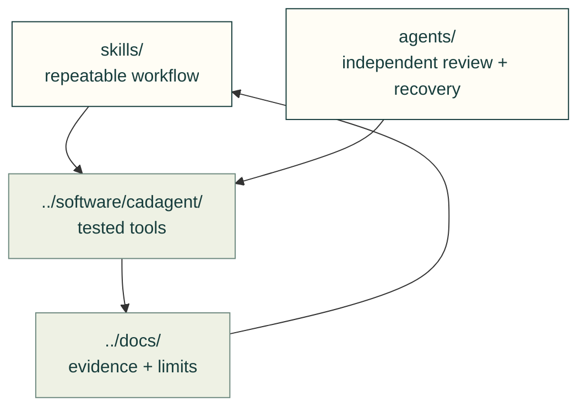

# Agent kit

Canonical workflow skills and independent reviewer/resume prompts live here. `cad-agent agents install` links or copies them into each harness's user directories; the repository-root plugin manifest points at the same files.

- [Skills](skills/README.md): design, hardware, motion, review and maintainer workflows.
- [Independent reviewer](agents/cad-pr-reviewer.md) and [recovery role](agents/cad-resume.md): their names and permissions stay in their frontmatter.
- [Operational symptom index](SYMPTOM-INDEX.md): the existing domains, inbox and playbooks remain preserved. They are not discovered as skills or published as site pages.
- [Workflow guide](../docs/practice/agent-workflow.md) and [shared lessons](../docs/lessons/README.md): installation behavior, evidence and the feedback loop.

Record new operational incidents in the [incident inbox](inbox/README.md), using `YYYY-MM-DD-<lesson>.md` under its owning domain when one exists with dated command/output evidence, cause, corrective rule and limits, and add the symptom pointer. Preserve the existing domain/playbook records. Curate reusable toolkit or project guidance into its existing [shared lesson](../docs/lessons/README.md), linking the incident rather than duplicating explanations.

The repository remains the plugin root so relative guide resources stay inside a copied plugin cache. Project-local and user-installed skills may coexist; use the named source when a harness presents duplicate names.

## File and child ownership

| File or folder | Purpose |
|---|---|
| [SYMPTOM-INDEX.md](SYMPTOM-INDEX.md) | Find dated operational evidence by symptom. |
| [agents/](agents/README.md) | Two manifest-listed independent-role prompts; no README is installed as a role. |
| [domains/](domains/README.md) | Curated operational facts. |
| [inbox/](inbox/README.md) | Dated incidents and retained failure evidence. |
| [playbooks/](playbooks/README.md) | Repeated operational procedures. |
| [skills/](skills/README.md) | Canonical installed workflow skills. |
| [plugin.json](../.claude-plugin/plugin.json) | Repository-root plugin wiring; no duplicate instructions. |

[Repository](../README.md)
