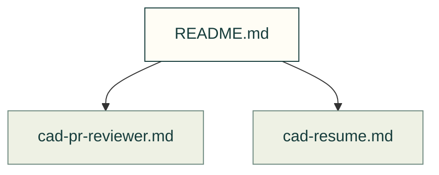

# Independent roles

Two role prompts support independent review and recovery. This folder map is not installed as a third role.

Files and sources

| File or folder | Purpose |
|---|---|
| [cad-pr-reviewer.md](cad-pr-reviewer.md) | Independent review of source, CAD and evidence; no authoring or merging. |
| [cad-resume.md](cad-resume.md) | Recover interrupted issue, branch and run state. |

[Agent kit](../README.md). The [installer](../../software/cadagent/agentkit.py) skips exactly `README.md`; other role Markdown must still pass its frontmatter checks.
