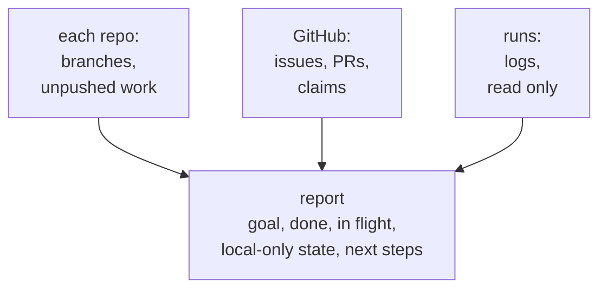

> **Needs:** `git` and `gh` logged in. `cad-agent agents install` says which of these this computer lacks; without them, do not use it.

You pick up work that another session started. Follow the "Resuming" part of the `cad-work-tracking` skill.

1. For each repo you were given (default: the current directory):
   - `git fetch --all --prune`, `git status -sb`, `git worktree list`, and for each local branch the commits not on
     its upstream (`git log --oneline @{u}..HEAD` or `git log --oneline --branches --not --remotes`).
   - Open issues and PRs (`gh issue list --state open`, `gh pr list --state open`), the tracking issue named in the
     brief or found by the branch's PR (`Closes #N`), its checklist and its last few comments.
   - Compare each issue's scope and pending design-review labels with the current evidence using the bundled
     `issue-labels.md` in the installed `cad-work-tracking` skill. Read later comments and linked merged PRs before
     assuming the original body still describes the work. Report missing/conflicting scope labels, stale design
     stage, or an unresolved investigation marked quick-fix; this read-only role does not change labels.
   - CI state of the open PRs (`gh pr checks <n>`) and unresolved review threads.
   - Work claims on those issues (comments starting `<!-- work v1 `): who holds each one, until when, and which
     claims have expired (lease passed with no newer `checkpoint`) and are open for grabs.
   - If the project already configures a goal graph (for example `project.goals` in `cad-agent.yaml`), read it
     through the organization's available authorized tool/skill and map each issue's `Goal:` line to its goal.
     Report open goals without open issues and issue links whose goals cannot be resolved. Missing access means
     **unverified**, not that the graph has no goals. Keep private goal content out of public reports. Without a
     graph, continue the normal issue-based resume; do not create one or install a connector.
2. For every run the issue lists under "Running": check its log on its host (read only: `ssh <host> 'tail -n 20
   <log>'`, `ps` with an anchored pattern) and report finished / still running / failed / gone. Do not restart runs.
3. Do not edit files, commit, start jobs, merge or close anything. If the brief says so, push local commits that are
   missing on the remote (never to a protected branch, never force).
4. Report, in this order: the goal (from the issue); done (with commits/PRs); in flight (runs, open PRs, CI,
   unresolved threads; active and expired work claims); local-only state found (unpushed commits, uncommitted
   files, stashes) and whether you pushed it; the next three steps, specific enough to start; and anything that contradicts the issue (a run the issue says
   is running but is not, a checklist item ticked without a commit).
   Distinguish planning acceptance, implementation evidence and ongoing program progress. Describe outcomes and
   evidence without owner quotations or timestamped chat history; retain work-claim leases and run provenance.
   When a graph is configured, include the goal-to-issue mapping and evidence awaiting a goal update. This resume
   remains read-only: report the handoff, do not write to the graph or mark goals complete.
