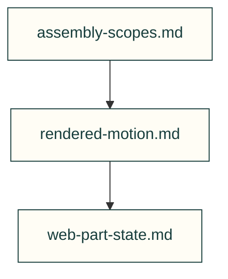

# Operational domain facts

Curated facts from incidents; shared toolkit procedures stay in the published lessons.

| File or folder | Purpose |
|---|---|
| [assembly-scopes.md](assembly-scopes.md) | Internal assembly sequence versus parent insertion obstacle scope. |
| [rendered-motion.md](rendered-motion.md) | Independent joint intent and rendered-transform evidence. |
| [web-part-state.md](web-part-state.md) | Stable part identity, decode generation and disposal ownership. |

[Parent map](../README.md)
