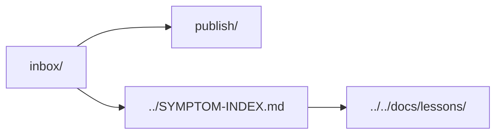

# Incident inbox

Dated incidents preserve evidence, causes, corrective rules and limits. Start from the
[symptom index](../SYMPTOM-INDEX.md); durable guidance belongs in the existing domains and shared lessons.

| Location | Contents |
| --- | --- |
| [publish/](publish/README.md) | Browser, document compilation and displayed CAD provenance incidents. |
| Dated files here | Other operational incidents, grouped further when a domain grows. |

[Agent kit](../README.md)
