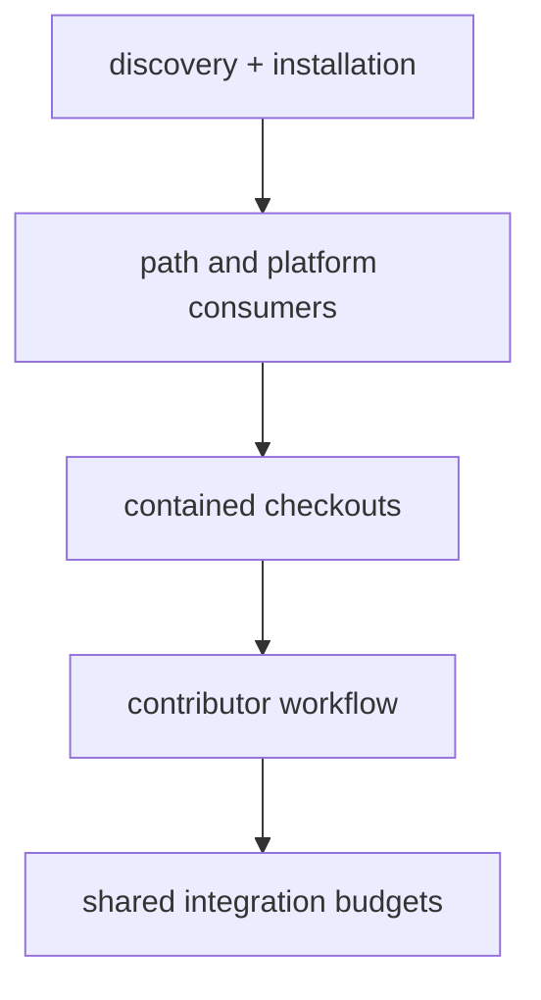

# Agent setup and checkout incidents

Dated evidence for instruction discovery, installation/update consumers and checkout dependencies.
Use the [symptom index](../../SYMPTOM-INDEX.md) to find the relevant case.

| File | Lesson |
| --- | --- |
| [Reference serialization](2026-11-10-reference-edits-need-the-importer-writer.md) | Registry validity and health-updater editability are separate contracts; use the canonical importer writer. |
| [Discovery boundaries](2026-11-06-agent-discovery-and-resource-boundaries.md) | Exact installed resources, supported checkout names and scoped harness evidence. |
| [Platform markers](2026-11-07-platform-markers-must-reach-update-consumers.md) | Installation requirements must reach every real update consumer. |
| [Checkout containers](2026-11-10-checkout-containers-must-preserve-path-consumers.md) | Preserve source, ownership, environments and every path consumer when organizing trees. |
| [Parallel layout budgets](2026-11-10-parallel-notes-share-a-layout-budget.md) | Recheck merged inventories; preserve history, maps and references when a shared folder reaches its growth limit. |

[Incident inbox](../README.md)
