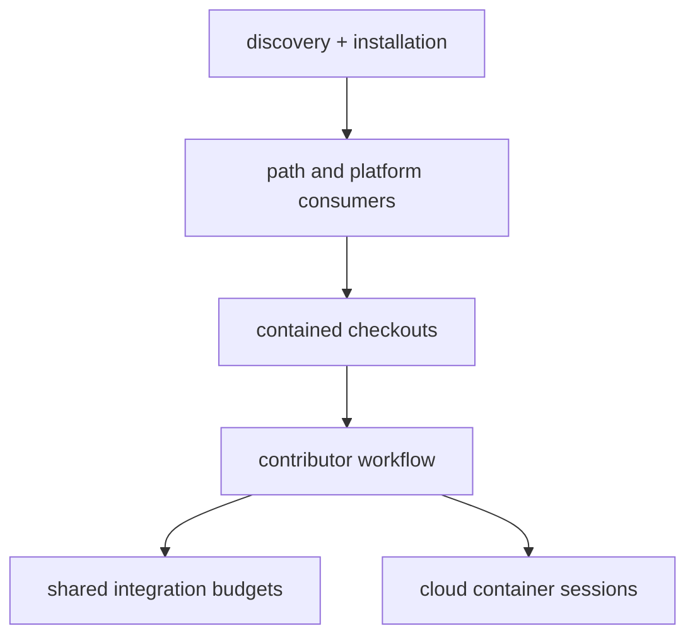

# Agent setup and checkout incidents

Dated evidence for instruction discovery, installation/update consumers, checkout dependencies and cloud-container
sessions.
Use the [symptom index](../../SYMPTOM-INDEX.md) to find the relevant case.

| File | Lesson |
| --- | --- |
| [Reading consumers](2026-11-10-reading-batches-need-the-release-and-page-consumers.md) | Source-reading batches still require the real fragment parser and whole-page layout consumer; preserve failures and reuse existing guards. |
| [Reference serialization](2026-11-10-reference-edits-need-the-importer-writer.md) | Registry validity and health-updater editability are separate contracts; use the canonical importer writer. |
| [Discovery boundaries](2026-11-06-agent-discovery-and-resource-boundaries.md) | Exact installed resources, supported checkout names and scoped harness evidence. |
| [Platform markers](2026-11-07-platform-markers-must-reach-update-consumers.md) | Installation requirements must reach every real update consumer. |
| [Checkout containers](2026-11-10-checkout-containers-must-preserve-path-consumers.md) | Preserve source, ownership, environments and every path consumer when organizing trees. |
| [Cloud GitHub route](2026-11-15-cloud-sessions-reach-github-through-mcp.md) | Write access, no usable `gh`, review verdicts the gate cannot read, CI restarts and MCP quirks. |
| [Cloud browser evidence](2026-11-15-cloud-containers-limit-browser-and-provenance-evidence.md) | Regenerate provenance receipts (never edit hashes), Python 3.12 fingerprints, browser builds and variables, site checks, slow steps. |
| [Cloud worktrees and review](2026-11-15-cloud-sessions-need-own-worktrees-and-fresh-reviewers.md) | Checkout layout, one venv per worktree, and the orchestration pattern that worked. |
| [Parallel layout budgets](2026-11-10-parallel-notes-share-a-layout-budget.md) | Recheck merged inventories; preserve history, maps and references when a shared folder reaches its growth limit. |

[Incident inbox](../README.md)
