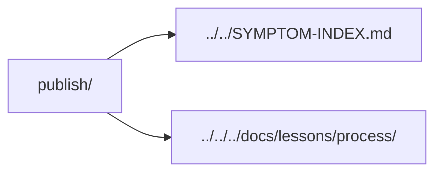

# Publication incidents

Evidence about what the actual rendered page or model shows, separate from source-only checks.

| Incident | Lesson |
| --- | --- |
| [Procurement print columns](2026-11-11-annotated-numbers-need-print-column-budgets.md) | Preserve numeric tokens and same-part long notes without starving printable identities/names. |
| [Camera matrices](2026-11-10-camera-state-needs-current-matrices.md) | Update synchronous camera matrices before projection/picking and fit outside real overlays. |
| [Outline scroll state](2026-11-08-outline-visibility-needs-scroll-state.md) | Keep an unchanged active entry visible on page scroll; observe actual scroll/frame delivery before strict geometry. |
| [Whole-set handoff](2026-11-08-release-links-need-current-project-inputs.md) | Link only the current native project; separate plate handoff from per-part estimates. |
| [Agent guide paths](2026-11-07-agent-guides-need-exact-local-paths.md) | Read full installed instructions when a summary drops requirements; validate the actual skill paths. |
| [Cache plan and delivery](2026-11-07-cache-policy-needs-plan-and-delivery-evidence.md) | Validate the actual plan and saved scope, then verify ordinary asset responses separately. |
| [Obfuscated code](2026-11-07-provider-obfuscation-can-change-code.md) | Compare delivered authored literals; a successful response and revision footer can still hide transformed instructions. |
| [Full test cap](2026-11-07-full-test-caps-need-active-case.md) | Preserve the cap and expose the active test and thread stack before diagnosing a cancelled release check. |
| [Resize runtime errors](2026-11-07-resize-checks-need-runtime-errors.md) | Collect errors on the exact interaction page; good geometry alone can miss observer feedback. |
| [Responsive resize](2026-11-07-responsive-style-can-lag-resize.md) | A new viewport width can precede the corresponding responsive style. |
| [Release guard boundaries](2026-11-07-release-guards-need-current-boundaries.md) | Inspect all current checks, preserve accepted bytes, and preflight source buffers and visible text/link contracts. |
| [Publication runtime](2026-11-07-publication-consumers-need-explicit-runtimes.md) | Bind the existing executable and browser before public calls. |
| [SOURCE namespace](2026-11-07-source-records-need-their-actual-namespace.md) | Derive public and immutable-source routes from the producer. |
| [Provider CSP failure](2026-11-07-provider-failures-need-matching-csp-evidence.md) | Classify only an observed exact enforced block; retain other errors. |
| [Markdown diagrams](2026-10-29-markdown-fences-need-rendered-evidence.md) | A fence needs rendered evidence. |
| [Embedded motion](2026-11-07-image-motion-needs-the-image-consumer.md) | Test the actual image consumer. |
| [Header bounds](2026-11-07-header-visibility-needs-paint-state.md) | Distinguish painted content from stale geometry. |
| [Page placement](2026-11-07-page-placement-can-duplicate-footer-art.md) | Compilation can duplicate footer artwork. |
| [Current CAD](2026-11-07-source-revision-does-not-refresh-a-cad-export.md) | A current checkout can contain stale exported geometry. |

[Incident inbox](../README.md)
