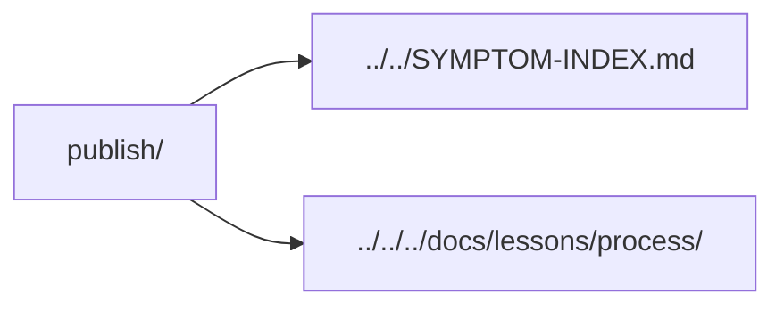

# Publication incidents

Evidence about what the actual rendered page or model shows, separate from source-only checks.

| Incident | Lesson |
| --- | --- |
| [Publication runtime](2026-11-07-publication-consumers-need-explicit-runtimes.md) | Bind the existing executable and browser before public calls. |
| [SOURCE namespace](2026-11-07-source-records-need-their-actual-namespace.md) | Derive public and immutable-source routes from the producer. |
| [Provider CSP failure](2026-11-07-provider-failures-need-matching-csp-evidence.md) | Classify only an observed exact enforced block; retain other errors. |
| [Markdown diagrams](2026-10-29-markdown-fences-need-rendered-evidence.md) | A fence needs rendered evidence. |
| [Embedded motion](2026-11-07-image-motion-needs-the-image-consumer.md) | Test the actual image consumer. |
| [Header bounds](2026-11-07-header-visibility-needs-paint-state.md) | Distinguish painted content from stale geometry. |
| [Page placement](2026-11-07-page-placement-can-duplicate-footer-art.md) | Compilation can duplicate footer artwork. |
| [Current CAD](2026-11-07-source-revision-does-not-refresh-a-cad-export.md) | A current checkout can contain stale exported geometry. |

[Incident inbox](../README.md)
