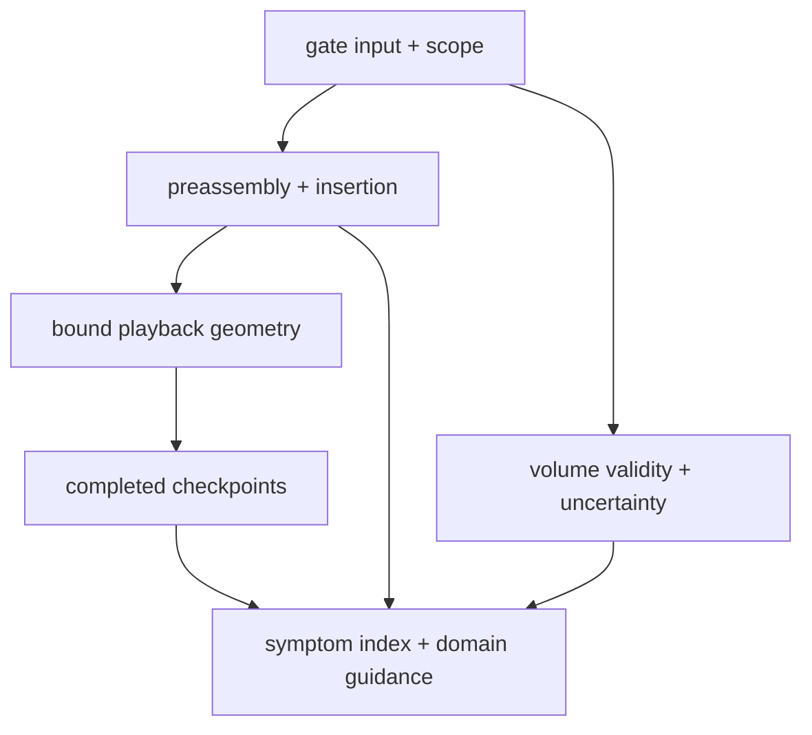

# Review-gate incidents

Dated mechanical review evidence: assembly scopes, geometry provenance, numerical relations and recoverable
validation. Find cases through the [symptom index](../../SYMPTOM-INDEX.md) and retain the original failures.

| File | Lesson |
| --- | --- |
| [Preassembly scope](2026-10-29-preassembly-needs-its-own-obstacle-scope.md) | Bench assembly, rigid parent insertion and explicit service targets need distinct checked scopes. |
| [Volume precision](2026-10-29-volume-precision-needs-valid-solids-and-aggregate-errors.md) | Validate solids and aggregate integration uncertainty before accepting relations. |
| [Playback geometry](2026-11-10-playback-needs-finite-bound-source-geometry.md) | Finite paths and exact world/source bindings must describe the displayed geometry. |
| [Lazy checkpoints](2026-11-10-lazy-callbacks-are-not-completed-checkpoints.md) | Deferred callback bodies cannot count as completed durable progress. |

[Incident inbox](../README.md) · [Assembly scope guidance](../../domains/assembly-scopes.md) ·
[Gate package](../../../software/cadagent/review/gates/README.md)
