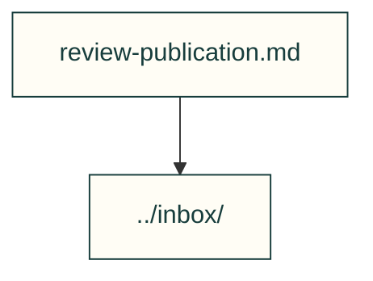

# Operational playbooks

Repeated maintainer procedures with bounded evidence and honest limits.

| File or folder | Purpose |
|---|---|
| [review-publication.md](review-publication.md) | Publish reviewed evidence without repeatedly restarting CI. |

[Parent map](../README.md)
