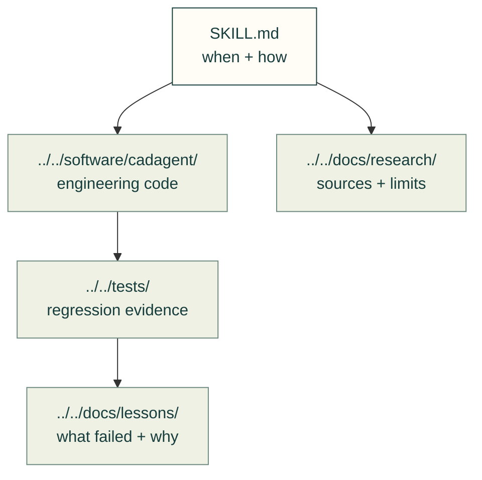

# Skills

Short entry points into tested tools and repeatable engineering workflows. Open the skill for the task at hand.

The arrows mean that a skill directs an agent to existing code, evidence and checks; prose alone does not validate a technique.

| Task | Skill |
|---|---|
| Design a part from requirements through review | [design-process](design-process/README.md) · [Instructions](design-process/SKILL.md) |
| Diagnose moving parts, pivots and coordinate frames | [cad-motion-validation](cad-motion-validation/README.md) · [Instructions](cad-motion-validation/SKILL.md) |
| Select real bought hardware and its CAD | [mcmaster-parts](mcmaster-parts/README.md) · [Instructions](mcmaster-parts/SKILL.md) |
| Check clinch hardware and riveted sheet-metal joints | [sheet-metal-hardware](sheet-metal-hardware/README.md) · [Instructions](sheet-metal-hardware/SKILL.md) |
| Choose a PEM attachment family and qualification plan | [pem-fastener-selection](pem-fastener-selection/README.md) · [Instructions](pem-fastener-selection/SKILL.md) |
| Audit dependencies, upstreams and resource safety | [cad-supply-chain](cad-supply-chain/README.md) · [Instructions](cad-supply-chain/SKILL.md) |
| Keep maintainer work recoverable | [cad-work-tracking](cad-work-tracking/README.md) · [Instructions](cad-work-tracking/SKILL.md) |
| Obtain independent review and answer findings | [cad-pr-review](cad-pr-review/README.md) · [Instructions](cad-pr-review/SKILL.md) |
| Run sustained engineering jobs on compute hosts | [cad-remote-runs](cad-remote-runs/README.md) · [Instructions](cad-remote-runs/SKILL.md) |
| Author equipment artwork, metadata, states and generated previews | [scada-component-authoring](scada-component-authoring/README.md) · [Instructions](scada-component-authoring/SKILL.md) |
| Describe one system with shared model state and multiple views | [scada-system-authoring](scada-system-authoring/README.md) · [Instructions](scada-system-authoring/SKILL.md) |
| Replace equations or connect an external model with explicit units and evidence | [scada-model-adaptation](scada-model-adaptation/README.md) · [Instructions](scada-model-adaptation/SKILL.md) |
| Inspect diagram controls, camera, lifecycle, states and accessibility in a browser | [scada-viewer-review](scada-viewer-review/README.md) · [Instructions](scada-viewer-review/SKILL.md) |
| Verify self-contained SCADA runtime and source distributions | [scada-distribution-review](scada-distribution-review/README.md) · [Instructions](scada-distribution-review/SKILL.md) |
| Maintain source-owned folder maps, galleries and agent documentation | [repository-documentation](repository-documentation/README.md) · [Instructions](repository-documentation/SKILL.md) |

`cad-agent agents install` links the kit into your harness and reports missing requirements; see [the workflow guide](../../docs/practice/agent-workflow.md) before applying maintainer workflows to a project. Skills stay in this folder so harness installation can discover them. New engineering techniques belong in the existing domain code and its tests, with a short skill only when a repeatable workflow needs one.

To mine a guide or another project's skills, follow [source → procedure → tested skill](../../docs/practice/agent-workflow.md#mine-procedures). Reuse our canonical methods and records across harnesses; keep the original source credited and the tested scope explicit.

[Home](../../README.md) · [Guides](../../docs/README.md) · [Research](../../docs/research/README.md) · [Subagents](../agents/) · [Tests](../../tests/README.md)

[Agent kit](../README.md)
