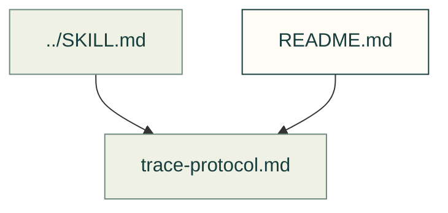

# Motion evidence protocol

The trace protocol connects rendered poses to declared joint intent. It does not establish physical fit.

Files and sources

| File or folder | Purpose |
|---|---|
| [trace-protocol.md](trace-protocol.md) | Trace inputs, invariants and evidence expected by motion review. |

[Skill folder](../README.md) · [Canonical skill](../SKILL.md)
