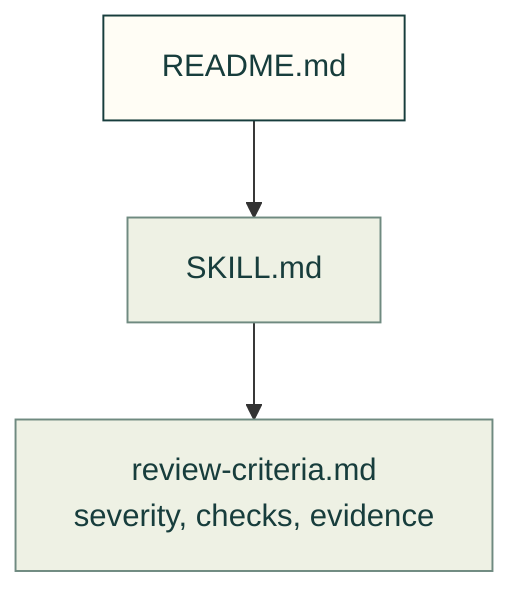

# Independent review

Take a proposed change through independent review, answers and the repository gates. Open the skill for operational instructions.

Files and sources

| File or folder | Purpose |
|---|---|
| [SKILL.md](SKILL.md) | Canonical applicability, procedure, requirements and limits; `gh` and GitHub MCP routes; what an agent may merge without the owner. |
| [review-criteria.md](review-criteria.md) | Severities, checks for every PR and by change type, required evidence, and what a pass verdict means; shipped with the skill. |

[All skills](https://github.com/Valpatel/cad-agent/blob/dev/.agents/skills/README.md). The map and local skill resources are included in copy-mode installs; repository guides linked by the skill still require their documented source.
