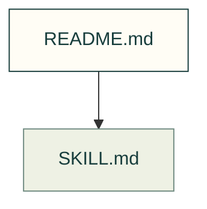

# Engineering runs

Keep sustained CAD and simulation runs recoverable on compute hosts. Open the skill for operational instructions.

Files and sources

| File or folder | Purpose |
|---|---|
| [SKILL.md](SKILL.md) | Canonical applicability, procedure, requirements and limits. |

[All skills](https://github.com/Valpatel/cad-agent/blob/dev/.agents/skills/README.md). The map and local skill resources are included in copy-mode installs; repository guides linked by the skill still require their documented source.
