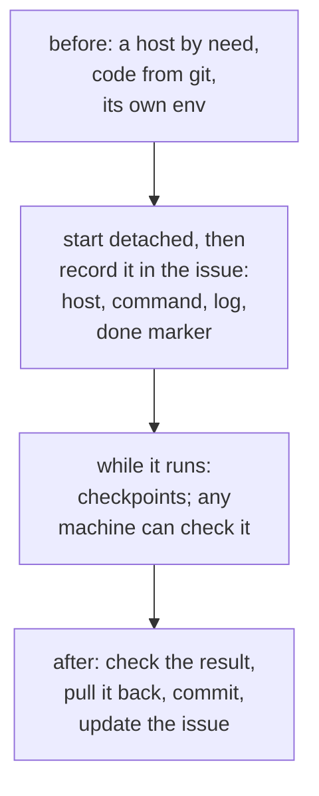
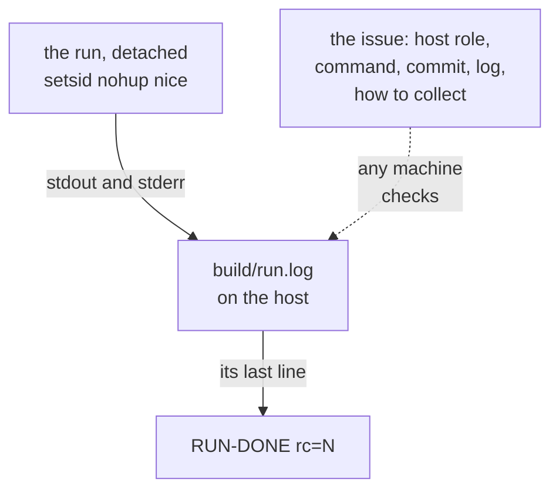

# Long runs on a compute host

> **Needs:** `git`, `gh` logged in, `ssh` and a compute host you can reach over `ssh`; `rsync` for copying files that are not in git. `cad-agent agents install` says which of these this computer lacks. Without `rsync`, skip that step; without the rest, do not use it.

Heavy runs (OpenFOAM CFD, FEA sweeps, topology optimisation, `cad-agent all`) on the workstation the agents share
can exhaust its memory and crash every session on it. Run them on a compute host, detached, and write them down
where another computer can find them.



## Before the run

- **Pick the host by need**: cores and memory for the solver, a GPU only if the tool uses one, Docker for OpenFOAM.
  Check its load first (`uptime`, `free -g`); other people's jobs may be running there.
- **Give it the code from git**, not a hand copy, where possible: clone the repo there and `git fetch && git checkout
  <sha>` of your pushed branch. If you must copy a working tree (uncommitted changes, large untracked references),
  use `rsync -a` with excludes for virtualenvs, caches and run folders. Pull back anything the host produced before
  you copy to it again. Use `--delete` only right after such a pull (it removes remote files that are not in your
  copy, including results newer than it); without it, files you deleted locally stay on the host.
- **In the cad-agent repo, ask which CI checks a branch triggers** before pushing: `python3 tools/ci/preflight.py`
  runs what this machine can and reports the rest as not run; `--slow` checks (site build, full suites) go here.
- **Give it its own environment** (a virtualenv from the project's pinned requirements, `pip install -e` of the
  cad-agent checkout or version the project uses). Record which cad-agent commit it runs.

  <details>
  <summary>FEA on an aarch64 host: gmsh from conda-forge</summary>

  PyPI has no aarch64 Linux wheel for gmsh (4.15.2 or any other release), so the `fea` extra does not install
  there; nor does pypardiso, whose MKL is x86-64 only. Install `cad-agent[cad]` with `scikit-fem pyamg`, then link
  conda-forge's gmsh into the venv:

      micromamba create -y -p <gmsh-env> -c conda-forge python-gmsh=4.15.2
      ln -s <gmsh-env>/lib/python3.*/site-packages/gmsh.py <venv site-packages>/

  If `import gmsh` then fails because version `OPENSSL_3.4.0` is not found (the venv's Python loaded the system
  OpenSSL first), start the run with `LD_PRELOAD=<gmsh-env>/lib/libcrypto.so.3:<gmsh-env>/lib/libssl.so.3`. Record
  which gmsh build the run used (`micromamba list -p <gmsh-env> gmsh`): two builds of one version can mesh a part
  differently, and the newest 4.15.2 build links a newer OCCT (8.0.1) than cadquery-ocp's (7.9.3). The FEA section
  of `docs/toolkit.md` in cad-agent has the details.
  </details>

## Starting it

Detach it from the ssh session and the agent, and make the log say when it is done:

```bash
ssh <host> 'cd <repo> && mkdir -p build && (setsid nohup nice -n 5 bash -c "<command> > build/<run>.log 2>&1; echo RUN-DONE rc=\$? >> build/<run>.log" < /dev/null > /dev/null 2>&1 &)'
```

Then **record it in the issue** right away (see `cad-work-tracking`):
`<host role>: <command> (commit <sha>), log <path>, done when "RUN-DONE", results in <paths>, collect with <command>`.



## While it runs

- Watch it from the agent with a poll every few minutes (`ssh <host> 'tail -n 3 <log>'`) or the harness's monitor;
  match the failure markers too (`Traceback`, `Error`, `Killed`, `FAIL`, non-zero `rc=`), not only success.
- When watching processes over ssh, anchor patterns so they do not match the ssh command line itself
  (`ps -eo pid,args | grep "^ *[0-9]* <exact command>"`, or the `[x]` bracket trick). Stop jobs by PID or process
  group, never with a broad `pkill -f`.
- A finding that changes the inputs (a wrong assumption, a geometry fix) means stop the run, fix, push, restart, and
  note the stopped run in the issue so nobody collects its stale results.

## After it

- Check the result before trusting it: converged and steady, balances closed, the inputs it used are the committed
  ones (hashes or revision recorded in the result file).
- Pull the results back (`rsync -a <host>:<repo>/<result paths> <local paths>`), commit them with the command that
  made them in the message, push, and tick the issue.
- Leave the host clean: stop containers you started, delete large scratch case folders you no longer need.

## Working from a cloud container

For an agent that itself runs in a hosted cloud container; the Needs line above does not apply here. Each point
links dated evidence that says what was observed only once.

- **GitHub.** Reads work without a grant on public repositories; a push or issue creation that fails with
  "Claude doesn't have GitHub access" needs the owner to give the GitHub App access to the repository. `gh` may be
  missing or logged out; use the GitHub MCP tools. The [review skill](../cad-pr-review/SKILL.md#commands) gives the
  MCP route for each step, including the gate re-run and the merge; the gate reads a cloud reviewer's verdict with
  its footer. Post status as comments: a description edit restarts CI
  ([evidence](../../inbox/agents/2026-11-15-cloud-sessions-reach-github-through-mcp.md)).
- **Checkouts.** Leave the session's own clone and its designated branch alone; make each topic worktree beside it
  with `git worktree add --no-track` on a `feat/`, `fix/` or `docs/` branch from `origin/dev`. Ask the owner before
  pushing any branch other than the one the session designates. Give each worktree its own venv and check
  `cadagent.__file__` ([evidence](../../inbox/agents/2026-11-15-cloud-sessions-need-own-worktrees-and-fresh-reviewers.md)).
- **Provenance receipts.** Never edit a recorded hash ([SCADA tools](../../../tools/webkit/scada/README.md));
  regenerate with the generator. SCADA explorer sources need `thumbnails:scenarios` on the pinned shell, which the
  container lacks: stop and ask the owner, attaching any same-build comparison as evidence. For `model.js`, see
  below. PR #763 (open) proposes a CI recapture ([evidence](../../inbox/agents/2026-11-15-cloud-containers-limit-browser-and-provenance-evidence.md)).
- **Browsers and Python:** Chromium only (report WebKit as not run locally); Python 3.12 for provenance checks.

<details>
<summary>Browsers, Python, slow steps, site checks and the orchestration that worked</summary>

- **`model.js` poster:** `node tools/site/figures/site-model-poster.mjs --model j501` uses whatever Chrome the
  machine has and always rewrites `j501.webp` and its receipt. If the poster's bytes change, report it in the PR as a
  new render from this container's browser, or ask the owner; never keep the old image with a new hash.
- **SCADA recapture:** #763's CI route reproduces captures byte for byte, but the first recapture re-baselines all
  thumbnails (about 9 MB), because the committed ones were rendered with different fonts.
- **Browsers:** only Playwright's Chromium is installed, newer than the pinned `@playwright/test` expects; WebKit is
  absent and stays so, and CI decides for it.
- **Python:** the npm scripts call `python3`; only 3.12 reproduces the CI hashes, so put a 3.12 venv first on `PATH`.
- **Browser variables:** `CHROMIUM_EXECUTABLE` for `tests/webkit/{assembly,host,simulation}/browser.mjs`,
  `webkit-fea-browser.mjs` and `webkit-stage-browser.mjs`; `PLAYWRIGHT_EXECUTABLE_PATH` for the SCADA explorer
  suite. The `tests/site` suites, `webkit-diagrams-browser.mjs`, `webkit-part-table-browser.mjs`, `files/browser.mjs`
  and `assembly/release-browser.mjs` take only `PLAYWRIGHT_CHANNEL`; unset, channel `chrome` reaches the installed
  Chromium through a `google-chrome` wrapper.
- **Slow steps:** the site build takes 3 to 5 minutes (longer with an empty diagram cache) and the catalogue browser
  suite about 4.5 minutes a run (observed once); #756's touch suite, not on `dev`, about 4 minutes. Run them once.
- **Site checks in the browser job:** a folder README lists every file in it, a new `__init__.py` included
  (`node --test tests/site/website-repo-map.test.mjs`: seconds, no browser or build); a folder map's Mermaid fits
  the page column (top down, at most three boxes per row); added prose can push a page past the 1200 px
  wall-of-text limit. Build the site and run `tests/site/website-browser.mjs` after a docs change.
- **Orchestration:** one orchestrating session; implementers each in its own worktree and branch; a cheaper checker
  for CI logs and issues; and a freshly started reviewer given only the PR. All post through one account, so the
  reviewer's independence is procedural and the gate cannot check it. Answer nits on the thread and carry them to
  the next change of the same lines rather than pushing after a pass, so the reviewed head stays reviewed.

Limits: from one session on 2026-11-15. The 403 text, the owner's go-ahead for topic branches, the shared-venv
mix-up, the catalogue timing, two MCP quirks, the byte-identical j501 poster and the three site-check failures
were observed once; container images change.

</details>

[Folder map](README.md)
