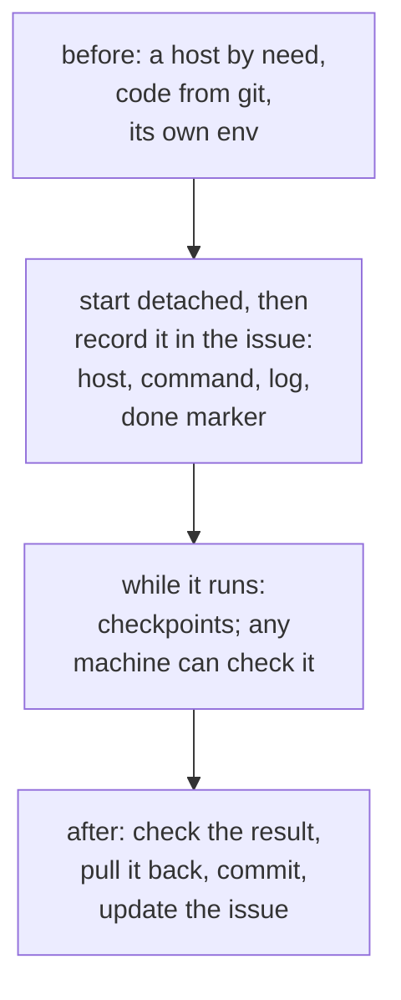
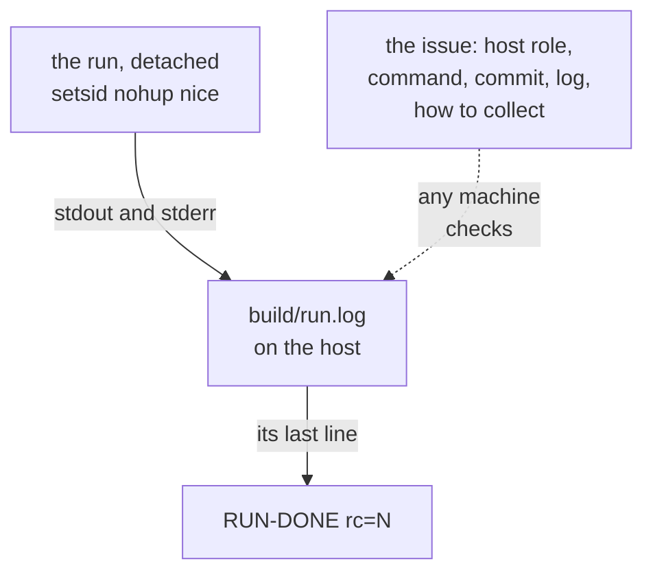

# Long runs on a compute host

> **Needs:** `git`, `gh` logged in, `ssh` and a compute host you can reach over `ssh`; `rsync` for copying files that are not in git. `cad-agent agents install` says which of these this computer lacks. Without `rsync`, skip that step; without the rest, do not use it.

Heavy runs (OpenFOAM CFD, FEA sweeps, topology optimisation, `cad-agent all`) on the workstation the agents share
can exhaust its memory and crash every session on it. Run them on a compute host, detached, and write them down
where another computer can find them.



## Before the run

- **Pick the host by need**: cores and memory for the solver, a GPU only if the tool uses one, Docker for OpenFOAM.
  Check its load first (`uptime`, `free -g`); other people's jobs may be running there.
- **Give it the code from git**, not a hand copy, where possible: clone the repo there and `git fetch && git checkout
  <sha>` of your pushed branch. If you must copy a working tree (uncommitted changes, large untracked references),
  use `rsync -a` with excludes for virtualenvs, caches and run folders. Pull back anything the host produced before
  you copy to it again. Use `--delete` only right after such a pull (it removes remote files that are not in your
  copy, including results newer than it); without it, files you deleted locally stay on the host.
- **Give it its own environment** (a virtualenv from the project's pinned requirements, `pip install -e` of the
  cad-agent checkout or version the project uses). Record which cad-agent commit it runs.

  <details>
  <summary>FEA on an aarch64 host: gmsh from conda-forge</summary>

  PyPI has no aarch64 Linux wheel for gmsh (4.15.2 or any other release), so the `fea` extra does not install
  there; nor does pypardiso, whose MKL is x86-64 only. Install `cad-agent[cad]` with `scikit-fem pyamg`, then link
  conda-forge's gmsh into the venv:

      micromamba create -y -p <gmsh-env> -c conda-forge python-gmsh=4.15.2
      ln -s <gmsh-env>/lib/python3.*/site-packages/gmsh.py <venv site-packages>/

  If `import gmsh` then fails because version `OPENSSL_3.4.0` is not found (the venv's Python loaded the system
  OpenSSL first), start the run with `LD_PRELOAD=<gmsh-env>/lib/libcrypto.so.3:<gmsh-env>/lib/libssl.so.3`. Record
  which gmsh build the run used (`micromamba list -p <gmsh-env> gmsh`): two builds of one version can mesh a part
  differently, and the newest 4.15.2 build links a newer OCCT (8.0.1) than cadquery-ocp's (7.9.3). The FEA section
  of `docs/toolkit.md` in cad-agent has the details.
  </details>

## Starting it

Detach it from the ssh session and the agent, and make the log say when it is done:

```bash
ssh <host> 'cd <repo> && mkdir -p build && (setsid nohup nice -n 5 bash -c "<command> > build/<run>.log 2>&1; echo RUN-DONE rc=\$? >> build/<run>.log" < /dev/null > /dev/null 2>&1 &)'
```

Then **record it in the issue** right away (see `cad-work-tracking`):
`<host role>: <command> (commit <sha>), log <path>, done when "RUN-DONE", results in <paths>, collect with <command>`.



## While it runs

- Watch it from the agent with a poll every few minutes (`ssh <host> 'tail -n 3 <log>'`) or the harness's monitor;
  match the failure markers too (`Traceback`, `Error`, `Killed`, `FAIL`, non-zero `rc=`), not only success.
- When watching processes over ssh, anchor patterns so they do not match the ssh command line itself
  (`ps -eo pid,args | grep "^ *[0-9]* <exact command>"`, or the `[x]` bracket trick). Stop jobs by PID or process
  group, never with a broad `pkill -f`.
- A finding that changes the inputs (a wrong assumption, a geometry fix) means stop the run, fix, push, restart, and
  note the stopped run in the issue so nobody collects its stale results.

## After it

- Check the result before trusting it: converged and steady, balances closed, the inputs it used are the committed
  ones (hashes or revision recorded in the result file).
- Pull the results back (`rsync -a <host>:<repo>/<result paths> <local paths>`), commit them with the command that
  made them in the message, push, and tick the issue.
- Leave the host clean: stop containers you started, delete large scratch case folders you no longer need.

## Working from a cloud container

When the agent itself runs in a hosted cloud container (no `gh`, GitHub through MCP tools), the long-run rules above
still apply; these are the differences. Each links the dated evidence and says what was observed only once.

- **GitHub.** Reads work without a grant on public repositories; a push or issue creation that fails with
  "Claude doesn't have GitHub access" needs the owner to give the GitHub App access to the repository. `gh` may be
  missing or logged out, so use the MCP tools as the [review skill](../cad-pr-review/SKILL.md) describes; until
  [#750](https://github.com/Valpatel/cad-agent/issues/750) and [#751](https://github.com/Valpatel/cad-agent/issues/751)
  merge, `tools/ci_gates.py all` cannot run here and a cloud reviewer's verdict is not read by the review gate, so
  leave those merges to a `gh` session or the owner. Put status in comments: a description edit restarts CI
  ([evidence](../../inbox/agents/2026-11-15-cloud-sessions-reach-github-through-mcp.md)).
- **Checkouts.** Leave the session's own clone and its designated branch alone; make each topic worktree beside it
  with `git worktree add --no-track` on a `feat/`, `fix/` or `docs/` branch from `origin/dev`, push only that branch,
  and give each worktree its own venv (check `cadagent.__file__`)
  ([evidence](../../inbox/agents/2026-11-15-cloud-sessions-need-own-worktrees-and-fresh-reviewers.md)).
- **Browsers and Python.** Only Playwright's Chromium is installed, at a newer revision than the pinned
  `@playwright/test` expects, so pass `executablePath`; WebKit is absent and stays so. Report WebKit as not run
  locally and let CI decide. Run provenance checks with `python3.12`, which CI uses
  ([evidence](../../inbox/agents/2026-11-15-cloud-containers-limit-browser-and-provenance-evidence.md)).

<details>
<summary>Hashes that move with their sources, slow steps, and the orchestration that worked</summary>

- **Hash pairs.** Change the source and its recorded hash in the same commit, and run the checks that compare them:
  - `software/cadagent/webkit/model/model.js` → `renderer_sha256` in `tools/site/assets/models/j501-source.json`
    (checked by `tests/webkit/webkit-model.test.mjs`);
  - SCADA explorer sources → `source_hashes` in `software/cadagent/webkit/scada/sim/metadata/thumbnails.json`
    (checked by the `scada (chromium)` job's provenance step; run its `npm run …:check` scripts in
    `tools/webkit/scada`, not only the browser suite).

  Do not regenerate thumbnails on the container's browser: a different build changes images for engine reasons
  alone. Compare old and new source on one build and update the hash, or recapture with the pinned shell.
- **Slow steps:** the site build takes about 3 minutes, the touch-orbit browser suite about 4 minutes in software
  WebGL, and the catalogue browser suite about 4.5 minutes a run (observed once). Run them once, at the end.
- **Orchestration:** one orchestrating session; implementers each in its own worktree and branch; a cheaper checker
  for CI logs and issues; and a freshly started reviewer given only the PR. Answer nits on the thread and carry them
  to the next change of the same lines rather than pushing after a pass, so the reviewed head stays reviewed.

Limits: from one session on 2026-11-15. The 403 text, the owner's go-ahead for topic branches, the shared-venv
mix-up, the catalogue timing and two MCP quirks were observed once and not confirmed; container images change.

</details>

[Folder map](README.md)
