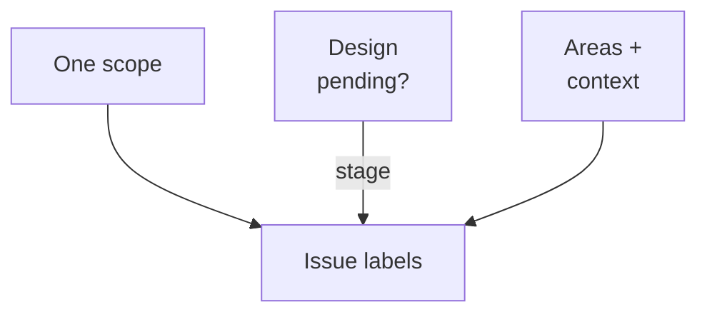
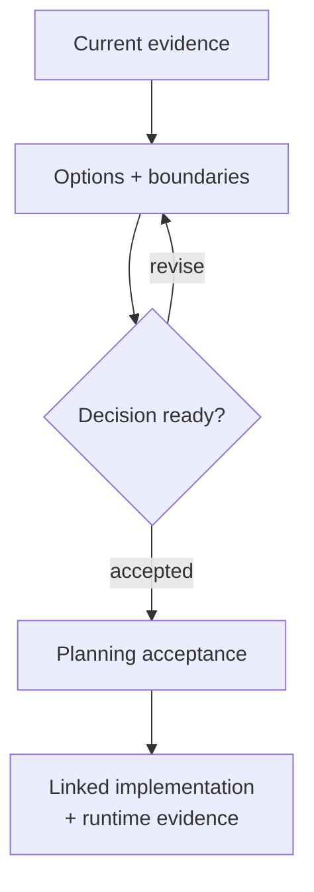

# Issue scope and design review

This is the canonical taxonomy for cad-agent issues. It travels with the
[work-tracking skill](SKILL.md), including copy-mode installs. In a product repository, follow its explicit label
policy first; use this taxonomy when that repository adopts it. Installing the skill does not create labels,
change issues, or grant write access. Keep maintenance in the existing issue workflow; no label bot is required.

Classify the work that remains from the current body, latest comments, linked PRs and technical evidence. A short
title or an old unchecked list is insufficient: later discussion may reject an option or record merged work.

## Labels

Every tracked cad-agent issue has **exactly one** of these scope labels:

| Label | Meaning | Completion |
|---|---|---|
| `scope:program` | Ongoing capability, research or improvement program coordinating multiple deliverables. | The stated program outcome is established or the program is explicitly retired; one merged child is insufficient. |
| `scope:bounded` | Finite feature, investigation, maintenance task, design proposal or release with observable acceptance. | Its stated deliverable and evidence are complete. Split further when the remaining work is no longer one deliverable. |
| `scope:quick-fix` | Small, understood repair with a known cause, narrow affected surface and direct verification. | The repair and its focused checks pass. Small wording or a desired deadline does not make an unknown investigation quick. |

Scope, pending decisions and affected areas classify different aspects of the same issue:



Use the stage and area labels independently of scope:

| Label | Apply when | Remove when |
|---|---|---|
| `stage:design-review` | A concrete proposal still needs an architecture or design decision before implementation. It can accompany any scope. | The decision is recorded as accepted, rejected or superseded and no design decision remains pending. Implementation may still be open. |
| `area:viewer-platform` | The issue concerns shared viewer hosting, lifecycle, artifact/review integration, discovery or browser runtime distribution. | The remaining scope no longer concerns that area. |
| `area:scada` | The issue concerns SCADA diagrams, equipment components, system descriptions, simulation models or their integration. | The remaining scope no longer concerns that area. |

Both area labels may apply; neither is mandatory. Preserve useful existing labels such as `bug`, `documentation`,
`enhancement`, research or domain labels. Scope describes the unit of work, stage describes a pending decision, and
area describes the affected capability. None expresses priority, authorization, deployment or a review verdict.

Examples:

- A continuing effort to improve simulation evidence is a program; its finite receipt-format proposal is bounded
  and may carry `stage:design-review`.
- A mobile viewer gesture failure with an unknown cause is a bounded investigation. Reclassify as quick-fix only
  once the cause, affected surface and verification are understood and the remaining repair is small.
- An accepted browser packaging design loses the pending stage label. Its implementation issue can remain open
  and bounded until the wheel and static publication evidence pass.

## Maintaining labels

Read the current record before each change, preserve unrelated labels, and verify the resulting scope and stage.

<details>
<summary>Maintenance steps, commands and backlog queries</summary>

1. **Create:** search existing issues, read their latest comments and linked changes, then choose the one scope
   that fits the intended remaining outcome. Add pending stage and relevant areas without clearing other labels.
   Write the acceptance criteria before claiming the work. If labels are missing and repository maintenance is
   authorized, create the exact names with the meanings above; otherwise report the missing setup.
2. **Resume:** check the current record again. Missing or conflicting scopes are a triage gap, not permission to
   guess. A read-only agent reports the mismatch and recommended correction; an authorized writer reconciles it.
3. **Checkpoint:** when scope or evidence changes, update the checklist and explain the label transition in the
   same concise checkpoint. Link bounded children to their program and the program back to its children. Keep
   ongoing intent on the program instead of repeatedly extending a completed deliverable.
4. **Decide a design:** record the chosen option, reasons, unresolved limitations and implementation issue links.
   Remove `stage:design-review` after the decision; reapply it only for a new pending decision, with its scope
   stated. An implementation PR still needs the normal independent PR review and gates.
5. **Close:** verify the issue's own acceptance and evidence, retain its final scope/area labels for discovery, and
   remove an obsolete pending-design label. Record a reason for rejection or supersession. Update the parent
   program's progress without claiming its unrelated work is complete.

Use add/remove operations on the relevant label names. Do not replace the whole label array from a stale snapshot:
another agent may have added context. For example, after reading the latest issue, an authorized writer changing
an investigated repair from quick-fix to bounded can use:

```bash
gh issue view <number> --repo <owner>/<repo> --comments
gh issue edit <number> --repo <owner>/<repo> --remove-label 'scope:quick-fix' --add-label 'scope:bounded'
gh issue view <number> --repo <owner>/<repo> --json labels
```

Inspect the resulting labels: exactly one scope, the correct pending stage and all unrelated context preserved.
Use the reverse transition only with evidence that the remaining repair meets the quick-fix definition. Do not
bulk-reclassify from titles alone. Classification does not replace the skill's machine-readable work claims.

Useful queries (replace the repository explicitly; `--limit 200` is a page budget, not proof of a complete audit):

```bash
gh issue list --repo <owner>/<repo> --state open --label 'scope:program' --limit 200
gh issue list --repo <owner>/<repo> --state open --label 'scope:bounded' --limit 200
gh issue list --repo <owner>/<repo> --state open --label 'scope:quick-fix' --limit 200
gh issue list --repo <owner>/<repo> --state open --label 'stage:design-review' --limit 200
gh issue list --repo <owner>/<repo> --state open --label 'area:viewer-platform' --label 'area:scada' --limit 200
gh issue list --repo <owner>/<repo> --state open --search '-label:scope:program -label:scope:bounded -label:scope:quick-fix' --limit 200
```

The two-area query requires both labels. For a full backlog review, enumerate every page (or increase the budget
and verify the total), check for multiple scope labels as well as missing ones, and read issue comments before
changing stage. A search result alone is not evidence that a design is still pending.

</details>

## Design-review proposals

Use a bounded design issue when a decision needs its own deliverable. A program can track the broader direction
without making every implementation task wait for an all-encompassing redesign. Keep proposals grounded in the
current repository; identify a proposed interface as proposed until code and verification exist.



<details>
<summary>Proposal checklist and acceptance template</summary>

A proposal includes:

1. **Problem and current evidence:** concrete behavior, source paths/commit or reproducible report, affected
   workflows, and already shipped foundations. Distinguish facts, assumptions and unanswered questions.
2. **Alternatives:** the minimal repair or existing mechanism, the recommended option and plausible alternatives;
   explain tradeoffs, rejected options and why the added complexity is justified.
3. **Boundaries and contracts:** what owns source data, identity/revisions, domain state, view state, storage,
   authentication and effects as relevant. State inputs/outputs, lifetimes, model/API versions and explicit exclusions.
   Avoid a universal framework unless several concrete consumers establish the need.
4. **Mermaid diagrams:** show the relevant current and proposed flow or ownership, including data/evidence
   handoffs and dependency direction. Label proposed elements; diagrams should clarify actual boundaries rather
   than just repeat a list of component names.
5. **Dependencies and delivery:** link parent/related issues and prerequisite decisions; describe incremental PR
   boundaries, affected consumers, packaging/distribution and rights/provenance constraints where applicable.
   Repair consumers directly when paths or contracts change. Track unresolved breaks in bounded issues with
   completion checks; do not add compatibility facades, generated aliases or permanent path-change guides.
6. **Two distinct acceptance sections:** specify evidence for completing the design review separately from the
   later implementation and runtime evidence. Put future work in linked implementation issues when the design
   closes. A document, mockup or approved decision does not prove that a feature runs.

Suggested additions to the [ordinary issue template](SKILL.md#issue-template):

```markdown
**Current evidence:** <source/revision, observed behavior, assumptions>
**Alternatives and recommendation:** <tradeoffs and reason>
**Boundaries:** <owners, contracts, exclusions; Mermaid diagrams above>
**Dependencies and delivery:** <linked prerequisites, staged changes and affected consumers>

**Planning acceptance — closes this design issue**
- [ ] <decision recorded with reasons and unresolved limitations>
- [ ] <contracts, consumer repairs and implementation issue boundaries are reviewable>

**Later implementation evidence — tracked in linked issues**
- [ ] <observable runtime behavior and validation; not claimed complete by this proposal>
```

</details>

Write for future maintainers: outcome, evidence, decision, limitations and next action. Do not add owner quotations,
timestamped chat summaries or session-origin stories. Preserve technical provenance that establishes freshness or
reproducibility: source revisions, measurement dates, run commands/receipts and work-claim lease timestamps.

[Folder map](README.md) · [Work-tracking procedure](SKILL.md)
