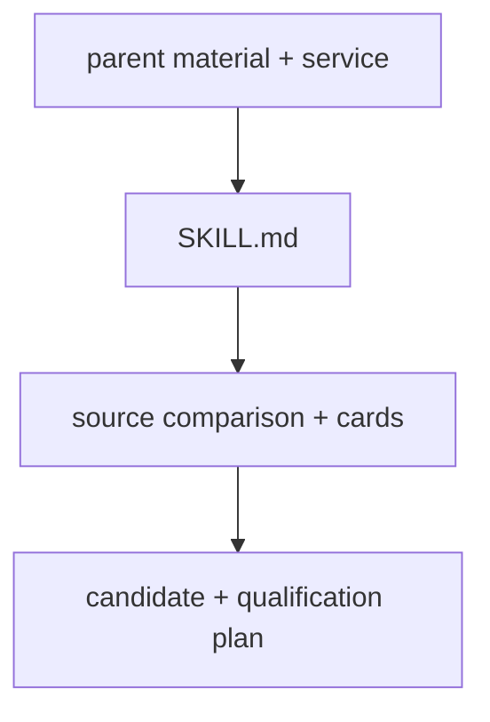

# PEM family selection

Route to the family-specific intake and qualification workflow.

| File | Purpose |
|---|---|
| [SKILL.md](SKILL.md) | Family selection, installation boundaries and qualification output. |

[All skills](../README.md)
