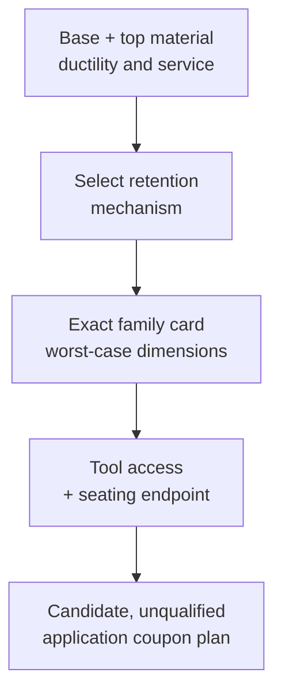

# Choose the mechanism before the part

Read [the sourced family comparison and worked example](../../../docs/research/manufacturing/pem-micro-fasteners.md). It identifies the exact 2022 overview and 2021 consumer-electronics guide, their coverage, conflicting headlines and unfinished current-drawing checks. Its read evidence is not physical qualification.

1. Record base and top materials separately, ductility, measured hardness, sheet/stack thickness intervals, hole manufacturing process, required access and service removal. A PCB or printed plastic is not a ductile sheet just because a press fits.
2. Route by retention mechanism using the comparison. Distinguish a cold-flow self-clinch from a broached interference attachment, a flared fastener and a solder joint. Do not transfer hardness, hole or load figures across those families.
3. For the scoped M2 standoffs, run `cad-agent rules pem-mso4-m2` and `cad-agent rules pem-msofs-m2`. Compare worst-case dimensions with each separate card. Never combine their limits into one generic M2 rule. A geometric candidate still needs the exact current part drawing and supplier installation tooling.
4. For supported conventional sheet hardware use `cadagent.mechanical.clinch.check_placement` and the [sheet-metal skill](../sheet-metal-hardware/SKILL.md). Those checks do not implement every microPEM family. For printed inserts use the existing [insert guidance](../../../docs/mechanical/inserts.md), preserving its material and print limits.
5. Name the installation endpoint and tool before discussing retention. Check both punch/anvil access, deformation space, local work hardening and whether surface finishing or deburring changes the specified hole. Include any corrosion, magnetic or temperature exclusions for the exact fastener material.
6. Deliver a short candidate record: exact family/part and source edition/page; dimensions that fit and fail; material/process unknowns; tooling/seat checks; required load/cycles; and a coupon qualification plan. Separate installation force, tightening torque and destructive retention results. Manufacturer averages are not design allowables. Stop at “candidate, unqualified” if no applicable application evidence exists.

Keep numerical limits in the process profiles and cards, not in this skill. Custom parts and unsupported sizes require current supplier drawings. Creating a candidate does not authorize purchases, installation or product geometry changes.

[Skill resource map](README.md)
