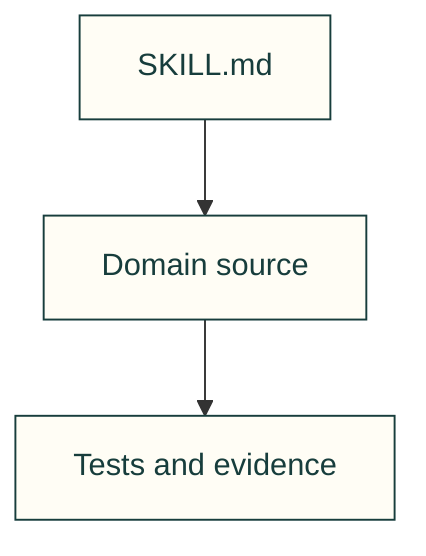

# Verify a self-contained SCADA consumer

A repeatable procedure over the maintained cad-agent SCADA source and its tests.

| File | Purpose |
| --- | --- |
| [SKILL.md](SKILL.md) | Applicability, real prerequisites, source owners, procedure and acceptance evidence |

[All skills](../README.md) · [SCADA owner](../../../software/cadagent/webkit/scada/README.md) · [MIT license](../../../software/cadagent/webkit/scada/LICENSE.txt)
