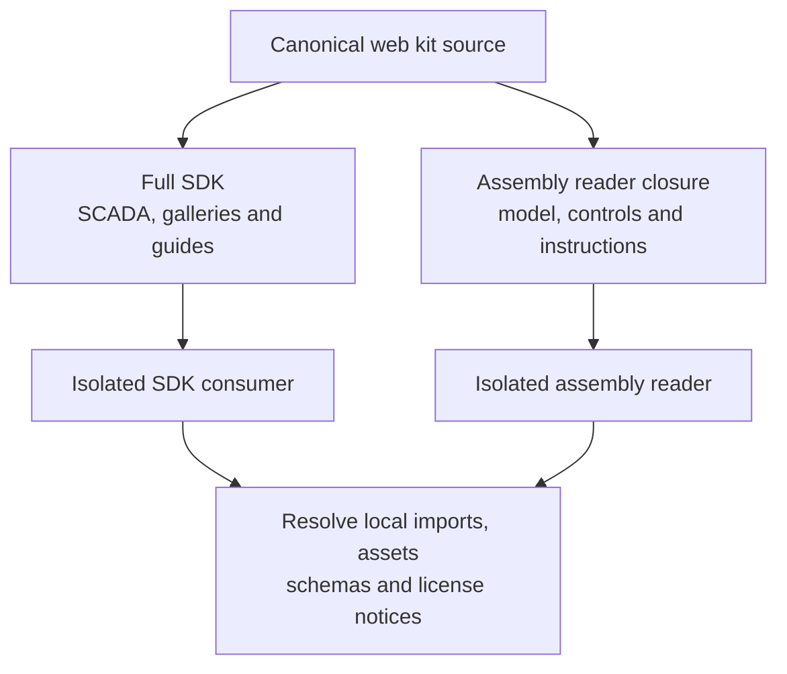

# Verify a self-contained SCADA consumer

> **Needs:** `node` 22.22.2+, 24.15.0+, or 26+ and `npm`; Python Playwright and local Chromium for SCADA browser capture and visual verification. `cad-agent agents install` says which of these this computer lacks. Without Python Playwright and local Chromium, skip that step; without the rest, do not use it.

Use the maintained cad-agent checkout. Read the [SCADA owner map](../../../software/cadagent/webkit/scada/README.md)
and scoped instructions before editing. Follow [work tracking](../cad-work-tracking/SKILL.md),
[independent review](../cad-pr-review/SKILL.md) and [supply-chain review](../cad-supply-chain/SKILL.md)
where applicable; this skill adds no separate approval process. Runtime APIs and
source-owned generators are authoritative.

This workflow verifies a concrete consumer or release from the maintained source. Follow the [integration architecture](../../../docs/practice/scada/architecture.md).

Delivery scope changes which files are included, not their canonical owner.
Verify both artifacts independently with the source checkout unavailable.

1. Name source/target revisions, actual consumer, supported document/model versions,
   controls, public exports and completion evidence. Inspect the target rather
   than assuming its viewer lifecycle or packaging is suitable.
2. Map the complete closure: runtime modules, schemas, styles, dynamic assets,
   providers, notices, optional gallery/examples, tests/tools and canonical skills.
   Keep runtime inclusion separate from source ownership. Each library keeps img/.
   The Python wheel and full `cad-agent webkit` copy carry the complete SCADA
   SDK, including local galleries, contextual guides, examples and package notices.
   An assembly-guide export uses its explicit reader closure and excludes SCADA.
   Do not create stripped SCADA metadata or an unused intermediate runtime profile.
   Preserve [package terms](../../../software/cadagent/webkit/scada/LICENSE.txt)
   and recorded authorization; an export does not grant a new license.
3. Preserve `getSnapshot`, `subscribe` returning unsubscribe and optional dispatch,
   one host-owned clock/session, explicit read-only behavior and independent views.
   Keep domain documents, equations, camera and command authority separate. Share
   new abstractions only with two actual consumers. No universal solver is implied.
4. Verify imports and schemas from an isolated installed/copied consumer without
   sibling-checkout or old-repository access. Include nested CSS, worker/decoder
   assets and notices. Test schema/provider/units/version mismatch, rejected restore,
   deterministic continuation and a broken required dependency.
5. Exercise the actual browser: two views and read-only observer, commands,
   fault/repair, disposal, keyboard/mobile Fit, reduced motion and sound policy.
   View removal must not reset or double-tick the session. Use actual current exports and browser consumers. Confirm that full SDK assets
   remain available locally and assembly-only exports contain no SCADA subtree.
6. For an authored source handoff, include generators/tests/docs/skills as well as
   runtime assets. Prove metadata/gallery regeneration and canonical skill discovery
   from the target-only checkout. A runtime tarball deliberately omitting tooling is
   not a complete development handoff.
7. Record exact artifact hashes, commands, consumer evidence and remaining limits.
   Distinguish source checks, installed-wheel/static-export tests and actual live
   HTTP readback. Preserve frozen releases; do not rewrite old archives to claim a
   newer result. Reuse the existing publishing/review and maintainer gate workflow.

Existing entrypoints include `npm --prefix tools/webkit/scada test`, package-local
`npm pack`, and the target publishing/CLI suites. Use the actual
[SCADA tools](../../../tools/webkit/scada/README.md) and
[tests](../../../tests/webkit/scada/README.md); inspect help before choosing delivery
or filter options. [Model adaptation](../scada-model-adaptation/SKILL.md) and
[viewer review](../scada-viewer-review/SKILL.md) own their deeper behavior checks.

[Skill map](README.md) · [All skills](../README.md) · [Retained terms](../../../software/cadagent/webkit/scada/LICENSE.txt)
