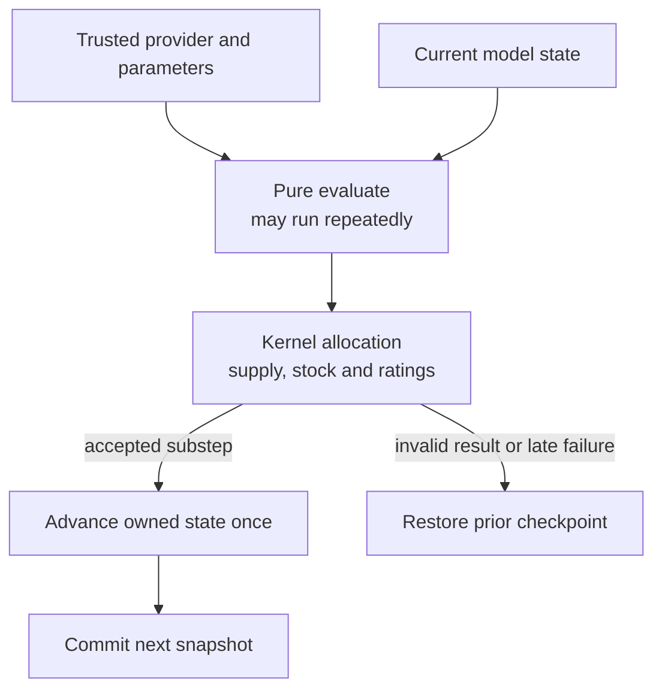

# Adapt equations and model sessions

> **Needs:** `node` 22.22.2+, 24.15.0+, or 26+ and `npm`; Python Playwright and local Chromium for SCADA browser capture and visual verification. `cad-agent agents install` says which of these this computer lacks. Without Python Playwright and local Chromium, skip that step; without the rest, do not use it.

Use the maintained cad-agent checkout. Read the [SCADA owner map](../../../software/cadagent/webkit/scada/README.md)
and scoped instructions before editing. Follow [work tracking](../cad-work-tracking/SKILL.md),
[independent review](../cad-pr-review/SKILL.md) and [supply-chain review](../cad-supply-chain/SKILL.md)
where applicable; this skill adds no separate approval process. Runtime APIs and
source-owned generators are authoritative.

Read the [model adaptation guide](../../../software/cadagent/webkit/scada/sim/docs/REAL_MODEL_ADAPTATION.md),
[Model API](../../../software/cadagent/webkit/scada/sim/docs/MODEL-API.md) and
[external-engine limits](../../../software/cadagent/webkit/scada/sim/docs/EXTERNAL-ENGINES.md).

1. Inspect the actual engine version, system/model definitions, descriptors,
   validators, controls, every attached view and clock owner. V1 component changes
   do not automatically change the v2 circuit solver. Keep models DOM-free.
2. Record an evidence specification: measured/source-derived/assumed data, units,
   curve identity, operating domain, uncertainty, initial/boundary conditions,
   excluded behavior and acceptance values from an independent reference. Never
   infer pipe geometry, elevation, impedance or connectivity from screen positions.
3. Choose the supported seam. Calibrate validated parameters when existing laws
   fit; register trusted `equationProviders` for replacement constitutive laws;
   or provide a full external-engine adapter when it owns the network/state solve.
   Bindings are data-only `definition.equations`, never executable expressions or
   arbitrary module URLs in JSON. Do not replace executable support with prose.

A provider proposes constitutive response; the kernel accepts bounded allocation.
Only an accepted substep advances provider-owned state.



4. Specify command/setpoint versus observation, physical quantity versus display
   percentage, units/signs, absolute/gauge, sampling time and quality. Preserve zero,
   missing/stale, degraded, fault and retained-stock/heat states separately. A glyph,
   alarm or drawn wire is not a protective interlock.
5. Read `EQUATION_PHASE_CONTRACTS` before implementing. V1 stock uses rate × dt/10;
   v2 amount uses rate × dt. SI helpers need explicit bridge parameters. The kernel
   owns finite allocation, ratings and absolute supply/isolation gates; the provider
   owns the supported constitutive response. Do not double-apply a gate or cap a
   replacement law at the previous built-in law.
6. Keep `evaluate` pure because solving may call it repeatedly. `advance` replaces
   owned serializable state once per accepted substep. Version provider/state/schema,
   validate outputs and units, and test atomic `setEquationBindings()`: core stocks
   and time remain, provider-owned state resets. A compatible snapshot separately
   restores validated provider state. Invalid swaps/restores roll back completely.
   Declared provider IDs/schema signatures are not hashes of implementation bytes;
   reproducibility evidence also binds code and dependency hashes.
7. A whole external engine supplies `getSnapshot`, `subscribe` returning unsubscribe,
   and optional `dispatch`. Map stable IDs, units, timestamps, quality and command
   authority explicitly. Hosts own initialization, worker/network lifetime, clocks,
   persistence and destruction; views borrow the session. Configuration/results
   exports are not restart snapshots unless that engine proves compatible restore.
8. Use independent physics/reference cases and negative controls: zero/idle/load
   boundaries, out-of-domain inputs, no supply, retained stock/heat, fault/repair,
   rejected mutation, step refinement and material/energy accounting. Preserve
   deterministic continuation and baseline defaults where compatibility is required.

   ```sh
   npm --prefix tools/webkit/scada test
   npm --prefix tools/webkit/scada run check:metadata
   npm --prefix tools/webkit/scada run check:default-baseline
   node --test tests/webkit/scada/sim/equation-runtime.test.mjs
   node --test tests/webkit/scada/sim/external-adapter.test.mjs
   ```

9. Run the [physical examples](../../../software/cadagent/webkit/scada/sim/examples/equation-models/README.md)
   and inspect the [switching bench](../../../software/cadagent/webkit/scada/sim/examples/model-switching/README.md)
   when touching providers. The fake-engine example proves adapter plumbing, not
   physics. Review changed observations in the actual UI through
   [viewer review](../scada-viewer-review/SKILL.md); animation must match supplied state.
10. Update contracts, examples and assumptions with exact executed evidence and
    limits. Distinguish calibrated local equations, full-system qualification,
    adapter correctness, packaging and live publication. No broad accuracy claim
    follows from transferring a working illustrative model.

[Skill map](README.md) · [All skills](../README.md) · [Retained terms](../../../software/cadagent/webkit/scada/LICENSE.txt)
