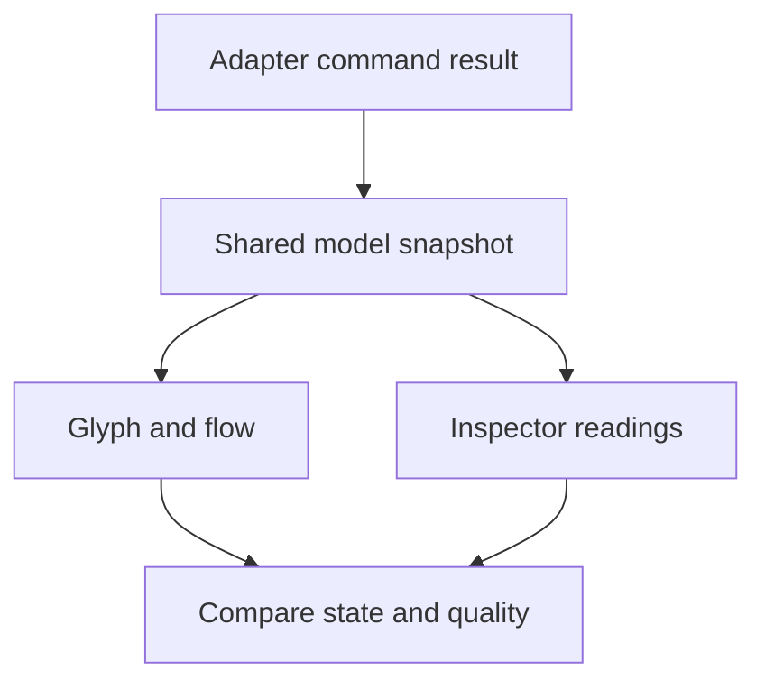

# Review the actual SCADA viewer

> **Needs:** `node` 22.22.2+, 24.15.0+, or 26+, `npm` and Python Playwright and local Chromium. `cad-agent agents install` says which of these this computer lacks; without them, do not use it.

Use the maintained cad-agent checkout. Read the [SCADA owner map](../../../software/cadagent/webkit/scada/README.md)
and scoped instructions before editing. Follow [work tracking](../cad-work-tracking/SKILL.md),
[independent review](../cad-pr-review/SKILL.md) and [supply-chain review](../cad-supply-chain/SKILL.md)
where applicable; this skill adds no separate approval process. Runtime APIs and
source-owned generators are authoritative.

Read the [style guide](../../../software/cadagent/webkit/scada/ui/STYLE_GUIDE.md),
[state coverage](../../../software/cadagent/webkit/scada/ui/docs/STATE_COVERAGE.md),
[viewer API](../../../software/cadagent/webkit/scada/ui/docs/API.md) and relevant
[model API](../../../software/cadagent/webkit/scada/sim/docs/MODEL-API.md).

1. Record input commit/file hashes, actual entry URL, delivery (source, wheel/copy,
   generated site or live HTTPS), browser/version, scenario/view/equipment and
   viewport. A local response fulfilled under an HTTPS-looking origin is still local.
   Name historical/resumed evidence separately from fresh checks.
2. Select a meaningful state matrix: off/on, idle/zero, low/normal/high, unavailable,
   connected/disconnected, open/closed, warning, supported damage and recovery.
   Include small cards, full diagrams and equipment inspectors. For layout changes,
   add phone, short landscape, ordinary desktop and ultrawide windows. Measure the
   actual fitted artwork as well as its containing frame; preserve manual camera
   focus during resize. Check both application themes, persisted choices, system
   preference changes and direct/copied-kit entry. Name omitted cases rather than
   claiming all.
3. Verify a single in-view camera toolbar owns zoom, readable/reset scale and Fit,
   with visible focus and at least 44 px targets. Measure inspector action and
   toggle text against their actual surfaces in both themes, including pressed,
   unpressed and hovered states; require at least 4.5:1 for normal text and status
   spans. Wait for the camera's resize update before comparing manual world focus.

Compare visible output against model evidence, and test the interaction path in
the opposite direction. A moving symbol alone does not establish either contract.



3. Compare the glyph/readout with canonical snapshot bindings. Commands are not
   observations; retained setpoints are not actual output. Off does not imply empty,
   cold or depressurized. Missing telemetry must not become a plausible zero.
4. Supply damage-only visual states, then exercise actual model fault/repair
   commands. Check stopped mechanisms, retained heat/stock/leaks and both views.
   Repair follows model semantics; it is not automatically reset or instant cooling.
5. Watch actual movement across time and workload changes. Inspect recognizable
   silhouettes, units, contrast, crossings/direction and repeated-SVG ID collisions.
   Reduced motion/pause must retain warning and retained-state meaning. Animation
   declarations or frame counts alone do not establish visible correct motion.
6. Exercise keyboard focus, labels, touch targets, selection, inspector/modal focus,
   Escape and return focus. Live updates preserve input drafts. Contained canvases
   have no scrollbar navigation, including hidden native scroll offsets: use mouse
   drag/wheel, touch pan/pinch, keyboard pan and always-visible Fit. Outer pages and
   long inspector forms may scroll. Resize preserves a deliberate camera.
7. Change equipment in one view and compare the same model in the other/observer.
   Switching/removing a view must not reset history, double-tick or destroy the
   session. Read-only controls are unavailable. Test rejected commands/imports
   atomically, mount/unmount cleanup and one clock. Audio requires opt-in; mute,
   acknowledge and navigation cannot replay old accidents or duplicate alarms.

   ```sh
   npm --prefix tools/webkit/scada run qa:viewer -- --help
   npm --prefix tools/webkit/scada run qa:viewer
   npm --prefix tools/webkit/scada run qa:gallery
   node tests/webkit/scada/explorer/browser.mjs
   ```

8. Inspect captured images and interact with repaired screens; do not equate a
   process exit with completed visual review. Use the actual tool's help for scope,
   output and live-byte options. Keep measured Web Audio output distinct from
   subjective listening, and static/animated SVG previews distinct from simulation.
9. Record finding, exact inputs/commands, expected/observed behavior, source identity,
   screenshot/motion evidence and remaining limits. Fix canonical owners when
   authorized, rerun affected cases and use independent review for delivery.

Model/equation work belongs to [model adaptation](../scada-model-adaptation/SKILL.md),
new artwork to [component authoring](../scada-component-authoring/SKILL.md), and system
composition to [system authoring](../scada-system-authoring/SKILL.md). Refresh owned
image outputs only after the relevant runtime source is stable.

[Skill map](README.md) · [All skills](../README.md) · [Retained terms](../../../software/cadagent/webkit/scada/LICENSE.txt)
