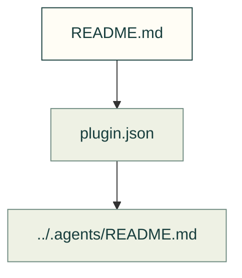

# Plugin entry

The plugin manifest points at the canonical agent kit inside this repository.

Files and sources

| File or folder | Purpose |
|---|---|
| [plugin.json](plugin.json) | Plugin identity, version and explicit skill/role entries. |

[Repository](../README.md) · [Agent kit](../.agents/README.md). This map does not add a plugin hook or alter its declared roles.

The surrounding toolkit uses MIT; the SCADA-derived skills retain the terms in
[the SCADA notice](../software/cadagent/webkit/scada/LICENSE.txt). The manifest declares
this mixed scope explicitly; installation does not grant additional rights.
