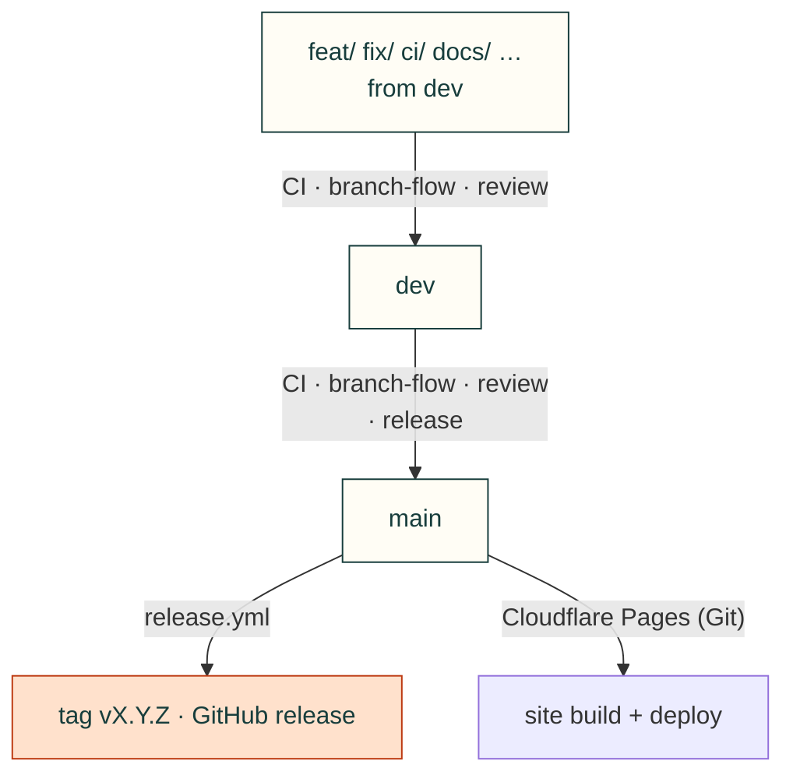

# Contributing

Several projects build on cad-agent at the same time (the J501 enclosure, Gyropup, the AGX Thor CAN boards, and
others), often with AI agents working in parallel. A change to cad-agent can break all of them, so every change
goes through a branch, a pull request, CI and a review.

## Branches
| Branch | What it is | Who writes to it |
|---|---|---|
| `main` | Released toolkit, tagged `vX.Y.Z`. | Only by merging a release PR from `dev`. |
| `dev` | Integration, and the repository's default branch. Everything here passed CI and review. | Only by merging a reviewed PR. |
| `feat/<topic>`, `fix/<topic>`, `ci/<topic>`, `docs/<topic>`, `research/<topic>`, `test/<topic>`, `refactor/<topic>`, `release/vX.Y.Z`, `vendor-update/<name>-<sha>`, `dependabot/…` | One piece of work, branched from `dev`. | Its author, in its own worktree. |

`main` and `dev` are protected: no direct pushes (admins included), no force pushes, the required checks below must
pass and every review conversation must be resolved. Agents may merge into both, through the gates.

## Gates

Required checks, all automated. Nobody, agent or person, merges around them.



| Required check | `dev` | `main` | What it asks |
|---|---|---|---|
| `core (3.10)`, `core (3.12)`, `full` | ✓ | ✓ | The test suite with required dependencies only, and with every extra |
| `browser (chromium)`, `browser (webkit)` | ✓ | ✓ | Web kit and website suites in two browser engines |
| `cad-gates/<base>/branch-flow` | ✓ | ✓ | `dev` takes `feat/ fix/ ci/ docs/ research/ test/ refactor/ release/ vendor-update/ dependabot/` branches (forks: the outside-contribution checks); `main` takes `dev` only |
| `cad-gates/<base>/review` | ✓ | ✓ | The latest verdict from a maintainer is pass, on the PR's head commit |
| `cad-gates/main/release` | | ✓ | `pyproject.toml` version above `main`'s, and a dated `## vX.Y.Z (YYYY-MM-DD)` entry in [CHANGELOG.md](../CHANGELOG.md) |
| Conversations resolved | ✓ | ✓ | Every review thread answered and resolved |

✓ means branch protection requires it. On 2026-11-05, `main` was verified to require all eight checks above (the three
Python checks, two browser checks and three `cad-gates/main/…` checks), bound to GitHub Actions, with up-to-date
branches required (`strict=true`; [#112 settings evidence](https://github.com/Valpatel/cad-agent/issues/112#issuecomment-6671694150)).
`python3 tools/ci_gates.py all` checks the three `cad-gates` rows. It does not read the browser runs, so confirm those
with `gh pr checks <n>`.

- **The verdict.** It is the last line of the reviewer's summary review: `<!-- cad-review verdict=pass sha=<40-character head sha> -->` (or `verdict=block`). It is written by the `cad-pr-reviewer` subagent, or by a reviewer following the `cad-pr-review` skill, who then re-runs the gates: `gh workflow run gates.yml -R Valpatel/cad-agent -f pr=<n>`.
- **Who can review.** Only verdicts from a maintainer (`MAINTAINERS` in `tools/ci_gates.py`) who still has write access count, and dismissed reviews never count. A collaborator with write access can push branches and run CI, but their PRs merge only after a maintainer's review. All our agents work through one account, so GitHub cannot tell author from reviewer: an author never writes a verdict on its own PR.
- **Collaborators.** A collaborator with write access works like any agent here, and is still gated:
  - they branch from `dev` in this repository and open a PR into `dev`;
  - they can push as often as they like, and CI runs without approval;
  - **they cannot merge.** The repository ruleset "Only maintainers merge into dev and main" lets only the admin role
    update those branches. A maintainer reviews the PR (the verdict marker; only a maintainer's verdict counts) and
    merges it with `gh pr merge --admin`, the ruleset's bypass. The required checks still apply to admins
    (enforce admins is on). Run `tools/ci_gates.py all` before every merge; `main` also requires the release gate
    and up-to-date branches.
  - Outside contributors without write access open PRs from forks (#111).
- **How the gates run.** `gates.yml` runs on `pull_request_target`: the default branch's (`dev`'s) copy of the workflow and of [`tools/ci_gates.py`](../tools/ci_gates.py) decides, so a PR cannot pass the gates by editing them, and PRs into `main` (which come from `dev`) are judged by the same copy. The PR is only read as data, never checked out or run. Results are commit statuses named after the base, so a PR into `dev` cannot supply `main`'s checks. A fork's own workflows run with a read-only token, so they cannot post statuses. Anyone with write access can, even through a workflow of their own, so the trust boundary is the maintainer list in `tools/ci_gates.py` and the merge ruleset, not write access. Fork workflows wait for approval: a maintainer approves a run only after reading every changed workflow and script, and agents never approve one on their own (the intake skill, #120, will make that read systematic).
- **When they run.** On every push to the PR, when the reviewer re-runs them after a verdict, and every 15 minutes for all open PRs (a review cannot trigger them). A run for one PR posts `pending` first, so a crash leaves the PR blocked rather than green. The sweep posts only statuses that change: GitHub keeps at most 1000 statuses per commit and name, and refuses new ones after that.
- **Just before merging**, run `python3 tools/ci_gates.py all --repo Valpatel/cad-agent --pr <n>` from an up-to-date `dev` checkout. It reads the reviews live and must exit 0, so a block posted since the last run stops the merge.
- **GitHub settings the gates need** (owner): the `cad-gates/…` checks required on `dev` and `main` with GitHub Actions as their source; an Actions event policy for `.github/workflows/gates.yml` that allows all three of its events, `pull_request_target`, `schedule` and `workflow_dispatch` (GitHub disables `pull_request_target` by default in public repos from 2026-12-02, and a policy lists allowed events, so one left out stops the sweep or the re-run).
- **Pins.** Workflow actions are pinned by commit SHA, and Dependabot proposes updates weekly.

## Workflow
Agents: install the workflow kit (`cad-agent agents install`, [docs/practice/agent-workflow.md](../docs/practice/agent-workflow.md)) and
follow `cad-work-tracking`: an issue per change, an early draft PR with `Closes #<issue>`, and pushes as you go.

0. **Issue.** Find or open the GitHub issue the change belongs to, with a checklist of done / next / how to resume.
1. **Look before building.** Before writing a new capability (a command, check, calculator, generator or skill),
   find what already does the job: the [catalogue](https://cad-agent.valpatel.com/catalog)
   ([`catalog.json`](https://cad-agent.valpatel.com/catalog.json), which `tools/site/compiler/site-catalog.mjs` builds from the
   repo), the [landscape survey](../docs/research/agent-workflow/landscape.md), [`software/vendor/upstreams/registry.yaml`](../software/vendor/upstreams/registry.yaml), the
   skills in [`.agents/skills/`](../.agents/skills), and the open-source libraries and agent skills outside them. Under "Considered
   existing tools" in the PR, name each candidate and whether you adopted it, wrapped it, borrowed from it or passed
   on it, and why. Write our own only for the gap, and credit what you use.
2. **Worktree from `dev`.** Keep one project container: `repo/` for the canonical checkout, `worktrees/<topic>/`
   for linked checkouts. Inspect `git worktree list` first and reuse an existing owned tree where appropriate.
   Never edit a checkout another session may be using. Run this example from the canonical `repo/` checkout:
   ```bash
   git fetch origin
   git worktree add --no-track ../worktrees/<topic> -b feat/<topic> origin/dev
   cd ../worktrees/<topic> && git push -u origin feat/<topic>     # the branch tracks itself, not dev
   ```
3. **Commit and push** small, focused changes with tests (in `tests/<domain>/`: [where files go](#where-files-go)) as you go, not in one batch at the end. Keep the package generic: anything specific to one
   product stays in that product's repository. A new docs or research page, `cad-agent` command, skill, agent or
   `docs/lessons/` folder also gets its line in [`docs/areas.yaml`](../docs/areas.yaml), the topic tree ([docs/vision.md](../docs/vision.md)):
   `tests/repo/test_areas.py` fails until it does. When two open PRs cross, the one that merges second adds the line, after
   merging `dev` and re-running CI (`dev` does not require branches to be up to date).
4. **Open a PR into `dev`** early, as a draft if it is unfinished (`gh pr create --draft --base dev`), with `Closes #<issue>`; fill in the template, including what projects using
   cad-agent must change.
5. **CI** (`.github/workflows/ci.yml`) runs `core` on Python 3.10 and 3.12 (required dependencies only; optional
   features must skip cleanly) and `full` on 3.12 (CAD, FEA, robot and site extras, imported loudly before the tests;
   the `cad` and `sim` extras need 3.11 or newer);
   `webkit.yml` runs the browser suites and `gates.yml` the [gates](#gates). CI's `supply-chain` job runs the offline
   [supply-chain report](../.agents/skills/cad-supply-chain/SKILL.md): a PR that adds a dependency, vendored file or catalogue
   entry pastes its rows (`python3 tools/resource_audit.py rows --base origin/dev --online`) under "Supply chain".
6. **Review.** Every PR gets a review from a person or from a separate review agent that did not write the change,
   posted as PR comments (the `cad-pr-reviewer` subagent, or a separate Codex session with that skill), ending with
   the verdict marker that the `review` gate reads. The author answers or fixes each comment and resolves it.
7. **Merge** into `dev` (squash or merge commit). Then, before removing the worktree, repoint anything installed
   from it: `pip show -f cad-agent` (or the `direct_url.json` it lists) in each project venv tells you where
   `cadagent` comes from. Repoint those to the reviewed `dev` checkout below, verify imports and other path consumers,
   then run `git worktree remove ../worktrees/<topic>` from the canonical `repo/` checkout. Preserve dirty, untracked,
   ignored and unincorporated work; do not force removal or delete an active provider just to reduce folder count.

## Where files go

Each kind of file has one place. Prefer growing an existing module, page or folder to starting a new one; a new
folder comes when one gets cluttered (the growth rule in [AGENTS.md](../AGENTS.md#repo-structure-and-where-files-go)).
`tests/repo/test_layout.py` checks the test, `software/` and top-level rules, and says where a misplaced file goes.

| Kind of file | Where it goes |
|---|---|
| Code: a check, calculator, generator or reader | The module for its topic in `software/cadagent/<domain>/` ([map](../software/cadagent/README.md)), with its line in that domain's `api:` in `docs/areas.yaml`. A function or two joins an existing module; never a new file at the top of `software/cadagent/` |
| A closed-form equation | `software/cadagent/formulas/`, with golden vectors in its test |
| A `cad-agent` command | Its parser and handler in `software/cadagent/cli.py`, its logic in the domain package |
| A browser component | `software/cadagent/webkit/` |
| A test of package code | `tests/<domain>/test_<subject>.py`, the folder of the package its main subject lives in ([map](../tests/README.md)) |
| A test of `cli.py` or a module beside it | `tests/cli/` |
| A Node or browser test of the web kit | `tests/webkit/`: `webkit-<name>.test.mjs` (`node --test`), `webkit-<name>-browser.mjs` (Playwright) |
| A test of the website or its build | `tests/site/` (`website-*.test.mjs`, `website-*-browser.mjs`) |
| A test of a repo rule or of the repo's own tooling | `tests/repo/` |
| A test of a figure generator in `tools/` | The folder of the package it draws (`tools/figures/motion_figures.py` → `tests/mechanical/`) |
| Test data | `tests/fixtures/<set>/`, made by a script beside it or described in a README |
| A docs page | `docs/<page>.md` (`docs/<domain>/` once its area has three pages, #145), with its line in `docs/areas.yaml` |
| A figure on a page | `docs/img/<topic>/`, drawn by a generator in `tools/` that a test runs with `--check` |
| A survey or sourced data table | `docs/research/` |
| A lesson from a real project | `docs/lessons/<area>/`, listed in the area's README |
| A repo script (figures, site build, gates, release) | `tools/` |
| A website asset | `tools/site/assets/` |
| An example project | `docs/examples/<name>/`, with a README |
| A CHANGELOG entry | `docs/changelog.d/<issue>-<slug>.md` |
| Vendored upstream code | `software/vendor/<name>/`, through `tools/vendor_sync.py` |
| A skill or a subagent | `.agents/skills/<name>/SKILL.md`, `.agents/agents/<name>.md`: the canonical copies to edit. `.claude/` and `.codex/` hold only wiring; the native plugin manifest points at the same canonical files |
| Operational incident evidence | `.agents/inbox/YYYY-MM-DD-<lesson>.md`, linked from `.agents/SYMPTOM-INDEX.md`; preserve dated commands, controls, cause and limits |
| Reusable toolkit or project guidance | Curate into the existing `docs/lessons/<area>/` lesson and its index; keep one canonical explanation rather than duplicate prose |

## Using cad-agent from a project
- **Released:** a checkout of `main` (or a tag), installed editable: `pip install -e "<checkout>[cad,fea]"`.
- **Latest reviewed:** from the canonical `repo/` checkout, create a dedicated read-only tree with
  `git worktree add --detach ../worktrees/dev origin/dev`. Update it with `git fetch origin` followed by
  `git -C ../worktrees/dev merge --ff-only origin/dev`. Detached trees have no branch upstream for an implicit pull.
  Reuse a verified existing integration tree instead of creating duplicates. Never edit in it.
- **A feature under test:** that feature's worktree, while its PR is open. Say so in the PR.

A project that needs a new toolkit feature opens a cad-agent PR for it; it does not patch its local copy.

## Releases
Shipping to `main` is part of the development loop, not an occasional event. When `dev` has merged work that people
or projects would notice (a command, a check, a fix, a site change), cut a release; while work is landing, at least
once a day. `main` should never be more than a day behind `dev`. Agents cut and merge releases under the same gates as
any PR; nobody has to ask for one. Use a patch release (`--patch`) for fixes, docs and the site, and a minor release
(`--minor`) when projects must change something (the CHANGELOG's "Projects must change") or when it adds a feature,
such as a new command or check, even one that asks nothing of projects.
1. On a `release/vX.Y.Z` branch from `dev`:
   - bring in `main`'s release merges (`git merge origin/main`), so the release PR is up to date with `main`;
   - run `python3 tools/cut_release.py --patch` (or `--minor`). It bumps `version` in `pyproject.toml`, folds the
     fragments in [`docs/changelog.d/`](../docs/changelog.d/README.md) into the CHANGELOG's `## Unreleased` entry and deletes
     them, dates the entry as `## vX.Y.Z (YYYY-MM-DD)`, opens a new empty `## Unreleased`, and checks the result
     against CI's release gate;
   - check that the entry covers every PR merged since the last release, with what projects must change.

   PR it into `dev` and merge.
2. Open a PR from `dev` into `main` titled `Release vX.Y.Z`. It needs CI, `cad-gates/main/release`, and a review whose pass verdict is on the PR's head commit. Merge it with a **merge commit** (not squash or rebase), so `main` and `dev` keep a common history.
3. `release.yml` then:
   - tags `vX.Y.Z` on the merge commit;
   - publishes the GitHub release from the CHANGELOG entry;

   Cloudflare Pages deploys the site; `release.yml` does not. The Pages project `cad-agent` (the name in
   `tools/site/wrangler.toml` and `npm --prefix tools/site run deploy:site`) is connected to this repository like every Valpatel Pages site:
   build command `npm --prefix tools/site ci && npm --prefix tools/site run build`, output `dist`, root directory blank.
   The steady command was read back on 2026-11-06 UTC after the actual v0.22.0 deployment passed
   [publication checks](https://github.com/Valpatel/cad-agent/issues/362#issuecomment-6677025539).
   Repository moves and external settings are separate changes. Two settings differ from
   Cloudflare's defaults and matter here:
   - **Production branch `main`.** This repository's default branch is `dev`, and the release build accepts HEAD on
     `origin/dev` too, so a production branch of `dev` would publish every merge into `dev`.
   - **Preview deployments: None.** A branch build fails the release build's reviewed-commits check, and would put
     a red Cloudflare check on every PR.
   - On each push to `main` the configured build publishes `dist` to cad-agent.valpatel.com and
     cad-agent.gyropup.com. `tools/site/pages-build.mjs` fetches the full history and `origin/main` and `origin/dev`,
     which Cloudflare's clone lacks, then runs `tools/site/build-site.mjs --release`.
   - With previews off, only `main` publishes.
   - Check that `https://cad-agent.valpatel.com/version.json` shows the release.
   - `npm --prefix tools/site run deploy:site` uploads a build by hand. Use it only when Cloudflare's build is down.

   <details>
   <summary>Runtime and diagram evidence, 2026-11-06 UTC</summary>

   Both environments retain build image v3 without a `NODE_VERSION` override. The v0.21.0 production log explicitly
   reports Node 22.23.4/npm 10.9.9. After the root npm metadata moved, v0.22.0's detector lists only pip/Python;
   its successful npm/Node entry does not itself reveal the new binary version.
   [Cloudflare documents](https://developers.cloudflare.com/pages/configuration/build-image/#limitations) that v3
   does not select Node from package.json engines. CI and the installed-wheel check explicitly use Node 22;
   a runtime pin remains a separate policy decision.

   Actual v0.22.0 production drew all 264 themed SVGs in Chrome 156. Raw SVGs were checked on three public routes;
   JavaScript-disabled /docs/gates views showed the correct figures at 390/1366 px in both themes. Browserless fleet
   job 199 instead exercised the documented client fallback: it proved entry/history/root-output behavior, not
   prerendered publication. Keep those receipt scopes distinct.

   </details>

4. Move the projects' pins (`requirements*.txt`) to the tag, each in its own PR.

## GitHub policy map

These files keep their GitHub discovery names. This guide owns their map rather than installing another front page.

| File or folder | Purpose |
|---|---|
| [CONTRIBUTING.md](CONTRIBUTING.md) | Canonical contribution, integration and release procedure. |
| [SECURITY.md](SECURITY.md) | Vulnerability reporting policy. |
| [dependabot.yml](dependabot.yml) | Deliberate GitHub-Actions-only version update campaign. |
| [pull_request_template.md](pull_request_template.md) | Review and evidence checklist. |
| [ISSUE_TEMPLATE/](ISSUE_TEMPLATE/) · [feedback.yml](ISSUE_TEMPLATE/feedback.yml) | Structured feedback intake. |
| [workflows/](workflows/) | Existing required checks and publication automation. |
| [ci.yml](workflows/ci.yml) | Python, supply-chain, provenance and installer checks. |
| [gates.yml](workflows/gates.yml) | Live branch-flow, independent review and release guards. |
| [release.yml](workflows/release.yml) | Normal main tag and release publication. |
| [supply-chain.yml](workflows/supply-chain.yml) | Weekly online resource/dependency audit. |
| [webkit.yml](workflows/webkit.yml) | Full browser, site and web-kit consumers. |

[Repository](../README.md) · [Generated ownership map](../docs/map.md)
