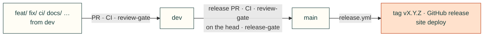

# Contributing

Several projects build on cad-agent at the same time (the J501 enclosure, Gyropup, the AGX Thor CAN boards, and
others), often with AI agents working in parallel. A change to cad-agent can break all of them, so every change
goes through a branch, a pull request, CI and a review.

## Branches
| Branch | What it is | Who writes to it |
|---|---|---|
| `main` | Released toolkit, tagged `vX.Y.Z`. | Only by merging a release PR from `dev`. |
| `dev` | Integration, and the repository's default branch. Everything here passed CI and review. | Only by merging a reviewed PR. |
| `feat/<topic>`, `fix/<topic>`, `ci/<topic>`, `docs/<topic>`, `research/<topic>`, `test/<topic>`, `refactor/<topic>`, `release/vX.Y.Z`, `vendor-update/<name>-<sha>` | One piece of work, branched from `dev`. | Its author, in its own worktree. |

`main` and `dev` are protected: no direct pushes (admins included), no force pushes, the required checks below must
pass and every review conversation must be resolved. Agents may merge into both, through the gates.

## Gates

Required checks, all automated. Nobody, agent or person, merges around them.



| Check | PR into `dev` | PR into `main` | What it asks |
|---|---|---|---|
| `core (3.10)`, `core (3.12)`, `full` | ✓ | ✓ | The test suite with required dependencies only, and with every extra |
| `browser (chromium)`, `browser (webkit)` | ✓ | ✓ | Web kit and website suites in two browser engines |
| `branch-flow` | ✓ | ✓ | `dev` takes the branch kinds above (forks: the outside-contribution checks); `main` takes `dev` only |
| `review-gate` | ✓ | ✓ | An independent review's latest verdict is pass; for `main`, on the head commit |
| `release-gate` | | ✓ | `pyproject.toml` version above `main`'s, and a dated `## vX.Y.Z (YYYY-MM-DD)` entry in [CHANGELOG.md](CHANGELOG.md) |
| Conversations resolved | ✓ | ✓ | Every review thread answered and resolved |

The verdict is the last line of the reviewer's summary review, `<!-- cad-review verdict=pass sha=<head sha> -->` (or
`verdict=block`), written by the `cad-pr-reviewer` subagent or a reviewer following the `cad-pr-review` skill. Only
reviews from the owner, members and collaborators count. All our agents work through one account, so GitHub cannot
tell author from reviewer: an author never writes a verdict on its own PR. The rules live in
[`tools/ci_gates.py`](tools/ci_gates.py) and are tested in `tests/test_ci_gates.py`. Workflow actions are pinned by
commit SHA.

## Workflow
Agents: install the workflow kit (`cad-agent agents install`, [docs/agent-workflow.md](docs/agent-workflow.md)) and
follow `cad-work-tracking`: an issue per change, an early draft PR with `Closes #<issue>`, and pushes as you go.

0. **Issue.** Find or open the GitHub issue the change belongs to, with a checklist of done / next / how to resume.
1. **Worktree from `dev`.** Never edit a checkout another session may be using:
   ```bash
   git fetch origin
   git worktree add --no-track ../cad-agent-<topic> -b feat/<topic> origin/dev
   cd ../cad-agent-<topic> && git push -u origin feat/<topic>     # the branch tracks itself, not dev
   ```
2. **Commit and push** small, focused changes with tests (`tests/`) as you go, not in one batch at the end. Keep the package generic: anything specific to one
   product stays in that product's repository.
3. **Open a PR into `dev`** early, as a draft if it is unfinished (`gh pr create --draft --base dev`), with `Closes #<issue>`; fill in the template, including what projects using
   cad-agent must change.
4. **CI** (`.github/workflows/ci.yml`) runs `core` on Python 3.10 and 3.12 (required dependencies only; optional
   features must skip cleanly) and `full` (CAD, FEA, robot and site extras, imported loudly before the tests);
   `webkit.yml` runs the browser suites and `gates.yml` the [gates](#gates).
5. **Review.** Every PR gets a review from a person or from a separate review agent that did not write the change,
   posted as PR comments (the `cad-pr-reviewer` subagent, or a separate Codex session with that skill), ending with
   the verdict marker that `review-gate` reads. The author answers or fixes each comment and resolves it.
6. **Merge** into `dev` (squash or merge commit). Then, before removing the worktree, repoint anything installed
   from it: `pip show -f cad-agent` (or the `direct_url.json` it lists) in each project venv tells you where
   `cadagent` comes from. Reinstall those from the `dev` checkout below, then `git worktree remove ../cad-agent-<topic>`.

## Using cad-agent from a project
- **Released:** a checkout of `main` (or a tag), installed editable: `pip install -e "<checkout>[cad,fea]"`.
- **Latest reviewed:** a dedicated worktree that only tracks `origin/dev` (`git worktree add ../cad-agent-dev origin/dev`,
  updated with `git -C ../cad-agent-dev pull --ff-only`). Never edit in it.
- **A feature under test:** that feature's worktree, while its PR is open. Say so in the PR.

A project that needs a new toolkit feature opens a cad-agent PR for it; it does not patch its local copy.

## Releases
Releases are cut when the user asks for one.
1. On a `release/vX.Y.Z` branch from `dev`, bump `version` in `pyproject.toml` and date the CHANGELOG entry
   (`## vX.Y.Z (YYYY-MM-DD)`, with what projects must change); PR it into `dev` and merge.
2. Open a PR from `dev` into `main` titled `Release vX.Y.Z`. It needs CI, `release-gate`, and a review whose pass
   verdict is on the PR's head commit. Merge it with a **merge commit** (not squash or rebase), so `main` and `dev`
   keep a common history.
3. `release.yml` then tags `vX.Y.Z` on the merge commit, publishes the GitHub release from the CHANGELOG entry, and
   deploys cad-agent.valpatel.com from that commit (`production` environment; it needs the `CLOUDFLARE_API_TOKEN`
   secret and the `CLOUDFLARE_ACCOUNT_ID` variable).
4. Move the projects' pins (`requirements*.txt`) to the tag in their own PRs.
