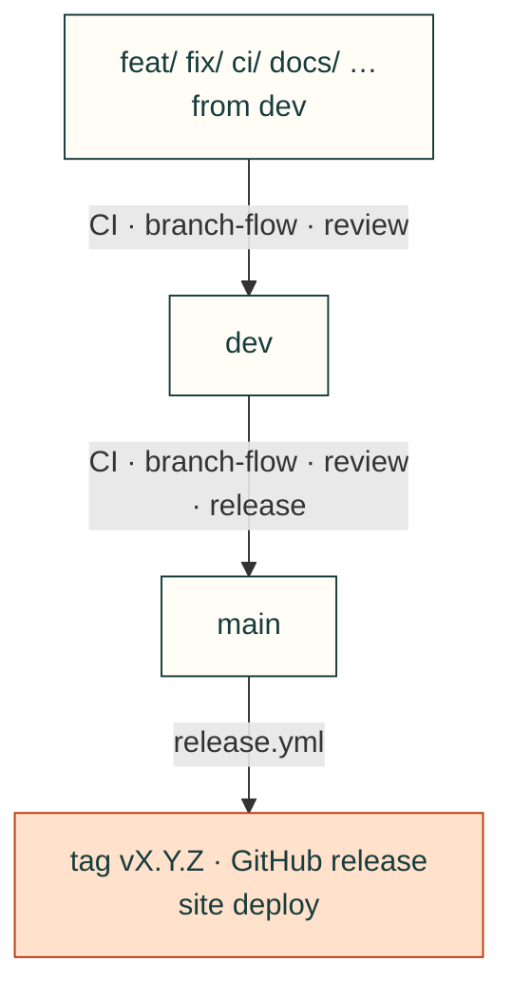

# Contributing

Several projects build on cad-agent at the same time (the J501 enclosure, Gyropup, the AGX Thor CAN boards, and
others), often with AI agents working in parallel. A change to cad-agent can break all of them, so every change
goes through a branch, a pull request, CI and a review.

## Branches
| Branch | What it is | Who writes to it |
|---|---|---|
| `main` | Released toolkit, tagged `vX.Y.Z`. | Only by merging a release PR from `dev`. |
| `dev` | Integration, and the repository's default branch. Everything here passed CI and review. | Only by merging a reviewed PR. |
| `feat/<topic>`, `fix/<topic>`, `ci/<topic>`, `docs/<topic>`, `research/<topic>`, `test/<topic>`, `refactor/<topic>`, `release/vX.Y.Z`, `vendor-update/<name>-<sha>`, `dependabot/…` | One piece of work, branched from `dev`. | Its author, in its own worktree. |

`main` and `dev` are protected: no direct pushes (admins included), no force pushes, the required checks below must
pass and every review conversation must be resolved. Agents may merge into both, through the gates.

## Gates

Required checks, all automated. Nobody, agent or person, merges around them.



| Required check | `dev` | `main` | What it asks |
|---|---|---|---|
| `core (3.10)`, `core (3.12)`, `full` | ✓ | ✓ | The test suite with required dependencies only, and with every extra |
| `browser (chromium)`, `browser (webkit)` | ✓ | ✓ | Web kit and website suites in two browser engines |
| `cad-gates/<base>/branch-flow` | ✓ | ✓ | `dev` takes `feat/ fix/ ci/ docs/ research/ test/ refactor/ release/ vendor-update/ dependabot/` branches (forks: the outside-contribution checks); `main` takes `dev` only |
| `cad-gates/<base>/review` | ✓ | ✓ | The latest verdict from a reviewer with write access is pass, on the PR's head commit |
| `cad-gates/main/release` | | ✓ | `pyproject.toml` version above `main`'s, and a dated `## vX.Y.Z (YYYY-MM-DD)` entry in [CHANGELOG.md](CHANGELOG.md) |
| Conversations resolved | ✓ | ✓ | Every review thread answered and resolved |

- **The verdict.** It is the last line of the reviewer's summary review: `<!-- cad-review verdict=pass sha=<40-character head sha> -->` (or `verdict=block`). It is written by the `cad-pr-reviewer` subagent, or by a reviewer following the `cad-pr-review` skill, who then re-runs the gates: `gh workflow run gates.yml -R Valpatel/cad-agent -f pr=<n>`.
- **Who can review.** Only reviewers with write access count, and dismissed reviews never count. All our agents work through one account, so GitHub cannot tell author from reviewer: an author never writes a verdict on its own PR.
- **How the gates run.** `gates.yml` runs on `pull_request_target`: the default branch's (`dev`'s) copy of the workflow and of [`tools/ci_gates.py`](tools/ci_gates.py) decides, so a PR cannot pass the gates by editing them, and PRs into `main` (which come from `dev`) are judged by the same copy. The PR is only read as data, never checked out or run. Results are commit statuses named after the base, so a PR into `dev` cannot supply `main`'s checks. A fork's own workflows run with a read-only token, so they cannot post statuses; anyone with write access can, which is why write access is the trust boundary. Fork workflows wait for approval; the intake skill (#120) reads a fork's workflow changes before approving them.
- **When they run.** On every push to the PR, when the reviewer re-runs them after a verdict, and every 15 minutes for all open PRs (a review cannot trigger them). A run for one PR posts `pending` first, so a crash leaves the PR blocked rather than green. The sweep posts only statuses that change: GitHub keeps at most 1000 statuses per commit and name, and refuses new ones after that.
- **Just before merging**, run `python3 tools/ci_gates.py all --repo Valpatel/cad-agent --pr <n>` from an up-to-date `dev` checkout. It reads the reviews live and must exit 0, so a block posted since the last run stops the merge.
- **GitHub settings the gates need** (owner): the `cad-gates/…` checks required on `dev` and `main` with GitHub Actions as their source; an Actions event policy for `.github/workflows/gates.yml` that allows all three of its events, `pull_request_target`, `schedule` and `workflow_dispatch` (GitHub disables `pull_request_target` by default in public repos from 2026-12-02, and a policy lists allowed events, so one left out stops the sweep or the re-run); and the deploy token as a `production` environment secret.
- **Pins.** Workflow actions are pinned by commit SHA, and Dependabot proposes updates weekly.

## Workflow
Agents: install the workflow kit (`cad-agent agents install`, [docs/agent-workflow.md](docs/agent-workflow.md)) and
follow `cad-work-tracking`: an issue per change, an early draft PR with `Closes #<issue>`, and pushes as you go.

0. **Issue.** Find or open the GitHub issue the change belongs to, with a checklist of done / next / how to resume.
1. **Worktree from `dev`.** Never edit a checkout another session may be using:
   ```bash
   git fetch origin
   git worktree add --no-track ../cad-agent-<topic> -b feat/<topic> origin/dev
   cd ../cad-agent-<topic> && git push -u origin feat/<topic>     # the branch tracks itself, not dev
   ```
2. **Commit and push** small, focused changes with tests (`tests/`) as you go, not in one batch at the end. Keep the package generic: anything specific to one
   product stays in that product's repository. A new docs or research page, `cad-agent` command, skill, agent or
   `lessons/` folder also gets its line in [`docs/areas.yaml`](docs/areas.yaml), the topic tree ([docs/vision.md](docs/vision.md)):
   `tests/test_areas.py` fails until it does. When two open PRs cross, the one that merges second adds the line, after
   merging `dev` and re-running CI (`dev` does not require branches to be up to date).
3. **Open a PR into `dev`** early, as a draft if it is unfinished (`gh pr create --draft --base dev`), with `Closes #<issue>`; fill in the template, including what projects using
   cad-agent must change.
4. **CI** (`.github/workflows/ci.yml`) runs `core` on Python 3.10 and 3.12 (required dependencies only; optional
   features must skip cleanly) and `full` (CAD, FEA, robot and site extras, imported loudly before the tests);
   `webkit.yml` runs the browser suites and `gates.yml` the [gates](#gates).
5. **Review.** Every PR gets a review from a person or from a separate review agent that did not write the change,
   posted as PR comments (the `cad-pr-reviewer` subagent, or a separate Codex session with that skill), ending with
   the verdict marker that the `review` gate reads. The author answers or fixes each comment and resolves it.
6. **Merge** into `dev` (squash or merge commit). Then, before removing the worktree, repoint anything installed
   from it: `pip show -f cad-agent` (or the `direct_url.json` it lists) in each project venv tells you where
   `cadagent` comes from. Reinstall those from the `dev` checkout below, then `git worktree remove ../cad-agent-<topic>`.

## Using cad-agent from a project
- **Released:** a checkout of `main` (or a tag), installed editable: `pip install -e "<checkout>[cad,fea]"`.
- **Latest reviewed:** a dedicated worktree that only tracks `origin/dev` (`git worktree add ../cad-agent-dev origin/dev`,
  updated with `git -C ../cad-agent-dev pull --ff-only`). Never edit in it.
- **A feature under test:** that feature's worktree, while its PR is open. Say so in the PR.

A project that needs a new toolkit feature opens a cad-agent PR for it; it does not patch its local copy.

## Releases
Shipping to `main` is part of the development loop, not an occasional event. When `dev` has merged work that people
or projects would notice (a command, a check, a fix, a site change), cut a release; while work is landing, at least
once a day. `main` should never be more than a day behind `dev`. Agents cut and merge releases under the same gates as
any PR; nobody has to ask for one. Use a patch release (`--patch`) for fixes, docs and the site, and a minor release
(`--minor`) when projects must change something (the CHANGELOG's "Projects must change").
1. On a `release/vX.Y.Z` branch from `dev`:
   - bring in `main`'s release merges (`git merge origin/main`), so the release PR is up to date with `main`;
   - run `python3 tools/cut_release.py --patch` (or `--minor`). It bumps `version` in `pyproject.toml`, dates the
     CHANGELOG's `## Unreleased` entry as `## vX.Y.Z (YYYY-MM-DD)`, opens a new empty `## Unreleased`, and checks the
     result against CI's release gate;
   - check that the entry covers every PR merged since the last release, with what projects must change.

   PR it into `dev` and merge.
2. Open a PR from `dev` into `main` titled `Release vX.Y.Z`. It needs CI, `cad-gates/main/release`, and a review whose pass verdict is on the PR's head commit. Merge it with a **merge commit** (not squash or rebase), so `main` and `dev` keep a common history.
3. `release.yml` then:
   - tags `vX.Y.Z` on the merge commit;
   - publishes the GitHub release from the CHANGELOG entry;
   - deploys cad-agent.valpatel.com from that commit.

   The deploy uses the `production` environment, which only `main` may deploy to. It needs that environment's `CLOUDFLARE_API_TOKEN` secret, set by the owner with `gh secret set CLOUDFLARE_API_TOKEN --env production`, and its `CLOUDFLARE_ACCOUNT_ID` variable.
4. Move the projects' pins (`requirements*.txt`) to the tag, each in its own PR.
