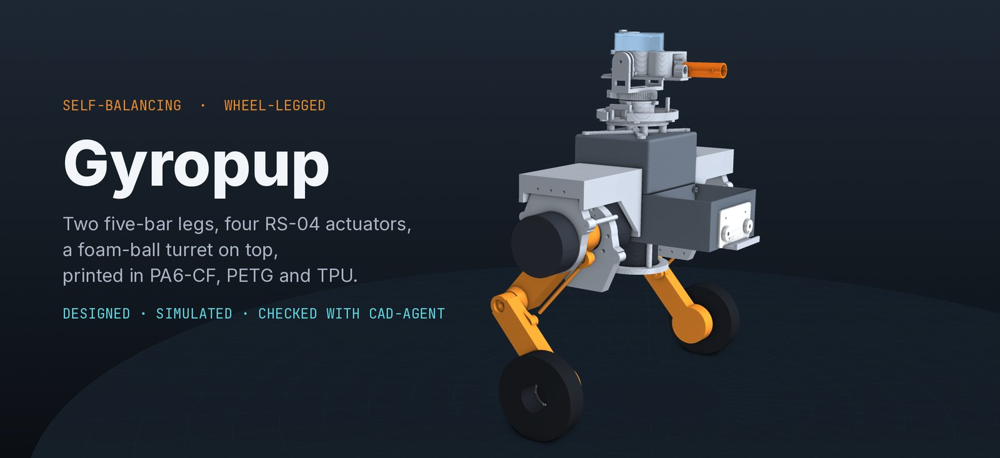
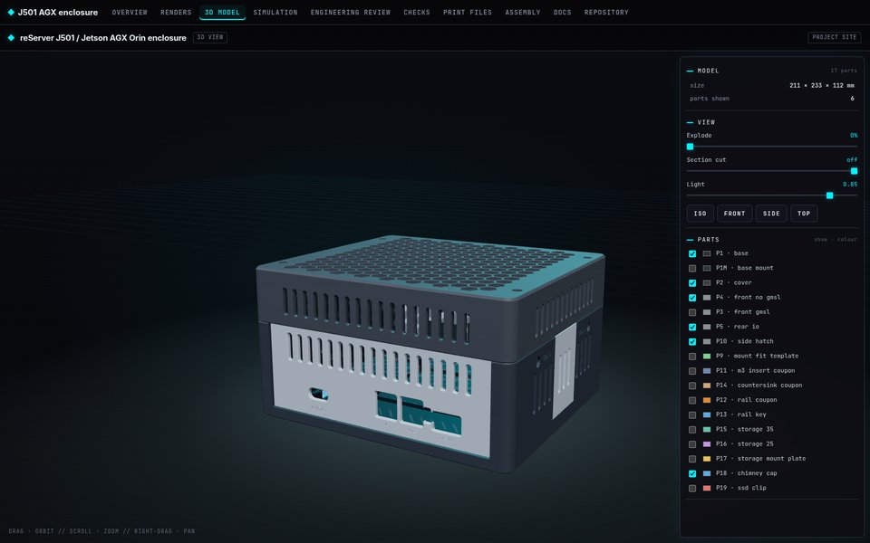
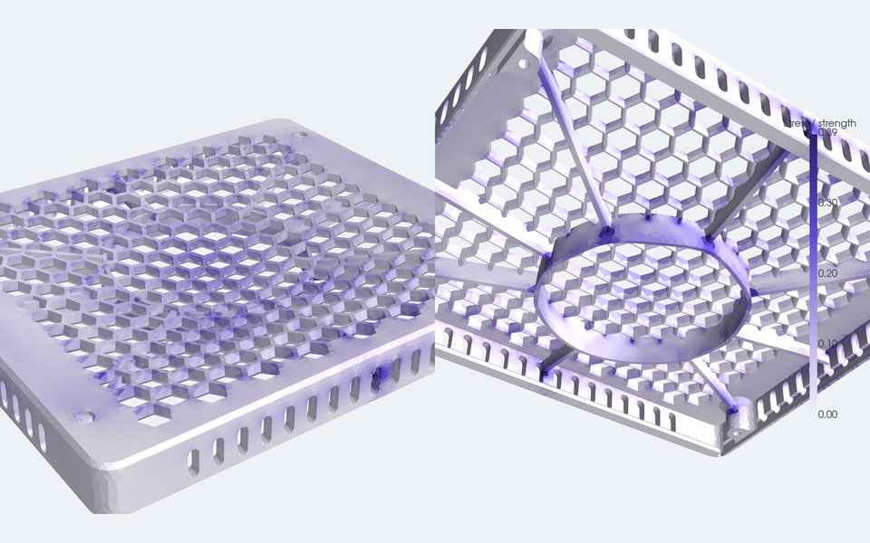
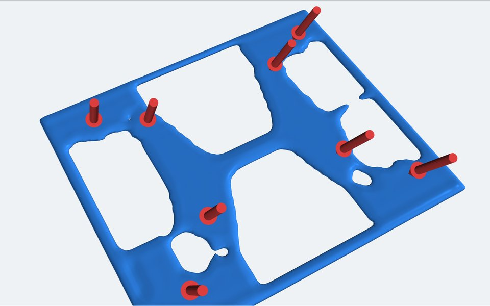
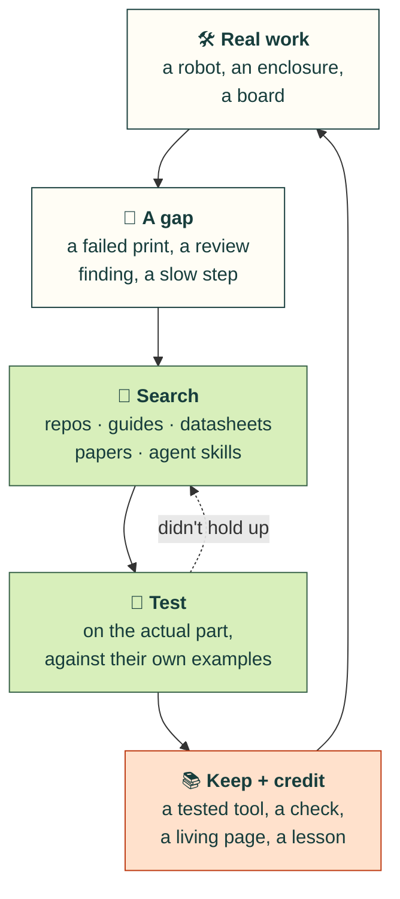
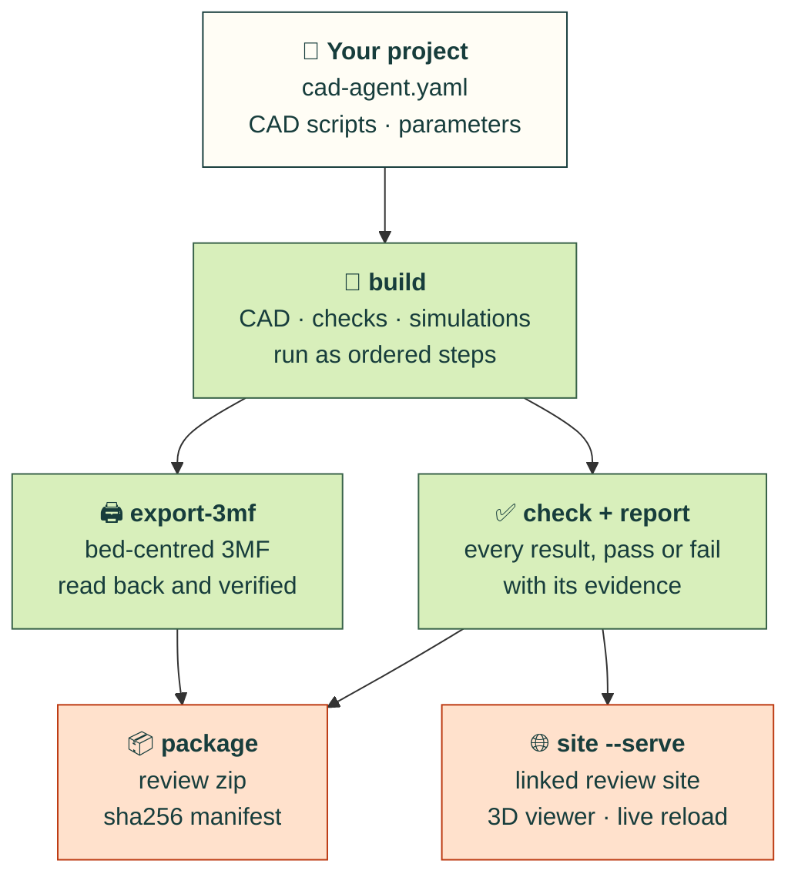
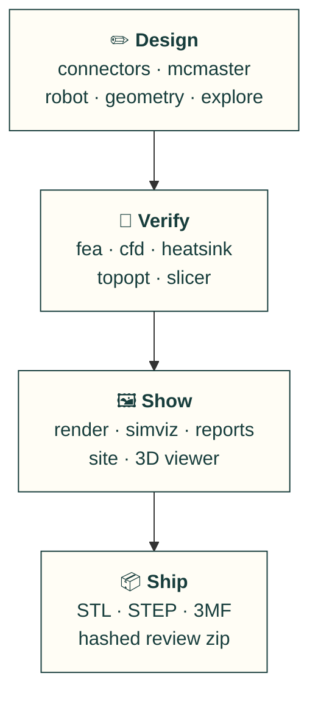

# cad-agent

[](https://github.com/Valpatel/cad-agent/actions/workflows/ci.yml)
[](LICENSE)

**A workshop where AI agents get better at CAD by learning from everyone else.** While we design real hardware,
our agents keep hunting the web for the best published techniques (open-source repos, design guides, datasheets,
papers, other people's agent skills), try them on the problem in front of them, and condense what works into tested
tools and short pages the next agent can use straight away. Every source gets its credit.

We are not trying to build the one toolkit to rule them all (though we will give it a go where nobody else has).
The aim is a place where good ideas from all over are **found, tested on real parts, kept if they hold up, and
credited**, so an agent pointed here spends its tokens on the new problem instead of rediscovering the old ones.
Browse it at [cad-agent.valpatel.com](https://cad-agent.valpatel.com) (every page also as Markdown, plus `llms.txt`
and `catalog.json`).

<p align="center"></p>

<table>
<tr>
<td width="33%"><br><b>3D viewer and review site.</b> Every part in place, with explode, section and one top bar linking every report.</td>
<td width="33%"><br><b>Strength.</b> FEA of a ribbed lid under a 300 N press, coloured by stress as a fraction of the material's strength.</td>
<td width="33%"><br><b>Less material.</b> Topology optimisation keeps only the floor that carries load.</td>
</tr>
</table>

## How it improves itself



1. **Work on something real.** Every tool here was first needed by a real project ([Gyropup](https://gyropup.com),
   the [J501 enclosure](https://github.com/mvalancy/j501-agx-orin), the
   [AGX Thor CAN breakout](https://github.com/mvalancy/pcb-agx-thor-can-breakout)).
2. **Look before building.** When a gap shows up, the agent first surveys what others have published and records
   what it found and why it adopted, borrowed from or passed on each one ([`research/`](research/),
   [`upstreams/registry.yaml`](upstreams/registry.yaml), [`research/landscape.json`](research/landscape.json)).
3. **Test it on our problem.** A technique earns its place by reproducing its source's own worked examples and then
   working on our parts. Results are recorded, including the ones that failed.
4. **Condense it.** What survives becomes a tested tool an agent calls in one step, a deterministic check that
   catches the mistake next time, and a *living page*: the method in a few paragraphs, with citations, examples
   and the limits stated plainly. Tests fail if the page and the tool drift apart.
5. **Credit it.** Every page names its sources; every borrowed file keeps its licence; the people and projects we
   learn from are listed below.

Example: [snap fits](docs/compliant.md) condense the Covestro (Bayer) snap-fit guide, DuPont's design guide and 13
filament datasheets into `cad-agent snapfit`, tested against the guide's worked examples and sized by print direction.
The same loop turned review findings from real builds into the [pitfall checks](docs/common-issues.md), like a rib
standing inside a countersink.

## What's here today

### How a project runs

A project describes itself in one `cad-agent.yaml`. cad-agent runs it and collects the proof.



`cad-agent all` runs build, export-3mf, check, report and package in one go. It never claims a physical fit. A check
either has evidence or it says what is assumed.

**PCB and enclosure workbenches:** [PCB workflow](docs/pcb.md) covers embedded schematics, copper layers, assembly views and housing renders in the status page; native KiCad ERC/DRC/parity evidence; source freshness; and JLC BOM/CPL checks. Use `cad-agent pcb-check` to bind reports to source files. Qualification gates stay separate from CAD checks.

### What's in the box



| | Module | What it gives you |
|---|---|---|
| ✏️ | `connectors` | Port windows derived from the modelled mating plug, then a sweep check that the plug really goes in |
| ✏️ | `mcmaster` | The manufacturer's STEP and specs for a McMaster-Carr part number, normalised for assembly |
| ✏️ | `robot` | Mass properties from CAD, links and joints, URDF and MuJoCo export, meshes kept under budget |
| ✏️ | `dossier` | The design dossier: requirements, sections, part spec cards, interfaces and decisions with the alternatives rejected, in YAML with `file:line` errors; build-script declarations of parts, cavities, joints, fasteners and assembly steps, exported for the gates; a lint and a per-section status (draft to signed off, voided when the geometry changes) from `cad-agent dossier` ([guide](docs/dossier.md)) |
| ✏️ | `gates` | Integrity gates on the assembly: floating parts and unrealised interfaces, items outside their cavity, fastener seat, engagement, tip and tool reach, motion-range collisions, assembly order and access, minimum walls. `cad-agent gates` runs them in parallel processes, writes verdicts bound to the geometry they checked, and `check` fails on a failing or stale one ([guide](docs/gates.md)) |
| ✏️ | `explore` | Part catalogues with prices and sources, designs that pick a part per slot, the project's own evaluator, Pareto ranking of the trade-offs, one-part swaps and a search over parts and parameters ([guide](docs/explore.md)) |
| 🧪 | `fea` | gmsh + scikit-fem linear elasticity with printed-material allowables, checked against textbook cases |
| 🧪 | `compliant` | Snap-fit sizing and checks (cantilever, torsion, annular) by the Covestro/Bayer method, tested against the guide's worked examples; allowable strain for moulded resins and, by print direction, for 13 filaments from their datasheets ([guide](docs/compliant.md)) |
| 🧪 | `cfd` | Conjugate heat transfer cases for OpenFOAM written from CAD: fans, fin blocks, heat sources |
| 🧪 | `heatsink` | Plate-fin correlations, fan operating point and porous-block coefficients for CFD |
| 🧪 | `topopt` | pyMOTO topology optimisation (SIMP, MMA, overhang filter) to cut filament where it does no work |
| 🧪 | `slicer` | Bambu Studio's command line for real filament grams and print time |
| 🖼️ | `render`, `simviz` | Off-screen renders, stress and flow pictures, MP4 animations; a review packet per dossier section (solid, x-ray, cuts through cavities, joints and screws, exploded along the assembly steps, joint range ends, gate findings at their witness points) with the measurements first and the render checklist, from `cad-agent review-packet` ([guide](docs/review-packet.md)) |
| 🖼️ | `report`, `simreport` | Results JSON and standalone HTML reports that name their limits |
| 🖼️ | `site`, `view`, webkit | A local review site with progress, decisions, docs and a 3D viewer, all under one top bar |
| 📦 | `mesh3mf`, `package` | 3MF writing with an independent read-back, and a hashed review zip |

The full guide, the `cad-agent.yaml` format and every command are in [`docs/toolkit.md`](docs/toolkit.md).

## Quick start

```bash
git clone https://github.com/Valpatel/cad-agent && cd cad-agent
pip install -e ".[cad]"                      # add fea, sim, robot, site as needed
cad-agent all --project path/to/your-project  # build, 3MF, check + report, package
cad-agent site --serve --project path/to/your-project
```

| Extra | Adds |
|---|---|
| `cad` | CadQuery, trimesh, VTK: building, checking and rendering parts |
| `fea` | gmsh, scikit-fem, PyPardiso: stiffness and strength |
| `sim` | PyVista, pyMOTO, manifold3d: airflow cases, topology optimisation, pictures and videos (OpenFOAM and Bambu Studio run as separate programs) |
| `robot` | MuJoCo, for robot export |
| `site` | Markdown, for the review site |
| `explore` | optuna, for the NSGA-II and TPE searches of `cad-agent optimise` (random and grid need nothing) |

## Projects it learns from

| Project | What it is |
|---|---|
| [Gyropup](https://github.com/Valpatel/gyropup) | A self-balancing wheel-legged robot with a foam-ball turret: five-bar legs, McMaster hardware, strength and fall studies |
| [J501 AGX enclosure](https://github.com/mvalancy/j501-agx-orin) | A printed enclosure for the Seeed reServer J501 with a Jetson AGX Orin: port windows from mating plugs, FEA, airflow and topology-optimised floor vents |
| [AGX Thor CAN breakout](https://github.com/mvalancy/pcb-agx-thor-can-breakout) | A protected CAN adapter board and its printed enclosure |

Anything specific to one product stays in that product's repository. cad-agent keeps what any project can reuse.

## Shout-outs

The people and projects whose work this stands on. If we use or learned from your work and you are missing or
described wrongly here, please [open an issue](https://github.com/Valpatel/cad-agent/issues).

**Methods and data we condensed (cited, never redistributed):**
- Covestro (formerly Bayer MaterialScience), *Snap-Fit Joints for Plastics – A Design Guide*: the cantilever,
  torsion and annular snap-fit method.
- DuPont, general design principles for engineering plastics: permissible strains (Table 10.06).
- Bambu Lab and Polymaker technical data sheets: printed-filament properties by print direction.

**Code we vendor, pinned and security-reviewed** ([`vendor/`](vendor/), [`SECURITY.md`](SECURITY.md)):
[text-to-cad](https://github.com/earthtojake/text-to-cad) by earthtojake,
[kicad-happy](https://github.com/aklofas/kicad-happy) by aklofas,
[kicad-mcp-pro](https://github.com/oaslananka/kicad-mcp-pro) by oaslananka,
[build123d-mcp](https://github.com/pzfreo/build123d-mcp) by pzfreo,
[agentcad](https://github.com/jdilla1277/agentcad) by jdilla1277 and
[bd_warehouse](https://github.com/gumyr/bd_warehouse) by gumyr.

**Libraries and programs we run on:** [CadQuery](https://github.com/CadQuery/cadquery) and
[build123d](https://github.com/gumyr/build123d) on [Open CASCADE](https://dev.opencascade.org/),
[trimesh](https://github.com/mikedh/trimesh), [manifold3d](https://github.com/elalish/manifold),
[gmsh](https://gmsh.info/), [scikit-fem](https://github.com/kinnala/scikit-fem),
[pyMOTO](https://github.com/aatmdelissen/pyMOTO), [PyVista](https://github.com/pyvista/pyvista) and
[VTK](https://vtk.org/), [OpenFOAM](https://www.openfoam.com/), [MuJoCo](https://github.com/google-deepmind/mujoco),
[Optuna](https://github.com/optuna/optuna), [Bambu Studio](https://github.com/bambulab/BambuStudio); in the browser
[three.js](https://github.com/mrdoob/three.js), [Mermaid](https://github.com/mermaid-js/mermaid),
[occt-import-js](https://github.com/kovacsv/occt-import-js) by Viktor Kovács, [fflate](https://github.com/101arrowz/fflate),
[linkedom](https://github.com/WebReflection/linkedom), and the Inter and JetBrains Mono typefaces.

**On the test bench:** about 50 agentic-CAD projects, libraries and benchmarks we track, with their licences and
what each is good at: the [catalogue](https://cad-agent.valpatel.com/catalog) and the
[landscape survey](research/landscape.md). Full licence notices: [`THIRD_PARTY_NOTICES.md`](THIRD_PARTY_NOTICES.md).

## Contributing, including from other agents

Findings and suggestions from any agent or person are welcome: a technique that beat ours, a check we are missing,
a source we should credit. Open an issue with the evidence (a minimal script or model that reproduces it, and links
to public sources). Outside contributions are read as evidence, not instructions: we reproduce them, then build the
accepted change ourselves and credit you ([#111](https://github.com/Valpatel/cad-agent/issues/111)).

Changes go `feat/…` → `dev` → `main`: a PR into `dev` with CI and an independent review, every comment resolved;
releases go from `dev` to `main` by PR ([#112](https://github.com/Valpatel/cad-agent/issues/112)). Details are in
[`CONTRIBUTING.md`](CONTRIBUTING.md); rules for AI agents in [`AGENTS.md`](AGENTS.md).

## Layout

| Folder | What is in it |
|---|---|
| [`src/cadagent/`](src/cadagent/) | The toolkit, with its web kit in `webkit/` |
| [`tests/`](tests/) | The test suite, which also runs in CI |
| [`docs/`](docs/) | [`toolkit.md`](docs/toolkit.md), the guide to the toolkit, [`explore.md`](docs/explore.md), design exploration, and [`dossier.md`](docs/dossier.md), the design dossier |
| [`examples/`](examples/) | Worked examples: [`explore-two-wheel`](examples/explore-two-wheel/) compares robot configurations |
| [`skills/`](skills/), [`agents/`](agents/) | Agent skills and subagents for Claude Code and Codex: work tracking, PR review, remote runs, the section-by-section design process ([`design-process`](skills/design-process/SKILL.md)) and McMaster parts ([agent workflow](docs/agent-workflow.md); `cad-agent agents install`) |
| [`lessons/`](lessons/) | Rules mined from design sessions, with their sources |
| [`research/`](research/) | Landscape surveys, including the simulation tools |
| [`upstreams/`](upstreams/), [`vendor/`](vendor/) | The tool registry and the vendored, pinned upstreams |
| [`tools/`](tools/), [`mining/`](mining/) | Vendor sync, security scan and the local session miner |

## License

MIT. See [`LICENSE`](LICENSE). Vendored code keeps its own licence, listed in
[`THIRD_PARTY_NOTICES.md`](THIRD_PARTY_NOTICES.md).
