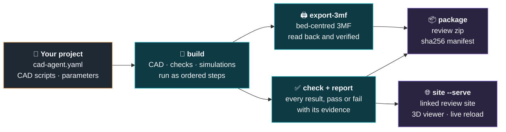
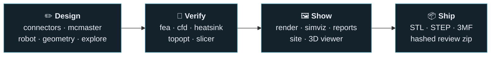
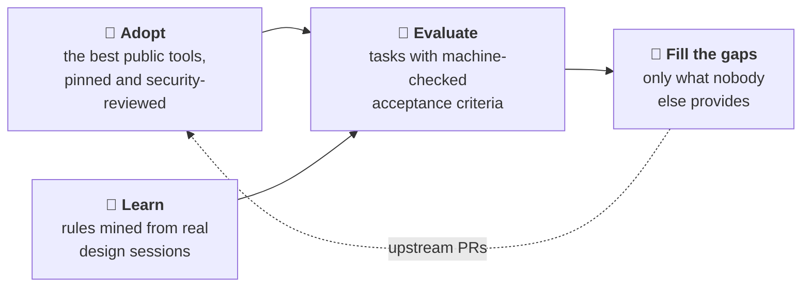
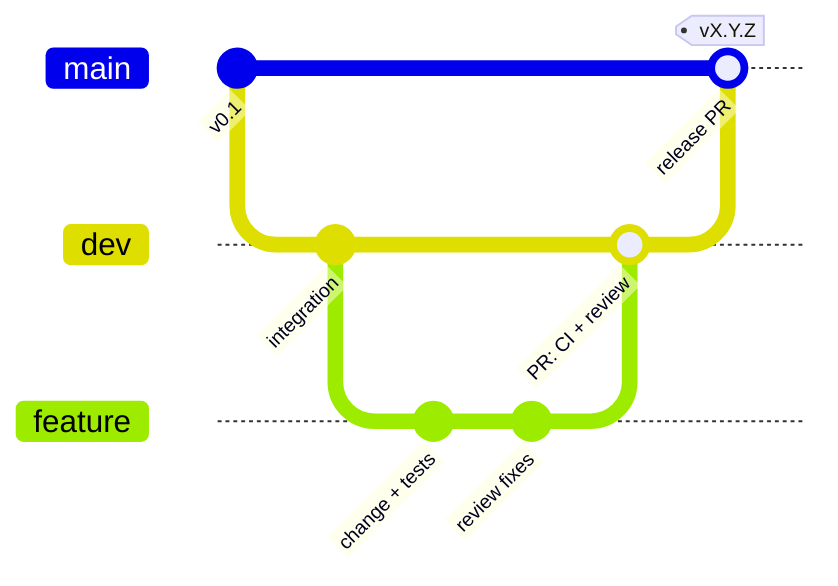

# cad-agent

[](https://github.com/Valpatel/cad-agent/actions/workflows/ci.yml)
[](LICENSE)

**Hardware design with AI agents, checked like engineering.** cad-agent turns a folder of CAD scripts into a
repeatable pipeline: build the parts, check the fit, simulate strength and airflow, and publish the evidence as
print files, reports and a linked review site. It works with Claude Code first, plus Codex, Cursor and Gemini.

<p align="center"></p>

<table>
<tr>
<td width="33%"><br><b>3D viewer and review site.</b> Every part in place, with explode, section and one top bar linking every report.</td>
<td width="33%"><br><b>Strength.</b> FEA of a ribbed lid under a 300 N press, coloured by stress as a fraction of the material's strength.</td>
<td width="33%"><br><b>Less material.</b> Topology optimisation keeps only the floor that carries load.</td>
</tr>
</table>

## How it works

A project describes itself in one `cad-agent.yaml`. cad-agent runs it and collects the proof.



`cad-agent all` runs build, export-3mf, check, report and package in one go. It never claims a physical fit. A check
either has evidence or it says what is assumed.

**PCB and enclosure workbenches:** [PCB workflow](docs/pcb.md) covers embedded schematics, copper layers, assembly views and housing renders in the status page; native KiCad ERC/DRC/parity evidence; source freshness; and JLC BOM/CPL checks. Use `cad-agent pcb-check` to bind reports to source files. Qualification gates stay separate from CAD checks.

## What's in the box



| | Module | What it gives you |
|---|---|---|
| ✏️ | `connectors` | Port windows derived from the modelled mating plug, then a sweep check that the plug really goes in |
| ✏️ | `mcmaster` | The manufacturer's STEP and specs for a McMaster-Carr part number, normalised for assembly |
| ✏️ | `robot` | Mass properties from CAD, links and joints, URDF and MuJoCo export, meshes kept under budget |
| ✏️ | `dossier` | The design dossier: requirements, sections, part spec cards, interfaces and decisions with the alternatives rejected, in YAML with `file:line` errors; build-script declarations of parts, cavities, joints, fasteners and assembly steps, exported for the gates ([guide](docs/dossier.md)) |
| ✏️ | `explore` | Part catalogues with prices and sources, designs that pick a part per slot, the project's own evaluator, Pareto ranking of the trade-offs, one-part swaps and a search over parts and parameters ([guide](docs/explore.md)) |
| 🧪 | `fea` | gmsh + scikit-fem linear elasticity with printed-material allowables, checked against textbook cases |
| 🧪 | `cfd` | Conjugate heat transfer cases for OpenFOAM written from CAD: fans, fin blocks, heat sources |
| 🧪 | `heatsink` | Plate-fin correlations, fan operating point and porous-block coefficients for CFD |
| 🧪 | `topopt` | pyMOTO topology optimisation (SIMP, MMA, overhang filter) to cut filament where it does no work |
| 🧪 | `slicer` | Bambu Studio's command line for real filament grams and print time |
| 🖼️ | `render`, `simviz` | Off-screen renders, stress and flow pictures, MP4 animations |
| 🖼️ | `report`, `simreport` | Results JSON and standalone HTML reports that name their limits |
| 🖼️ | `site`, `view`, webkit | A local review site with progress, decisions, docs and a 3D viewer, all under one top bar |
| 📦 | `mesh3mf`, `package` | 3MF writing with an independent read-back, and a hashed review zip |

The full guide, the `cad-agent.yaml` format and every command are in [`docs/toolkit.md`](docs/toolkit.md).

## Quick start

```bash
git clone https://github.com/Valpatel/cad-agent && cd cad-agent
pip install -e ".[cad]"                      # add fea, sim, robot, site as needed
cad-agent all --project path/to/your-project  # build, 3MF, check + report, package
cad-agent site --serve --project path/to/your-project
```

| Extra | Adds |
|---|---|
| `cad` | CadQuery, trimesh, VTK: building, checking and rendering parts |
| `fea` | gmsh, scikit-fem, PyPardiso: stiffness and strength |
| `sim` | PyVista, pyMOTO, manifold3d: airflow cases, topology optimisation, pictures and videos (OpenFOAM and Bambu Studio run as separate programs) |
| `robot` | MuJoCo, for robot export |
| `site` | Markdown, for the review site |
| `explore` | optuna, for the NSGA-II and TPE searches of `cad-agent optimise` (random and grid need nothing) |

## Built with cad-agent

| Project | What it is |
|---|---|
| [J501 AGX enclosure](https://github.com/mvalancy/j501-agx-orin) | A printed enclosure for the Seeed reServer J501 with a Jetson AGX Orin: port windows from mating plugs, FEA, airflow and topology-optimised floor vents |
| [Gyropup](https://github.com/Valpatel/gyropup) | A self-balancing wheel-legged robot with a foam-ball turret: five-bar legs, McMaster hardware, strength and fall studies |
| AGX Thor CAN boards | PCB and enclosure reviews |

Anything specific to one product stays in that product's repository. cad-agent only holds what every project can use.

## How cad-agent grows



- **Adopt.** Six upstreams are vendored under `vendor/`, pinned by commit, scanned and updated weekly through a
  reviewed process ([`SECURITY.md`](SECURITY.md), [`WEEKLY-UPDATE.md`](WEEKLY-UPDATE.md)): text-to-cad,
  kicad-happy and kicad-mcp-pro (MIT), and build123d-mcp, agentcad and bd_warehouse (Apache-2.0). OpenFOAM (GPL)
  and Bambu Studio (AGPL) run only as separate programs. gmsh (GPL) is imported, but only by the optional `fea`
  extra. Licences are in [`THIRD_PARTY_NOTICES.md`](THIRD_PARTY_NOTICES.md).
- **Learn.** [`lessons/`](lessons/) holds eleven sets of rules mined from real design sessions, each citing its source.
  They cover verifying from source, connectors, fasteners, evidence, simulation and material.
- **Evaluate, then fill the gaps.** Each tool is scored on the same tasks. What wins gets adopted, the gaps go
  upstream, and only what nobody else provides lives here.

## Contributing

Several projects and AI agents use cad-agent at once, so every change goes through a pull request.



1. Work in your own worktree on `feat/<topic>`, branched from `dev`.
2. Open a PR into `dev`. CI runs `core` on Python 3.10 and 3.12, and `full` with every extra.
3. A person or a separate review agent reviews it. Every comment is answered and resolved before the merge.
4. Releases go from `dev` to `main` by PR. Both branches are protected.

Details are in [`CONTRIBUTING.md`](CONTRIBUTING.md). Rules for AI agents are in [`AGENTS.md`](AGENTS.md).

## Layout

| Folder | What is in it |
|---|---|
| [`src/cadagent/`](src/cadagent/) | The toolkit, with its web kit in `webkit/` |
| [`tests/`](tests/) | The test suite, which also runs in CI |
| [`docs/`](docs/) | [`toolkit.md`](docs/toolkit.md), the guide to the toolkit, [`explore.md`](docs/explore.md), design exploration, and [`dossier.md`](docs/dossier.md), the design dossier |
| [`examples/`](examples/) | Worked examples: [`explore-two-wheel`](examples/explore-two-wheel/) compares robot configurations |
| [`skills/`](skills/) | Agent skills that fill gaps, such as McMaster parts |
| [`lessons/`](lessons/) | Rules mined from design sessions, with their sources |
| [`research/`](research/) | Landscape surveys, including the simulation tools |
| [`upstreams/`](upstreams/), [`vendor/`](vendor/) | The tool registry and the vendored, pinned upstreams |
| [`tools/`](tools/), [`mining/`](mining/) | Vendor sync, security scan and the local session miner |

## License

MIT. See [`LICENSE`](LICENSE). Vendored code keeps its own licence, listed in
[`THIRD_PARTY_NOTICES.md`](THIRD_PARTY_NOTICES.md).
