<div align="center">

<picture>
  <source media="(prefers-reduced-motion: reduce)" srcset="docs/img/hero/repository-map-still.svg">
  
</picture>

# <a href="docs/practice/share-badge.md"><picture><source media="(prefers-reduced-motion: reduce)" srcset="docs/img/hero/made-with-cad-agent-still.svg"></picture></a>

[](https://github.com/Valpatel/cad-agent/actions/workflows/ci.yml)
[](https://github.com/Valpatel/cad-agent/actions/workflows/webkit.yml)
[](https://github.com/Valpatel/cad-agent/actions/workflows/supply-chain.yml?query=branch%3Adev)
[](https://github.com/Valpatel/cad-agent/actions/workflows/release.yml)
[](https://github.com/Valpatel/cad-agent/releases)
[](docs/practice/agent-workflow.md#extras)
[](docs/README.md)
[](https://cad-agent.valpatel.com/catalog)
[](.agents/skills/README.md)
[](.github/CONTRIBUTING.md)
[](LICENSE)

</div>

## What is it?

An open-source toolkit that helps your AI assistant design physical things: find a method, build a model, check
its assumptions and keep the evidence for review.

Start with the [guides](docs/README.md), or explore the [visual catalogue](https://cad-agent.valpatel.com/catalog).

<a id="find-your-next-step"></a>
<a id="how-it-improves-itself"></a>

## Why this is cool

Real projects expose gaps. We study good sources, reproduce examples, test what survives and turn the lesson into
a reusable [skill](.agents/skills/README.md) or [technique](docs/research/README.md).

Virtual checks and real measurements keep separate evidence. CAD and simulation do not prove physical fit or durability.

<div id="what-works-today">



<sub>Recorded <a href="https://github.com/Valpatel/gyropup">Gyropup</a> CAD example (MIT), source <code>77f6d00b</code>.
Made by <a href="tools/readme_anim.py"><code>tools/readme_anim.py</code></a>.
<a href="docs/practice/animated-figures.md">Sources, limits and regeneration</a>; not the latest design or a physical qualification.</sub>

</div>

[What works and its limits](docs/toolkit.md) · [Code and tests](software/cadagent/README.md) · [Lessons](docs/lessons/README.md)

<a id="build-with-your-favorite-ai-agent"></a>
<a id="contribute"></a>

## How to join in

Install on macOS or Linux:

```bash
curl -fsSL https://cad-agent.valpatel.com/install.sh | sh
```

[Windows, agent setup and uninstall](docs/practice/agent-workflow.md#install) · [Ask your assistant](docs/practice/agent-workflow.md#ask-your-assistant)

Bring a small design, a useful source or a reproducible failure. [Contributing](.github/CONTRIBUTING.md) explains
independent review and how to help. cad-agent collects no telemetry; your agent submits findings only if you say yes.

### Show our badge

Built something with cad-agent? [Add our badge](docs/practice/share-badge.md) to your project.

<a id="extras"></a>

[Optional dependencies](docs/practice/agent-workflow.md#extras) · [Vision](docs/vision.md) · [Credits](software/vendor/THIRD_PARTY_NOTICES.md) · [Security](.github/SECURITY.md)
