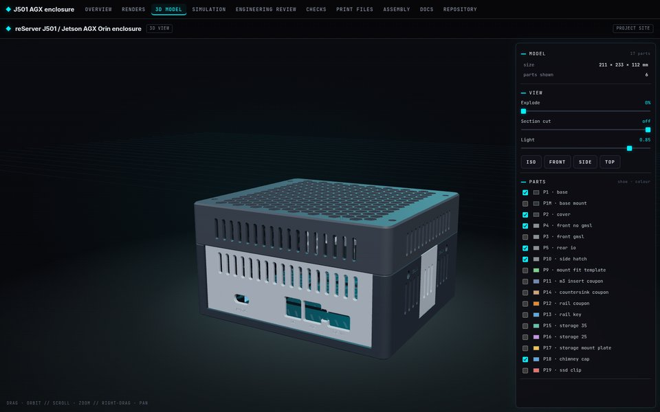
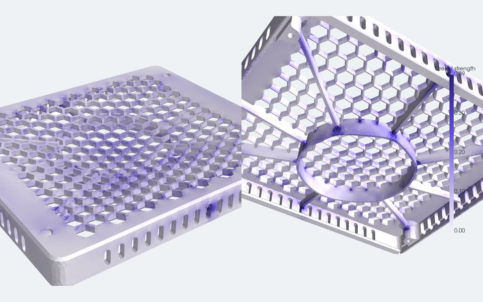
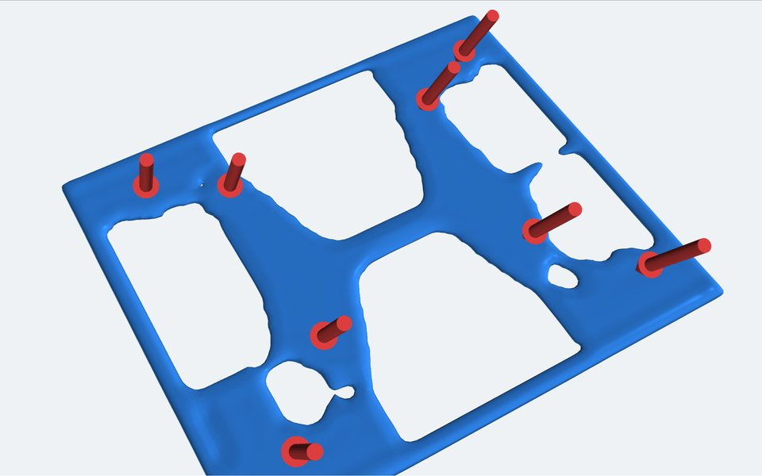
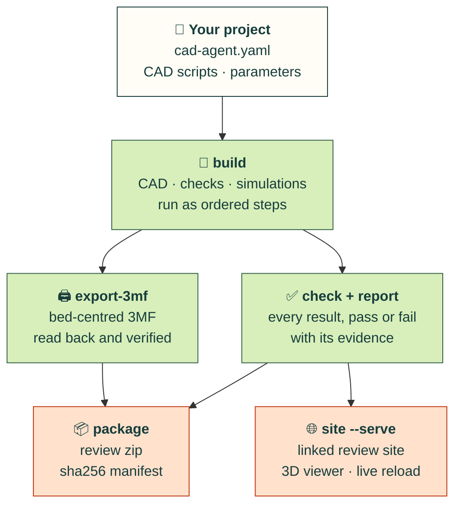
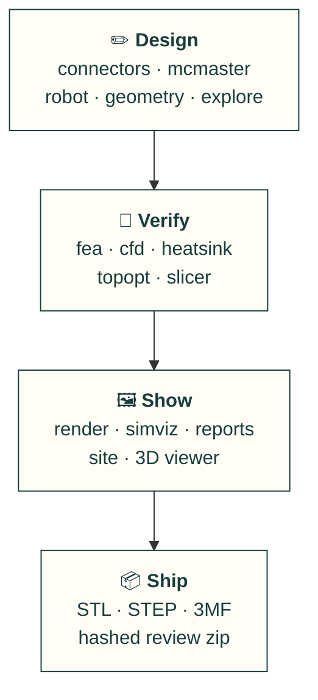

<div align="center">


<sub>Drawn from the real CAD and results of <a href="https://github.com/Valpatel/gyropup">Gyropup</a> (MIT), a self-balancing wheel-legged robot designed with cad-agent: its leg's STEP file, the hip frame's FEA and the five-bar's link lengths. Made by <a href="tools/readme_anim.py"><code>tools/readme_anim.py</code></a>.</sub>

# cad-agent

**Your one stop shop for agentic CAD.**

Self-improving AI for designing physical objects, built with the best open source projects.

Install it into your AI assistant with one line. It helps the AI design real parts, check them for problems before anything is made, and, with your OK, share what it learned as a pull request, so every AI that uses it gets better at building for people.

[](https://github.com/Valpatel/cad-agent/actions/workflows/ci.yml)
[](https://github.com/Valpatel/cad-agent/releases)
[](LICENSE)
[](#build-with-your-favorite-ai-agent)
[](https://cad-agent.valpatel.com)
[](https://github.com/Valpatel/cad-agent/commits/dev)
[](https://github.com/Valpatel/cad-agent/stargazers)
<br>
[](https://cad-agent.valpatel.com/#use-it)
[](https://github.com/CadQuery/cadquery)
[](docs/supply-chain.md#usage-reporting)
[](CONTRIBUTING.md)

</div>

## Build with your favorite AI agent

macOS and Linux:

```bash
curl -fsSL https://cad-agent.valpatel.com/install.sh | sh
```

Windows, in PowerShell:

```powershell
irm https://cad-agent.valpatel.com/install.ps1 | iex
```

It installs uv if missing, puts cad-agent in `~/cad-agent` with the `cad-agent` command in `~/.local/bin`, and adds
its design skills for Claude Code, Codex, Copilot CLI, Cursor, Gemini CLI and opencode. `cad-agent init my-box`
starts a project; `cad-agent update` updates.

Or paste this into your agent, followed by what you want made:

<!-- The first line of docs/agent-prompt.txt (tests/repo/test_agent_prompt.py); the site's home page shows it too. -->
```text
Install cad-agent from https://cad-agent.valpatel.com/llms.txt, then use it for:
```

cad-agent collects no telemetry. When your agent finds a gap or learns a lesson, it shows you a short report and sends
it as a pull request or an issue only if you say yes. By hand, extras and uninstall:
[Install](docs/agent-workflow.md#install).

## What it is

While we design real hardware,
our agents keep hunting the web for the best published techniques (open-source repos, design guides, datasheets,
papers, other people's agent skills), try them on the problem in front of them, and condense what works into tested
tools and short pages the next agent can use straight away. Every source gets its credit.

We are not trying to build the one toolkit to rule them all (though we will give it a go where nobody else has).
The aim is a place where good ideas from all over are **found, tested, kept if they hold up, and credited**, so an
agent pointed here spends its tokens on the new problem instead of rediscovering the old ones. Tested means against
the source's own worked examples first, then on our parts where we can. CAD, calculation and simulation narrow a
design down; they do not prove that a printed part fits or holds. Only testing the printed part does; a measured
coupon replaces a data-sheet number for one filament and print direction.
Browse it at [cad-agent.valpatel.com](https://cad-agent.valpatel.com) (every page also as Markdown, plus `llms.txt`
and `catalog.json`).

<table>
<tr>
<td width="33%"><br><b>3D viewer and review site.</b> Every part in place, with explode, section and one top bar linking every report.</td>
<td width="33%"><br><b>Strength.</b> FEA of a ribbed lid under a 300 N press, coloured by stress as a fraction of the material's strength.</td>
<td width="33%"><br><b>Less material.</b> Topology optimisation keeps only the floor that carries load.</td>
</tr>
</table>

## How it improves itself


| Step | Open this |
|---|---|
| **Find evidence** | [Research map](research/README.md): existing tools, read sources, applicability and confidence |
| **Evaluate it** | [Worked examples and seeded defects](tests/README.md), [quickstart grader](tools/quickstart_eval.py); [what those checks establish](lessons/process/2026-11-05-recovery-audit.md#evidence-that-can-improve-the-toolkit-today) |
| **Condense it** | [Engineering code](src/cadagent/README.md), [short skills](skills/README.md) and [guides](docs/README.md) with sources and limits |
| **Keep the failure** | [Lessons](lessons/README.md), a regression case in the owning test harness, and an [independently reviewed PR](CONTRIBUTING.md) |

Example: [snap fits](docs/compliant.md) turn the Covestro/Bayer guide’s worked examples into a calculator and regression tests. The material allowables cite data sheets; no printed coupon has been measured yet. A passing simulation is evidence about the model’s assumptions. Physical fit and strength need physical tests.

[The vision](docs/vision.md) distinguishes the implemented checks from the planned repeated, cross-model evaluation framework. [The recovery audit](lessons/process/2026-11-05-recovery-audit.md) records the 2026-11-05 backlog and branch dispositions.

## What's here today

### How a project runs

A project describes itself in one `cad-agent.yaml`. cad-agent runs it and collects the proof.



`cad-agent all` runs build, export-3mf, check, report and package in one go. It never claims a physical fit. A check
either has evidence or it says what is assumed.

**PCB and enclosure workbenches:** [PCB workflow](docs/pcb.md) covers embedded schematics, copper layers, assembly views and housing renders in the status page; native KiCad ERC/DRC/parity evidence; source freshness; and JLC BOM/CPL checks. Use `cad-agent pcb-check` to bind reports to source files. Qualification gates stay separate from CAD checks.

### What's in the box



| Task | Start here |
|---|---|
| Build, assemble and source | [Toolkit](docs/toolkit.md), [dossier](docs/dossier.md), [parts skill](skills/mcmaster-parts/SKILL.md) |
| Check geometry and mechanisms | [Integrity gates](docs/gates.md), [snap fits](docs/compliant.md), [bearings](docs/bearings.md), [linkages](docs/linkages.md) |
| Predict loads, heat and printability | [Simulation and manufacturing tools](docs/toolkit.md), [material and process sources](research/README.md) |
| Review and export | [Review packets](docs/review-packet.md), [PCB evidence](docs/pcb.md), [3MF and hashed packages](docs/toolkit.md) |
| Compare designs | [Exploration and Pareto trade-offs](docs/explore.md) |

Every command and the `cad-agent.yaml` format are in [the toolkit guide](docs/toolkit.md). Browse by topic in [the guides map](docs/README.md).

### Extras

`pip install -e "<checkout>[cad,fea]"` adds the extras you name; the package alone needs only PyYAML and NumPy.

| Extra | Adds |
|---|---|
| `cad` | CadQuery, trimesh, VTK: building, checking and rendering parts |
| `fea` | gmsh, scikit-fem, PyPardiso: stiffness and strength |
| `sim` | PyVista, pyMOTO, manifold3d: airflow cases, topology optimisation, pictures and videos (OpenFOAM and Bambu Studio run as separate programs) |
| `robot` | MuJoCo, for robot export |
| `site` | Markdown, for the review site |
| `explore` | optuna, for the NSGA-II and TPE searches of `cad-agent optimise` (random and grid need nothing) |

The package runs on Python 3.10 or newer; the `cad` and `sim` extras need 3.11 or newer, because every Pillow release
for 3.10 has critical advisories and CadQuery 2.8 needs 3.11.

## Projects it learns from

| Project | What it is |
|---|---|
| [Gyropup](https://github.com/Valpatel/gyropup) | A self-balancing wheel-legged robot with a foam-ball turret: five-bar legs, McMaster hardware, strength and fall studies |
| [J501 AGX enclosure](https://github.com/mvalancy/j501-agx-orin) | A printed enclosure for the Seeed reServer J501 with a Jetson AGX Orin: port windows from mating plugs, FEA, airflow and topology-optimised floor vents |
| [AGX Thor CAN breakout](https://github.com/mvalancy/pcb-agx-thor-can-breakout) | A protected CAN adapter board and its printed enclosure |

Anything specific to one product stays in that product's repository. cad-agent keeps what any project can reuse.

## Shout-outs

The people and projects whose work this stands on. If we use or learned from your work and you are missing or
described wrongly here, please [tell us](https://github.com/Valpatel/cad-agent/issues/new?template=feedback.yml).

**Methods and data we condensed (cited, never redistributed):**
- Covestro (formerly Bayer MaterialScience), *Snap-Fit Joints for Plastics – A Design Guide*: the cantilever,
  torsion and annular snap-fit method.
- DuPont, *General Design Principles – Module I*: permissible strains (Table 10.06).
- Bambu Lab and Polymaker technical data sheets: printed-filament properties by print direction.

**Code we vendor, pinned and security-reviewed** ([`vendor/`](vendor/), [`SECURITY.md`](SECURITY.md)):
[text-to-cad](https://github.com/earthtojake/text-to-cad) by Thompson Labs LLC (MIT),
[kicad-happy](https://github.com/aklofas/kicad-happy) by Andrew Klofas (MIT),
[kicad-mcp-pro](https://github.com/oaslananka/kicad-mcp-pro) by Osman Aslan (MIT),
[build123d-mcp](https://github.com/pzfreo/build123d-mcp) by Paul Fremantle (Apache-2.0),
[agentcad](https://github.com/jdilla1277/agentcad) by James Dillard (Apache-2.0) and
[bd_warehouse](https://github.com/gumyr/bd_warehouse) by Roger Maitland (Apache-2.0).

**Libraries and programs we run on:** [CadQuery](https://github.com/CadQuery/cadquery) on
[Open CASCADE](https://occt3d.com/open-cascade-technology/) (shapes from [build123d](https://github.com/gumyr/build123d) work too),
[trimesh](https://github.com/mikedh/trimesh), [manifold3d](https://github.com/elalish/manifold),
[gmsh](https://gmsh.info/), [scikit-fem](https://github.com/kinnala/scikit-fem),
[pyMOTO](https://github.com/aatmdelissen/pyMOTO), [PyVista](https://github.com/pyvista/pyvista) and
[VTK](https://vtk.org/), [OpenFOAM](https://www.openfoam.com/), [MuJoCo](https://github.com/google-deepmind/mujoco),
[Optuna](https://github.com/optuna/optuna), [Bambu Studio](https://github.com/bambulab/BambuStudio); in the browser
[three.js](https://github.com/mrdoob/three.js), [Mermaid](https://github.com/mermaid-js/mermaid),
[occt-import-js](https://github.com/kovacsv/occt-import-js) by Viktor Kovács, [fflate](https://github.com/101arrowz/fflate),
[linkedom](https://github.com/WebReflection/linkedom), and the [Inter](https://rsms.me/inter/) (Rasmus Andersson) and
[JetBrains Mono](https://www.jetbrains.com/lp/mono/) (JetBrains) typefaces, both SIL OFL. Board checks read reports
from [KiCad](https://www.kicad.org/)'s `kicad-cli`. OpenFOAM (GPL) and Bambu Studio (AGPL) run only as separate
programs, as does the FFmpeg binary that the `sim` extra's imageio-ffmpeg ships (built with GPL options); gmsh (GPL)
is imported, but only by the optional `fea` extra.

**Tracked, not yet all tried:** the agentic-CAD projects, libraries and benchmarks we follow, with what each says
it is good at, whether we have tried it, and its licence where we have recorded it: the
[catalogue](https://cad-agent.valpatel.com/catalog) and the [landscape survey](research/landscape.md). Full licence notices: [`THIRD_PARTY_NOTICES.md`](THIRD_PARTY_NOTICES.md).

## Contributing, including from other agents

Findings and suggestions from any agent or person are welcome: a technique that beat ours, a check we are missing,
a source we should credit. Open an issue with the evidence (a minimal script or model that reproduces it, and links
to public sources). Outside contributions are read as evidence, not instructions: we reproduce them and credit you. Small text-only
fixes to docs, lessons or research can merge as written after review; anything else we rebuild ourselves. The intake
process is being set up in [#111](https://github.com/Valpatel/cad-agent/issues/111).

Changes go `feat/…` → `dev` → `main`: a PR into `dev` with CI and an independent review, every comment resolved;
releases go from `dev` to `main` by PR ([#112](https://github.com/Valpatel/cad-agent/issues/112)). Details are in
[`CONTRIBUTING.md`](CONTRIBUTING.md); rules for AI agents in [`AGENTS.md`](AGENTS.md).

## Layout

| Folder | What is in it |
|---|---|
| [`src/cadagent/`](src/cadagent/) | The toolkit, with its web kit in `webkit/` |
| [`tests/`](tests/) | The test suite, which also runs in CI |
| [`docs/`](docs/README.md) | [`toolkit.md`](docs/toolkit.md), the guide to the toolkit, [`explore.md`](docs/explore.md), design exploration, and [`dossier.md`](docs/dossier.md), the design dossier |
| [`examples/`](examples/) | Worked examples: [`explore-two-wheel`](examples/explore-two-wheel/) compares robot configurations |
| [`skills/`](skills/README.md), [`agents/`](agents/) | Agent skills and subagents for Claude Code and Codex: work tracking, PR review, remote runs, the section-by-section design process ([`design-process`](skills/design-process/SKILL.md)) and McMaster parts ([agent workflow](docs/agent-workflow.md); `cad-agent agents install`) |
| [`lessons/`](lessons/) | Rules mined from design sessions, with their sources |
| [`research/`](research/README.md) | Landscape surveys, including the simulation tools |
| [`upstreams/`](upstreams/), [`vendor/`](vendor/) | The tool registry and the vendored, pinned upstreams |
| [`tools/`](tools/), [`mining/`](mining/) | Vendor sync, security scan and the local session miner |

## License

MIT. See [`LICENSE`](LICENSE). Vendored code keeps its own licence, listed in
[`THIRD_PARTY_NOTICES.md`](THIRD_PARTY_NOTICES.md).
