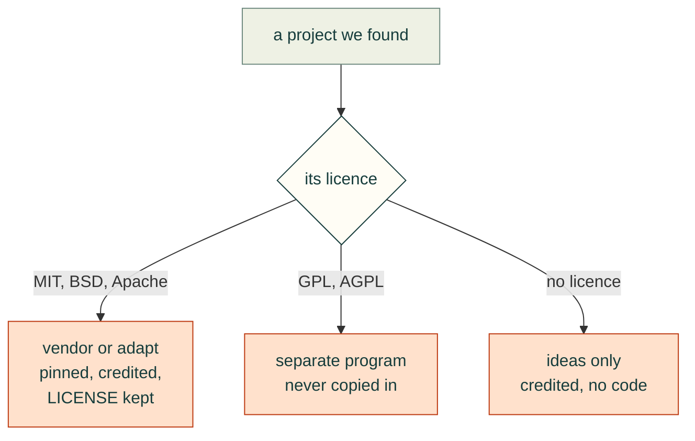

# Third-party notices

Code under `vendor/` is copied from the projects below at the pinned commit. Each directory keeps its
upstream LICENSE/NOTICE files; those terms apply to that code. Our changes are listed as patches in `vendor/patches/`.

| Project | Licence | Upstream | Pinned commit | Imported |
|---|---|---|---|---|
| text-to-cad | MIT | https://github.com/earthtojake/text-to-cad | `2f793659fb7b` | 2026-10-24 |
| kicad-happy | MIT | https://github.com/aklofas/kicad-happy | `2fd9aa0fe2d6` | 2026-10-24 |
| kicad-mcp-pro | MIT | https://github.com/oaslananka/kicad-mcp-pro | `f03b478f597d` | 2026-10-24 |
| build123d-mcp | Apache-2.0 | https://github.com/pzfreo/build123d-mcp | `59b256121886` | 2026-10-24 |
| agentcad | Apache-2.0 | https://github.com/jdilla1277/agentcad | `52af472ddade` | 2026-10-24 |
| bd_warehouse | Apache-2.0 | https://github.com/gumyr/bd_warehouse | `e6ae6e7bae74` | 2026-10-24 |

## Runtime dependencies and external programs (not vendored)

The simulation modules use these at run time. None of their code is copied into this repository.

| Project | Licence | How cad-agent uses it |
|---|---|---|
| OpenFOAM v2512 (OpenCFD) | GPL-3.0 | External program (`cadagent.cfd` writes a case and runs it natively or in the `opencfd/openfoam-default` Docker image) |
| Bambu Studio | AGPL-3.0 | External program (`cadagent.slicer` runs its command line; profiles are read, flattened and passed back as files) |
| gmsh | GPL-2.0-or-later | Imported by the optional `fea` extra. Our source stays MIT; distributing a bundle that includes gmsh falls under the GPL |
| scikit-fem | BSD-3-Clause | Imported (`fea`) |
| pyMOTO | MIT | Imported (`sim`, topology optimisation) |
| PyVista, VTK | MIT, BSD-3-Clause | Imported (`sim`, pictures and animations) |
| trimesh, manifold3d, Rtree | MIT, Apache-2.0, MIT | Imported (`sim`, mesh booleans and point-in-solid tests) |
| imageio, imageio-ffmpeg (FFmpeg) | BSD-2-Clause (FFmpeg LGPL/GPL binary, run as a process) | Imported (`sim`, MP4 writing) |
