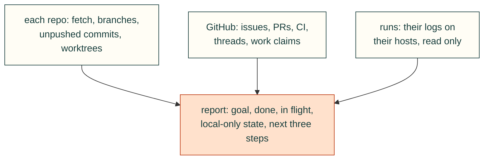

You pick up work that another session started. Follow the "Resuming" part of the `cad-work-tracking` skill.

1. For each repo you were given (default: the current directory):
   - `git fetch --all --prune`, `git status -sb`, `git worktree list`, and for each local branch the commits not on
     its upstream (`git log --oneline @{u}..HEAD` or `git log --oneline --branches --not --remotes`).
   - Open issues and PRs (`gh issue list --state open`, `gh pr list --state open`), the tracking issue named in the
     brief or found by the branch's PR (`Closes #N`), its checklist and its last few comments.
   - CI state of the open PRs (`gh pr checks <n>`) and unresolved review threads.
   - Work claims on those issues (comments starting `<!-- work v1 `): who holds each one, until when, and which
     claims have expired (lease passed with no newer `checkpoint`) and are open for grabs.
2. For every run the issue lists under "Running": check its log on its host (read only: `ssh <host> 'tail -n 20
   <log>'`, `ps` with an anchored pattern) and report finished / still running / failed / gone. Do not restart runs.
3. Do not edit files, commit, start jobs, merge or close anything. If the brief says so, push local commits that are
   missing on the remote (never to a protected branch, never force).
4. Report, in this order: the goal (from the issue); done (with commits/PRs); in flight (runs, open PRs, CI,
   unresolved threads; active and expired work claims); local-only state found (unpushed commits, uncommitted
   files, stashes) and whether you pushed it; the next three steps, specific enough to start; and anything that contradicts the issue (a run the issue says
   is running but is not, a checklist item ticked without a commit).
