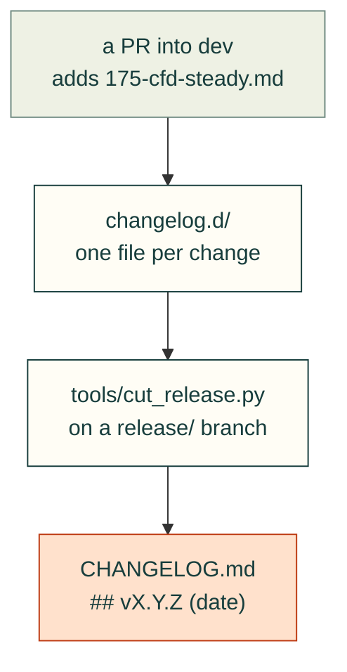

# changelog.d

Each PR's CHANGELOG lines, one file per change, until the next release folds them into
[CHANGELOG.md](../CHANGELOG.md). PRs that each add a file never conflict. PRs that edit the same lines of
CHANGELOG.md do, and every conflict fix means a new review.



Name the file `<issue>-<short-slug>.md`. Write bullets under one or more of these bold headings, in any order:

```markdown
**Fixed**
- `cadagent.simulation.cfd.read_results`: a fin block's air temperature settles within 1 °C, not 2 °C (#175).

**Projects must change**
- Re-run CFD steady checks on fin blocks: some that passed at 2 °C may not settle within 1 °C (#175).
```

- **Headings:** `**New**`, `**Changed**`, `**Fixed**`, `**Projects must change**`.
- **Who it is for:** write for the projects that use cad-agent: what they gain, and what they must change.
- **What the release does:** `python3 tools/cut_release.py --patch` (or `--minor`) adds each bullet under its heading
  in the `## Unreleased` entry, in file-name order. It then deletes the fragments and dates the entry.
- **What it refuses:**
  - a fragment with text before its first heading;
  - an unknown heading;
  - a heading with no bullet;
  - a Markdown heading (`## …`, `### …`), which would break the entry;
  - a one-line lead-in such as `**Projects must change:** text`: put the heading on its own line and the text in bullets.

  `tests/repo/test_cut_release.py` parses every fragment in this folder, so a malformed one fails CI.
