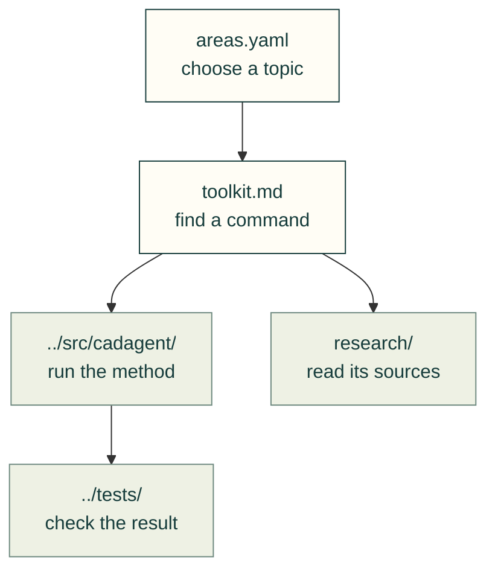

# Guides

Choose a task, then follow its method, sources and checks. [The topic tree](areas.yaml) is the complete index.

The arrows show how a guide connects to the files that support it.

| I want to… | Start here |
|---|---|
| Choose a guide collection | [Mechanical design](mechanical/README.md), [design and review practice](practice/README.md), [worked examples](examples/README.md) |
| Design and check a part | [Toolkit and project format](toolkit.md), [design dossier](practice/dossier.md), [integrity gates](practice/gates.md) |
| Choose a joint or mechanism | [Inserts](mechanical/inserts.md), [printed joints](mechanical/printed-joints.md), [snap fits](mechanical/compliant.md), [bearings](mechanical/bearings.md), [linkages](mechanical/linkages.md) |
| Make sheet-metal parts | [Sheet-metal hardware](sheet-metal-hardware.md), [source survey](research/manufacturing/sheet-metal.md) |
| Compare designs | [Exploration](explore.md), [shared formulas](formulas.md), [fans](fans.md) |
| Review electronics and evidence | [PCB workflow](pcb.md), [review packets](practice/review-packet.md), [pitfall checks](practice/common-issues.md) |
| Understand an animated result | [Rendered motion](mechanical/rendered-motion.md), [figure provenance](practice/animated-figures.md), [image inputs](img/) |
| Find source-backed practice | [Research map](research/README.md), [experts](practice/experts.md), [skills](../.agents/skills/README.md) |
| Improve the system | [Evidence loop](../README.md#how-it-improves-itself), [vision and evaluation limits](vision.md), [contributor workflow](../.github/CONTRIBUTING.md) |
| Maintain upstream dependencies | [Weekly update procedure](practice/weekly-upstream-update.md), [supply-chain guidance](practice/supply-chain.md) |
| Work on the site | [Style guide](practice/style-guide.md), [web kit](toolkit.md), [page configuration](pages.yaml), [catalogue configuration](catalog.yaml) |

[Home](../README.md) · [Tests](../tests/README.md) · [Lessons](lessons/README.md) · [Recovery snapshot](lessons/process/2026-11-05-recovery-audit.md)
