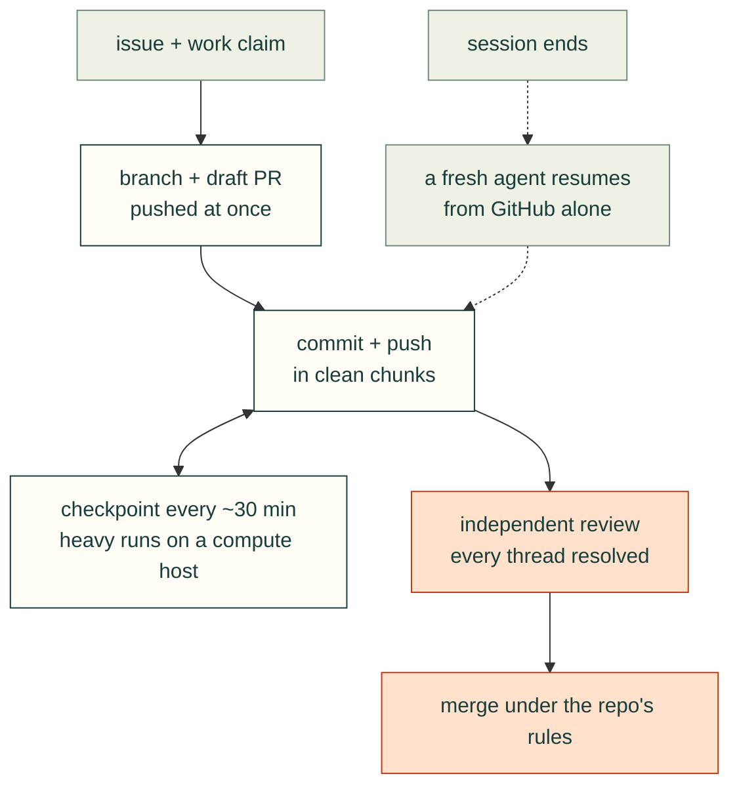

# Agent workflow: skills, subagents and work that survives a crash

cad-agent projects are mostly built by AI agents (Claude Code, Codex and others) working with a person. The way that work is
done (where it is recorded, how it is reviewed, where heavy runs go) is part of cad-agent. It ships as **skills**
and **subagents** that these tools load, not only as prose.

## Install

One command, for your user only (no sudo or administrator rights):

```bash
curl -fsSL https://cad-agent.valpatel.com/install.sh | sh        # macOS, Linux, WSL
irm https://cad-agent.valpatel.com/install.ps1 | iex             # Windows PowerShell
curl -fsSLO https://cad-agent.valpatel.com/install.sh && less install.sh && sh install.sh   # read it first
```

The scripts are [`web/install.sh`](../web/install.sh) and [`web/install.ps1`](../web/install.ps1). They:

1. need git, and install [uv](https://docs.astral.sh/uv/) (a pinned version, from astral.sh) into `~/.local/bin` if it
   is missing, without editing your shell profile;
2. clone `main` into `~/cad-agent`, or update the checkout that is there;
3. run `uv tool install --editable ~/cad-agent[cad]`: the `cad-agent` command goes in `~/.local/bin`, with a
   Python 3.12 of its own that uv manages, and runs the checkout's code, so the skills and the code stay in step;
4. run `cad-agent agents install` (below), which says which skills this computer can't use yet.

Options: `sh -s -- --extras fea,sim` (see [Extras](../README.md#extras)), `--ref v0.14.0` for a release tag, `--dir`
for another folder and `--uninstall`, which removes the command and the skills and keeps the checkout. In
PowerShell set `$env:CAD_AGENT_EXTRAS`, `$env:CAD_AGENT_REF`, `$env:CAD_AGENT_DIR` or `$env:CAD_AGENT_UNINSTALL=1`
first. They turn usage reporting off for everything they start; cad-agent itself sends nothing.

**Update** by running the command again, or `cad-agent update`; both do the same. `update` refuses a checkout with
changes or on another branch (use a fork for your own work), then:

- fast-forwards `main` (`git fetch`, then `git merge --ff-only`), or moves to `--ref`: a tag is checked out pinned, a
  branch is followed; that fetch is its only network use;
- reinstalls only when `pyproject.toml` or `uv.lock` changed, `--extras` adds some, an earlier reinstall did not
  finish, or the command runs from another checkout (`--dir`), keeping the extras you installed;
- links new skills, removes ones the kit dropped, and refreshes copies;
- prints the CHANGELOG entries since the old commit, "Projects must change" first;
- in a project folder, says what to re-run when the project was built with an older cad-agent.

Nothing checks for updates in the background. `cad-agent all` notes it when the checkout's last commit is more than 14
days old (not for a checkout pinned to a release tag), and refuses a project whose `cad: {cad-agent: "0.14"}` asks
for a newer cad-agent ([toolkit](toolkit.md)).

**By hand**, with Python 3.11 or newer and git:

```bash
git clone --depth 1 -b main https://github.com/Valpatel/cad-agent ~/cad-agent
python3 -m venv ~/cad-agent/.venv
~/cad-agent/.venv/bin/pip install -e "$HOME/cad-agent[cad]"   # Windows: .venv\Scripts
~/cad-agent/.venv/bin/cad-agent agents install
```

`cad-agent update` works for this install too (it reinstalls with pip).

### The skills

```bash
cad-agent agents install            # for your user: Claude Code, and every agent that reads ~/.agents/skills
cad-agent agents list               # what is installed where, and what is out of date
cad-agent agents install --dry-run  # show first
cad-agent agents uninstall          # remove everything it placed
```

| Kit file | Claude Code | `~/.agents/skills`: Codex, Copilot CLI, Cursor, Gemini CLI, opencode |
|---|---|---|
| `skills/<name>/SKILL.md` | `~/.claude/skills/<name>` (link) | `~/.agents/skills/<name>` (link) |
| `agents/<name>.md` | `~/.claude/agents/<name>.md` (link): a subagent | `~/.agents/skills/<name>/SKILL.md` (generated): run it as a separate session |

Links follow the checkout, so pulling updates the skills; `update` reruns `install` to refresh the generated files
(`list` shows them as out of date) and to remove links to skills the kit dropped. Link a long-lived checkout, not a
feature worktree that will be removed; `--copy` copies instead, and `install` copies by itself where links are not
allowed (Windows without Developer Mode). The installer replaces only what it installed (links into a cad-agent
checkout, generated files and marked copies); anything else at a destination, including your own links, is reported
as a conflict and left alone. `--target claude` or `--target agents` installs one side only.

Earlier versions put Codex's skills in `~/.codex/skills` (`$CODEX_HOME/skills`). Codex now reads `~/.agents/skills`,
so `install` removes what cad-agent put in the old folder and leaves the rest. If `~/.agents/skills` is a link to
`~/.claude/skills`, install with `--target claude`: the generated agent skills would otherwise shadow Claude's
subagents. Cursor and opencode read both folders, so they may list a skill twice. Run a generated agent skill only in
a separate session, never on work that session wrote.

Everything is installed for everyone. A skill or agent that needs something you may not have names it in its
frontmatter (`metadata: {requires: "gh git"}`; `optional:` and `optional-for:` for what only some steps use) and opens with a
`> **Needs:**` line saying the same. `install` and `list` then say which ones you can't use yet and why, checked on
this computer without any network call, and what they cannot check from here.

<details>
<summary><strong>What the notice looks like.</strong> Each need, how it is checked, and who needs it</summary>

```text
agents: you can use these, but some of their steps can't run yet:
  skill mcmaster-parts: Playwright is not installed in this Python (`"…/python" -m pip install playwright`)
agents: these also need what cad-agent can't check from here:
  write access to the repository it works in: cad-pr-review, cad-work-tracking
  a compute host you can reach over `ssh`: cad-remote-runs
```

| Needs | Checked how | Who needs it |
|---|---|---|
| `git` | on PATH | `cad-remote-runs`, `cad-work-tracking`, `cad-resume` |
| `gh` logged in | on PATH, and gh's own stored login answers (`gh auth token`, its output discarded; nothing is sent) | `cad-pr-review`, `cad-remote-runs`, `cad-work-tracking`, `cad-pr-reviewer`, `cad-resume` |
| `ssh` | on PATH | `cad-remote-runs` |
| `rsync` | on PATH; only to copy files that are not in git | `cad-remote-runs` |
| Playwright and Google Chrome | the module in cad-agent's Python, and Chrome itself (not Chromium) on PATH or in its usual place; only to download a new part | `mcmaster-parts` |
| write access to the repository it works in | not checkable here: you know whether you can push, open and merge PRs there | `cad-pr-review`, `cad-work-tracking` |
| a compute host you can reach over `ssh` | not checkable here | `cad-remote-runs` |

</details>

The workflow skills open issues, push branches and open pull requests in the repository they work in. Use them in
your own repositories, or where you have been given write access; an agent should not use them elsewhere unasked.

## What is in the kit

| | Name | Use it |
|---|---|---|
| Skill | [`cad-work-tracking`](../skills/cad-work-tracking/SKILL.md) | At the start of any multi-step change and every ~30 minutes: issue, branch, early draft PR, push as you go, checkpoints, resume |
| Skill | [`cad-pr-review`](../skills/cad-pr-review/SKILL.md) | When a PR is ready: independent review, answer and resolve every thread, merge rules |
| Skill | [`cad-remote-runs`](../skills/cad-remote-runs/SKILL.md) | Before any long run: compute host, detached, recorded in the issue, results pulled back |
| Skill | [`design-process`](../skills/design-process/SKILL.md) | Building or changing a design: section by section, with requirements, gates and a reviewer sign-off ([design-process-plan.md](design-process-plan.md)) |
| Skill | [`cad-motion-validation`](../skills/cad-motion-validation/SKILL.md) | Rendered mechanisms: independent joint frames, actual mesh captures, pivot/ownership regression checks |
| Skill | [`mcmaster-parts`](../skills/mcmaster-parts/SKILL.md) | Bought hardware: real part numbers and manufacturer models |
| Skill | [`sheet-metal-hardware`](../skills/sheet-metal-hardware/SKILL.md) | Bent sheet parts with clinch nuts, studs or rivets: bends, placement, seams and price, checked in order ([page](sheet-metal-hardware.md)) |
| Skill | [`cad-supply-chain`](../skills/cad-supply-chain/SKILL.md) | Before adding a dependency, vendored file, catalogue entry or link, or recommending a tool: the supply-chain report, its rows in the PR, what blocks a merge or an adoption |
| Subagent | [`cad-pr-reviewer`](../agents/cad-pr-reviewer.md) | Reviews a PR it did not write: verifies, posts inline comments and a summary, never merges |
| Subagent | [`cad-resume`](../agents/cad-resume.md) | After a session ended: rebuilds the state from GitHub, checkouts and run logs; reports next steps |

`design-process` has its own *design* reviewer pass with sign-off (`cad-agent review-section`); `cad-pr-reviewer`
reviews the pull request (code, evidence, docs), which is a different job.

Reviews of geometry also walk [common-issues.md](common-issues.md): the mistakes that recur in CAD designs, each
with the check that catches it, or that it needs a look.

## The workflow in one page

Assume the session ends within 30 minutes: tokens run out, the workstation crashes or is reformatted. GitHub is the
record; a fresh agent on another computer continues from it alone.



1. **Issue first, then claim it.** One per piece of work, with a checklist: done, next, running, how to resume. A big
   job gets a tracking issue linking smaller ones. Post a work-claim comment before starting (below).
2. **Branch and push at once**, per the repo's rules (cad-agent: `feat/<topic>` worktree from `origin/dev`; product
   repos say in their AGENTS.md).
3. **Draft PR early**, `Closes #<issue>` in its body, listing what is still missing.
4. **Commit and push in clean chunks**, each one coherent and pushed right away.
5. **Checkpoint every ~30 minutes** and before anything long: push, tick the checklist, comment with what changed,
   what is running (host, command, log, done marker) and the exact next step.
6. **Heavy runs on a compute host**, detached, recorded in the issue, results pulled back and committed.
7. **Independent review** by `cad-pr-reviewer` (or a separate Codex session); answer and resolve every thread.
8. **Merge under the repo's rules**, then check the issues closed and tick the tracking issue.

### Work claims

Agents on different tools and machines share issues with comments whose first line is machine-readable:

```markdown
<!-- work v1 claim agent=a-7kq2m4xw lease=2026-11-01T19:00Z -->
**Claimed** by agent `a-7kq2m4xw` until 2026-11-01T19:00Z UTC.

Scope: …
Branch: …
```

Actions are `claim`, `checkpoint` (renews the lease), `release` and `done`. A lease lasts at most 24 h; a claim not
refreshed in time has expired and the issue is open for anyone. Of the active claims, the one whose unbroken run of
claims and checkpoints started first holds. Tags are pseudonymous (`a-` + 8 of `[a-z2-7]`; one per tool and machine,
so sibling sessions share it): no host or user names in public repos. Full rules in
[cad-work-tracking](../skills/cad-work-tracking/SKILL.md#work-claims-sharing-issues-between-agents).

Things that must not live only locally: decisions and reasons, the user's measurements and observations, run
commands and results, lessons. Licensed or large inputs stay out of git, but the repo says where they come from and
how to fetch them, so a reformatted machine can rebuild.

## In a project repo

Point the project's AGENTS.md at this workflow (one line: "Follow the cad-agent workflow kit:
cad-work-tracking, cad-pr-review, cad-remote-runs; install with `cad-agent agents install`") and add the project's own
rules next to it: its integration branch, who may merge, its compute hosts (in private notes if the repo is public).
