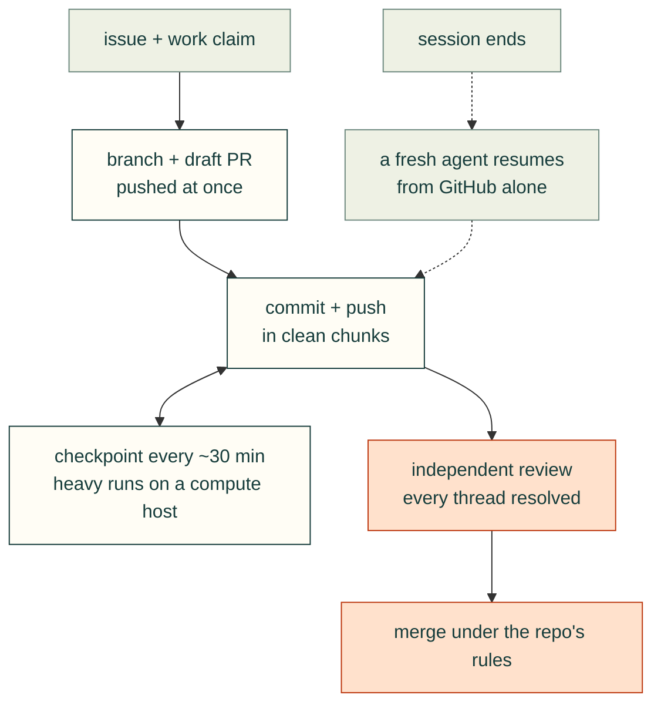

# Agent workflow: skills, subagents and work that survives a crash

cad-agent projects are mostly built by AI agents (Claude Code, Codex) working with a person. The way that work is
done (where it is recorded, how it is reviewed, where heavy runs go) is part of cad-agent. It ships as **skills**
and **subagents** that both tools load, not only as prose.

## Install

From a cad-agent checkout installed with `pip install -e`:

```bash
cad-agent agents install            # Claude Code and Codex, for your user
cad-agent agents list               # what is installed where, and what is out of date
cad-agent agents install --dry-run  # show first
```

| Kit file | Claude Code | Codex |
|---|---|---|
| `skills/<name>/SKILL.md` | `~/.claude/skills/<name>` (link) | `~/.codex/skills/<name>` (link) |
| `agents/<name>.md` | `~/.claude/agents/<name>.md` (link): a subagent | `~/.codex/skills/<name>/SKILL.md` (generated): run it as a separate Codex session |

Links follow the checkout, so `git pull` updates the skills; rerun `install` after pulling to refresh the generated
Codex files (`list` shows them as out of date). Link a long-lived checkout, not a feature worktree that will be
removed; `--copy` copies instead. The installer replaces only what it installed (links into a cad-agent checkout,
generated files and marked copies); anything else at a destination, including your own links, is reported as a
conflict and left alone. Codex's folder follows `$CODEX_HOME` when set. If `~/.codex/skills` is a link to
`~/.claude/skills`, install with `--target claude`: Codex then sees the skills, and the generated agent skills would
otherwise shadow Claude's subagents. Run a generated agent skill only in a separate Codex session, never on work
that session wrote.

## What is in the kit

| | Name | Use it |
|---|---|---|
| Skill | [`cad-work-tracking`](../skills/cad-work-tracking/SKILL.md) | At the start of any multi-step change and every ~30 minutes: issue, branch, early draft PR, push as you go, checkpoints, resume |
| Skill | [`cad-pr-review`](../skills/cad-pr-review/SKILL.md) | When a PR is ready: independent review, answer and resolve every thread, merge rules |
| Skill | [`cad-remote-runs`](../skills/cad-remote-runs/SKILL.md) | Before any long run: compute host, detached, recorded in the issue, results pulled back |
| Skill | [`design-process`](../skills/design-process/SKILL.md) | Building or changing a design: section by section, with requirements, gates and a reviewer sign-off ([design-process-plan.md](design-process-plan.md)) |
| Skill | [`cad-motion-validation`](../skills/cad-motion-validation/SKILL.md) | Rendered mechanisms: independent joint frames, actual mesh captures, pivot/ownership regression checks |
| Skill | [`mcmaster-parts`](../skills/mcmaster-parts/SKILL.md) | Bought hardware: real part numbers and manufacturer models |
| Skill | [`cad-supply-chain`](../skills/cad-supply-chain/SKILL.md) | Before adding a dependency, vendored file, catalogue entry or link, or recommending a tool: the supply-chain report, its rows in the PR, what blocks a merge or an adoption |
| Subagent | [`cad-pr-reviewer`](../agents/cad-pr-reviewer.md) | Reviews a PR it did not write: verifies, posts inline comments and a summary, never merges |
| Subagent | [`cad-resume`](../agents/cad-resume.md) | After a session ended: rebuilds the state from GitHub, checkouts and run logs; reports next steps |

`design-process` has its own *design* reviewer pass with sign-off (`cad-agent review-section`); `cad-pr-reviewer`
reviews the pull request (code, evidence, docs), which is a different job.

Reviews of geometry also walk [common-issues.md](common-issues.md): the mistakes that recur in CAD designs, each
with the check that catches it, or that it needs a look.

## The workflow in one page

Assume the session ends within 30 minutes: tokens run out, the workstation crashes or is reformatted. GitHub is the
record; a fresh agent on another computer continues from it alone.



1. **Issue first, then claim it.** One per piece of work, with a checklist: done, next, running, how to resume. A big
   job gets a tracking issue linking smaller ones. Post a work-claim comment before starting (below).
2. **Branch and push at once**, per the repo's rules (cad-agent: `feat/<topic>` worktree from `origin/dev`; product
   repos say in their AGENTS.md).
3. **Draft PR early**, `Closes #<issue>` in its body, listing what is still missing.
4. **Commit and push in clean chunks**, each one coherent and pushed right away.
5. **Checkpoint every ~30 minutes** and before anything long: push, tick the checklist, comment with what changed,
   what is running (host, command, log, done marker) and the exact next step.
6. **Heavy runs on a compute host**, detached, recorded in the issue, results pulled back and committed.
7. **Independent review** by `cad-pr-reviewer` (or a separate Codex session); answer and resolve every thread.
8. **Merge under the repo's rules**, then check the issues closed and tick the tracking issue.

### Work claims

Agents on different tools and machines share issues with comments whose first line is machine-readable:

```markdown
<!-- work v1 claim agent=a-7kq2m4xw lease=2026-11-01T19:00Z -->
**Claimed** by agent `a-7kq2m4xw` until 2026-11-01T19:00Z UTC.

Scope: …
Branch: …
```

Actions are `claim`, `checkpoint` (renews the lease), `release` and `done`. A lease lasts at most 24 h; a claim not
refreshed in time has expired and the issue is open for anyone. Of the active claims, the one whose unbroken run of
claims and checkpoints started first holds. Tags are pseudonymous (`a-` + 8 of `[a-z2-7]`; one per tool and machine,
so sibling sessions share it): no host or user names in public repos. Full rules in
[cad-work-tracking](../skills/cad-work-tracking/SKILL.md#work-claims-sharing-issues-between-agents).

Things that must not live only locally: decisions and reasons, the user's measurements and observations, run
commands and results, lessons. Licensed or large inputs stay out of git, but the repo says where they come from and
how to fetch them, so a reformatted machine can rebuild.

## In a project repo

Point the project's AGENTS.md at this workflow (one line: "Follow the cad-agent workflow kit:
cad-work-tracking, cad-pr-review, cad-remote-runs; install with `cad-agent agents install`") and add the project's own
rules next to it: its integration branch, who may merge, its compute hosts (in private notes if the repo is public).
