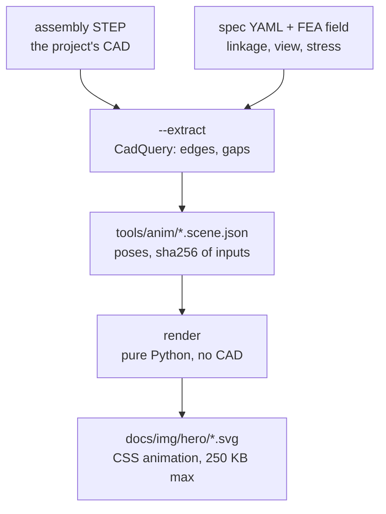

# Animated figures from real CAD

The README's hero is not drawn by hand. `tools/readme_anim.py` makes it from a real project's files:
- the STEP assembly, drawn as edges by hidden-line removal;
- the linkage's kinematics, solved from link lengths measured in the CAD;
- clearances from the assembly gates' relation engine;
- stress bands from the project's own FEA field.

It writes one SVG of about 140 KB that animates with CSS alone, so GitHub shows it in a README ``.


The first figure is [Gyropup](https://github.com/Valpatel/gyropup)'s five-bar leg (MIT): `docs/img/hero/gyropup-leg.svg`. The SVGs in `docs/img/hero/` may be reused on the site and elsewhere. Each one names its source in its caption and `<desc>`.

## Regenerate or check

```bash
PYTHONPATH=src python3 tools/readme_anim.py            # write every SVG from its committed scene
PYTHONPATH=src python3 tools/readme_anim.py --check    # exit 1 if a committed SVG differs or breaks a rule
```

`tests/test_readme_anim.py` runs `--check`, so a renderer change that alters a figure fails CI until the SVG is regenerated and committed.

Rendering needs only cad-agent's core dependencies.

## Re-measure from the project

```bash
PYTHONPATH=src python3 tools/readme_anim.py --extract hero --source <checkout of the project>
```

Extraction needs the `cad` extra (CadQuery). Use a clean checkout of the project's published branch, not a working tree with uncommitted changes. The scene records the commit and every input file's sha256.

The clearance sweep is slow, because each pair is an exact `relate()` call (#186). Its result is reused from the committed scene while the assembly, the parts, the linkage and the clearance spec are unchanged. Pass `--fresh` to run it again. `--workers N` measures poses in N processes; each one reads the STEP once and holds the assembly in memory, about 0.5 GB for Gyropup's leg. Gyropup's leg takes about 25 s without the sweep.

## A recorded FEA study

The second figure is not an assembly. It is a mesh-convergence study at an inside corner, run with this checkout's
own `cadagent.simulation.fea` and drawn from what the results said.


*A recorded run of the toolkit (cad-agent 0.7.0 on gmsh 4.15.2 with OpenCASCADE 7.8.1, 2026-11-01). Linear-elastic
FEA: a converged peak does not prove that the part holds.*

```bash
PYTHONPATH=src python3 tools/readme_anim.py --extract convergence    # record it again: gmsh, scikit-fem, CadQuery
```

`tools/anim/fea-convergence.yaml` names the study: the bracket, the load, the element sizes at the corner and the
words. Recording takes about a minute and about 3 GB. `tools/anim/fea-convergence.scene.json` keeps, for each step:
- the tets, the design peak and where it sits;
- the peak's flags (`result['mesh']['peak']`) and `converge()`'s verdict;
- the front face's mesh round the corner.

It also keeps the mesher (`result['mesh']['mesher']`), the toolkit's version and commit, and the sha256 of the files
that made it. `tests/test_anim_convergence.py` checks that the figure states the record's numbers and that the record
shows what the docs say. On the recorded gmsh build, it runs the 2 mm steps again and compares.

## A snap fit engaging

The third figure is a calculation, not a study: `cad-agent snapfit`'s closed form for one printed arm in two
filaments, as the mating part's edge rides the hook.



*The toolkit's closed-form calculator (`cadagent.mechanical.compliant.snapfit`) on the stated arm: not a measurement.
Allowables from the data sheets Polymaker PolyMide CoPA V5.4 and Bambu Lab PETG-CF V3.0. Printed snaps need a test
print.*

```bash
PYTHONPATH=src python3 tools/readme_anim.py --extract snapfit    # run the calculator again: core only, under a second
```

`tools/anim/snap-engagement.yaml` names the arm, as a `cad-agent snapfit` declaration, and the words.
`tools/anim/snap-engagement.scene.json` keeps, for each filament:
- what `check_spec_entry` says: the verdict, the rows, the material derivation and the data-sheet editions;
- the closed form along the insertion (`snapfit.engagement()`);
- the travel where the root strain reaches the allowable.

It also keeps the arm's bent shape at the drawn slices, the toolkit's version and commit, and the sha256 of the files
that made it. The arm is drawn in slices, each moved and turned by the shape at its middle. Both are linear in the
deflection, so every keyframe is exact and the arm bends smoothly. The still is the top of the lead, where the strain
peaks. `tests/test_anim_snapfit.py` runs the calculator again and compares every number, works the closed form by
hand, and checks the still and the pages that show the figure.

## Make one for another assembly

Copy `tools/anim/gyropup-leg.yaml`, then add the figure to `FIGURES` in `tools/readme_anim.py`.

<details>
<summary>What the spec names: the assembly, parts, linkage, view, FEA field and words</summary>

- **the assembly**: one STEP, one solid per part.
- **the parts**: solids by their number in the STEP. Each part has:
  - the body it moves with;
  - an explode distance along the joint axis;
  - a style;
  - optionally a part file whose volume the solid must match. If the STEP is rebuilt and its solids are renumbered, extraction fails instead of drawing the wrong part.
- **the linkage**: a planar one.
  - Joints are measured from coaxial solids, and the link lengths are checked against the design's.
  - The solve order says which joints are found from which.
  - The driven joint follows a path.
  - Four-bars driven by an output point, five-bars and chains of dyads all fit (`cadagent.publish.anim.linkage`).
- **the view**: a direction and an up vector. Set the stage box in pixels.
- **the FEA field**: optional, a `cadagent-fea-viewer` v1 file (what `cadagent.simulation.fea` writes for the viewer), with the stress bands as fractions of strength.
- **the words**: the wordmark and tagline, drawn as outlines because an `` loads no fonts. Labels, captions and the check rows' wording (`present.checks`, with `{placeholders}` filled from the scene) sit under `present`, so they can change without re-extracting.

</details>

A different kind of figure (a board into its enclosure, print layers) gets its own scene module next to `cadagent.publish.anim.hero`, as the convergence study and the snap fit have (`cadagent.publish.anim.convergence`, `cadagent.publish.anim.snapfit`). It reuses the shared parts:
- edge projection: `cad`;
- the rasteriser and outlines: `raster`;
- paths, timeline, theme and the embed rules: `svg`;
- text outlines: `text`.

The two stages, and what each reads and writes:



## What a figure must pass

`cadagent.publish.anim.svg.problems()` lists what makes an SVG unsafe or unfit to embed. Each rule has a test that breaks it.

<details>
<summary>The embed rules: size, XML, no scripts or outside references, accessibility, CSS only, reduced motion</summary>

- at most 250 KB;
- well-formed XML;
- no `<script>`, `<foreignObject>`, `<iframe>`, `<image>`, `<use>` or `<a>`;
- no event-handler attributes;
- no `href`, `src`, `url()` or `@import` pointing outside the document;
- `role="img"` with an `aria-label`, and a `<title>`;
- CSS animation only, no SMIL;
- a `prefers-reduced-motion` rule that stops every animation. The still it leaves is the final frame (the snap fit's
  is the top of the lead, where the strain peaks).

</details>

Both colour schemes are in the one SVG (`prefers-color-scheme`), on its own background. It was checked on github.com in WebKit and Chrome at 1440 and 390 px. At phone widths the words beside the drawing are hidden and the check marks are enlarged.

## What it approximates

- **Hidden lines.** Each solid hides only its own edges. Solids hide each other by their filled silhouettes, painted back to front. The order is the one that draws the fewest cells wrong on depth rasters of the assembled and exploded states. Interlocking parts, such as a pin through a bore, have no right order, so the scene records how many overlapping cells are drawn wrong.
- **Motion.** Each moving solid is drawn in slices along the joint axis. Each slice is moved by an exact rotation at its own depth, and edges are cut where they pass into the next slice. The scene records the largest error per part, over the visible mesh vertices and over the visible edges. For Gyropup's leg both are about 1 px. The hidden lines stay those of the reference pose.
- **Clearance.** It is checked at sampled poses, not as a swept volume. Each pair of solids, not of parts, is one of four kinds. The fit row states the closest running gap ("joints ≥ 0.1 mm" on Gyropup's leg) and the closest passing gap ("passing ≥ 7.3 mm"), each rounded down, and the figure marks the passing one.

  | kind | what it is | example |
  |---|---|---|
  | clash | it overlaps at some pose | none on Gyropup |
  | contact | it touches at every pose; a designed contact, with no gap to state | a flange on its motor, a pin in its bearing |
  | running gap | it stays apart by the same gap at every pose, so it turns about a shared axis | links stacked on a joint, a spacer beside a bearing, an adapter disc beside the frame |
  | passing | its gap changes as the parts move past each other | a link swinging past a hard-stop sleeve |
- **Stress.** The colours show the FEA's surface field, capped at its design stress. The load factor shown is the FEA's own prediction of first failure, made under its assumptions (linear-elastic, weakest print direction, idealised clamps).

CAD and simulation narrow a design down. They do not prove that a printed part fits or holds.
