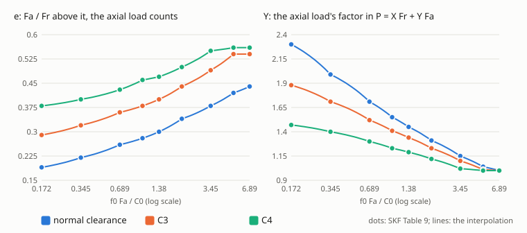

# Rolling bearings

A ball or roller bearing in a design has to last, stand its peak loads without denting, take the axial load its type
allows and run below its speed limits. `cadagent.mechanical.bearings` checks all of that for a catalogue bearing or
your own, turning at a speed or swinging through an angle like a robot's joint, under one load or a duty cycle.
`cad-agent bearings` runs it on every bearing in a file. The equations are in `cadagent.formulas`, each tested
against the makers' own worked examples. **The life is ISO 281's basic rating life: a statistic for a group of
bearings, not a promise for one. It leaves out lubrication, contamination, wear and the seals. Test the joint.**


*Drawn by `tools/bearing_figures.py` from `rating_life` and the SKF ratings in `BEARINGS`.*

## Check a bearing

```yaml
# bearings.yaml
bearings:
  - name: rope sheave
    bearing: skf-6207-2rsh
    radial_n: 550
    speed_rpm: 2450
    required_hours: 43800
  - name: knee
    bearing: skf-6201-2rsh
    oscillation: {amplitude_deg: 30, cycles_per_min: 60}     # ±30°, once a second
    duty:                                                     # shares of the oscillations
      - {name: stance, radial_n: 900, share: 0.6}
      - {name: swing, radial_n: 150, share: 0.4}
    required_hours: 2000
    static: [{name: power cut, radial_n: 3485}]               # a peak: infrequent, low certainty
    internal: {balls: 7, ball_mm: 5.953}                      # optional: for the critical amplitude
```

```text
$ cad-agent bearings bearings.yaml --output result.json
PASS  rope sheave: turning, 1.18e+05 million revolutions (804,796 h), least s0 27.82
FAIL  knee: oscillating, 2.42e+03 million oscillations (672,798 h), least s0 0.89
      warn: critical amplitude: below the outer raceway's critical amplitude 70.5 degrees (inner 40.5): ...
      fail: static safety: power cut: s0 = C0 / P0 = 3100 / 3485 N = 0.89 against 1 (infrequent motion, ...
```


*Drawn by `tools/bearing_figures.py` from `check_spec` on the file above: each row's value over its limit (limit
over value for the load range and speed), so anything left of 1 warns or fails.*

It exits 1 on a fail and 2 on a bad file. In Python, `check_bearing(...)` takes the same keys and returns each
row's value, limit, verdict and reason, with the life, the static cases and the limits:

| Row | What it checks | Fails or warns when |
|---|---|---|
| equivalent load | P = X Fr + Y Fa per block (SKF Table 9 for deep-groove bearings), and the duty cycle's cubic mean | warns if f0 Fa / C0 is outside the table |
| axial load | Fa against 0.5 C0, or 0.25 C0 for d ≤ 12 mm and light series; any axial load on an NU roller | fails above it |
| rating life | L10 (or Ln at the reliability asked), in revolutions or oscillations and hours, against `required_hours` | fails below it; warns if no life is asked |
| load range | the heaviest P against 0.5 C (ball) or 0.33 C (roller), where SKF calls the life robust | warns above it |
| minimum load | the lightest P against 0.01 C (ball) or 0.02 C (roller), below which rolling elements skid | warns below it (turning only) |
| speed | against the limiting speed (mechanical) and the reference speed (thermal); SKF's thermal rule | fails above the limiting speed; warns above the reference speed, or past half the limiting speed or below C / P = 10 |
| static safety | s0 = C0 / P0 for the heaviest running block and each `static` peak, against SKF's guideline s0 | fails below the guideline |
| amplitude, critical amplitude, contact travel | an oscillating joint: below 10°, below the critical amplitude, and the contact's roll x against its width 2b | warn |

## Oscillating joints: a robot's knee

A joint that swings does not turn: each oscillation of amplitude θ (from the centre to one end) rolls the balls
through 4θ, so a million revolutions of fatigue last 90 / θ million oscillations (the Harris factor; SKF's
180 / 2γ). Below a **critical amplitude**, θcrit = 360° / Z(1 − γ) on the outer raceway, each ball never reaches
where its neighbour started: parts of the raceway are never loaded and the rest are loaded more often, which
shortens the life (the Rumbarger factor, as Menck and Stammler, 2024, correct it). At small amplitudes the contact
hardly moves off its own footprint, and **wear and false brinelling, not fatigue, end the bearing**: the check
compares the arc x each contact rolls with the contact's width 2b, and warns below 1.


*Drawn by `tools/bearing_figures.py` from `check_bearing` on the worked example: a walking robot's knee, an SKF
6201-2RSH swinging ±30° once a second, 900 N for 60 % of each stride and 150 N for the rest (assumed loads), and a
fall with the power cut that puts 3 485 N on one bearing (the peak Gyropup's leg rig records at its rear knee).*

What the example shows:

- **Fatigue is not the problem.** The cubic-mean load is 760 N, C / P = 9.6, and the knee lasts about 2 400 million
  oscillations: far beyond any walking robot's life.
- **The peak is.** A power cut that folds the leg puts 3 485 N on a bearing whose C0 is 3 100 N: s0 0.89, below
  SKF's 1.0 for an infrequent, uncertain peak. The raceways dent and the knee runs rough afterwards. An SKF
  6301-2RSH in the same 12 mm bore (C0 4 150 N) brings it to 1.19. SKF also says a bearing that oscillates slowly
  under load is sized on its static load (p. 104), so the running load is checked too.
- **±30° is below the critical amplitude** (40.5° inner, 70.5° outer for 7 balls), so the life is 92 % of
  Harris's. The internal geometry, 7 balls of 5.953 mm (15/64 in), is **assumed**: SKF does not publish it. It agrees
  with SKF's own C0 and f0 through ISO 76 (Z Dw² = 248 mm² against C0 / f0 = 258 mm²). Count the balls in the bearing
  you buy.
- **The contact travels 12.7 times its width** in each stroke, well clear of false brinelling. A joint that only
  dithers (a degree or two) or stands still on a vibrating machine would not be.

## Deep-groove ball bearings under an axial load

An axial load counts once Fa / Fr exceeds a limit e, and then P = X Fr + Y Fa. The makers tabulate e, X and Y by the
relative axial load f0 Fa / C0, for each internal clearance; a bearing with more clearance runs at a larger contact
angle and takes axial load better.



*Drawn by `tools/bearing_figures.py` from `deep_groove_factors`: the dots are SKF's Table 9 (p. 257), the lines its
linear interpolation.*

## The catalogue

`BEARINGS` holds SKF's 6201 (open, shielded, sealed), 6301, 61800 to 61806, 61812, 6207-2RSH, NU 202 ECP and
NU 311 ECP, and Koyo's 6201, each with C, C0, the fatigue load limit, the reference and limiting speeds, f0 and the
minimum load factor, and its source: the maker's product page read on 2026-11-01, and the page of SKF's 2018
catalogue that lists the same values (where a product page has moved on from the catalogue, the row says so). A
bearing of the same size from another maker has other ratings: Koyo's 6201 has C 8.5 kN against SKF's 7.28 kN and no
reference speed. Give `check_bearing` a mapping of the fields for any other bearing.

<details>
<summary>The formulas, with their sources</summary>

| Function | What | Source |
|---|---|---|
| `rating_life`, `required_dynamic_rating`, `life_hours` | L10 = (C / P)^p, p = 3 ball, 10/3 roller; C for a life; hours at a speed | SKF *Rolling bearings* 17000/1 EN (2018-10), p. 89 (ISO 281) |
| `reliability_factor` | a1: SKF's table for 90, 95–99 %, and between and beyond it the Weibull form 0.95 (ln(100/R) / ln(100/90))^(2/3) + 0.05, which rounds to every tabulated value | SKF, Table 3, p. 90 |
| `deep_groove_factors`, `deep_groove_load`, `equivalent_load` | e, X, Y by f0 Fa / C0 and clearance, interpolated; P | SKF, pp. 91, 254 and Table 9, p. 257 |
| `static_equivalent_load`, `static_safety`, `static_rating_iso76` | P0 = 0.6 Fr + 0.5 Fa, not below Fr; s0 = C0 / P0; C0 = f0 Z Dw² | SKF, pp. 104–106 and 254; ISO 76 |
| `duty_cycle_load`, `miner_life`, `revolution_fractions`, `varying_load_mean` | the cubic mean; Palmgren–Miner; time into revolution shares; (Fmin + 2 Fmax) / 3 | SKF, pp. 90 and 92 |
| `harris_factor`, `critical_amplitude`, `rumbarger_factor`, `rolling_travel` | 90 / θ; 360 / Z(1 ± γ); (θ / θcrit)^(1 − 1/e) 90 / θ below it; the contact's roll θ dm (1 − γ²) / 4 | Menck and Stammler, *Wind Energy Science* 9 (2024) 777–798, Eqs. (3)–(5) and footnote 42; SKF Table 4, p. 91 |
| `stribeck_ball_load`, `hertz_point_contact`, `ball_raceway_contact` | Qmax = 5 Fr / Z; the exact Hertz ellipse from the elliptic integrals; a ball in its groove | NSK *Technical Report* E728h, Sections 5.2 and 5.4; Johnson, *Contact Mechanics*, Chapter 4; Hamrock and Brewe (1983) |

The contact width for the travel check comes from the Hertz contact when the internal geometry is given, else from
NSK's published constants for its own bearing of the same size (E728h, Table 1, p. 117: 2b = K3 Fr^(1/3)).

</details>

## Limits

- **The basic rating life only.** The makers' modified lives (SKF's aSKF, ISO's aISO) add lubrication,
  contamination and the fatigue load limit, and can be many times longer, or shorter in dirt. Below the fatigue load
  limit Pu the check says so, but does not use it.
- **Not covered:** wear, false brinelling and fretting (beyond the travel warning), corrosion, the grease's and the
  seals' life, a ring creeping in its seat, misalignment, preload and clearance changing the load zone, and moment
  loads on a single bearing.
- **Oscillation factors convert distance.** They do not model the moving ring's uneven load zone (the Houpert
  effect), and SKF calls the conversion invalid below 10°.
- **The loads are yours.** The check does not find them: get them from the mechanism, a simulation or a test.
- A calculated life is not proof that a bearing survives. Test the joint.

## Sources and survey

<details>
<summary>What was surveyed before building, and why the code is ours</summary>

Surveyed on 2026-11-01 (GitHub, PyPI, the makers' tools):

- **[frasere/ISO-281](https://github.com/frasere/ISO-281)** (MIT, a notebook and one module, last changed 2020):
  ISO 281's dynamic rating from the internal geometry. Unmaintained, and a design takes the maker's rating rather
  than computing one, so it was read for scope and not adopted.
- **AxisForge, bearlife, bearing-calculator** (GitHub, 2026): shaft, bearing and gear tools with ISO 281 lives, but
  with no licence, so nothing can be reused.
- **pybearing** (PyPI): defect frequencies and envelope analysis, not life.
- **The makers' calculators** (SKF Bearing Calculator, NSK, Schaeffler) and **MESYS, KISSsoft**: closed, or
  commercial; useful to cross-check a result by hand.

None checks an oscillating joint (Harris, Rumbarger, the critical amplitude, false brinelling), holds catalogue data
with sources, or returns pass, warn and fail rows an agent can act on. So the code is **built** here, from the
standard as the makers apply it. Nothing is vendored.

**Sources.** SKF Group, *Rolling bearings*, PUB BU/P1 17000/1 EN, October 2018 (sections B.3 and 1, the product
tables and the worked examples C.1 to C.3); SKF's and Koyo's product pages, read on 2026-11-01; NSK Ltd., *Technical
Report* CAT. No. E728h (2024), Sections 5.2 and 5.4; O. Menck and M. Stammler, *Review of rolling contact fatigue
life calculation for oscillating bearings*, Wind Energy Science 9 (2024) 777–798 (CC BY 4.0); ISO 281:2007 and
ISO 76:2006 through the makers' catalogues; K. L. Johnson, *Contact Mechanics* (1985), Chapter 4; B. J. Hamrock and
D. E. Brewe, *Journal of Lubrication Technology* 105 (1983) 171–177.

</details>

## Tests that keep it honest

`tests/test_bearings.py` runs the golden vectors in `tests/fixtures/bearing-vectors.json`, typed in from the makers'
worked examples: SKF's rope sheave (804 800 h), centrifugal pump (11.52 kN and 17 400 h; a roller over 1 000 000 h)
and vibrating screen (21 500 h), its a1 and X/Y tables, its oscillation conversion, Menck and Stammler's 9 million
oscillations, and NSK's 6210 contact (2 170 MPa, 3.92 and 0.39 mm). It checks the Hertz solution against Johnson's
closed form for a sphere and Hamrock and Brewe's fits, that ISO 76's C0 reaches its 4 200 MPa in the model, that
Palmgren–Miner and the cubic mean are one sum, the catalogue's consistency, every row's verdicts on built cases, and
the CLI's exit codes. It also redraws every figure on this page and fails if one has gone stale.

Related: [Engineering formulas](formulas.md) · [Printed load-bearing joints](printed-joints.md) ·
[package map](../src/cadagent/mechanical/README.md)
