# Common issues in CAD design reviews

These mistakes recur in printed parts and assemblies. The list comes from real projects, and each entry links the
lesson that recorded it. Every review walks this list, whoever wrote the design and however small the change:

1. Run `cad-agent all`. Every row in the report must pass. A row that fails, is stale or did not run is a finding,
   never a footnote.
2. Then go through the **Review** rows below. No automatic check covers them yet, so look at the model, the renders and
   the sources yourself. Say in the review which ones you checked and how.

When a review finds a new kind of mistake, add it here, in the same PR or in an issue, with the check that would catch
it. Once a check exists, move the entry from "review" to the check.

## Geometry and modelling

| Issue | How it shows up | Caught by | Lesson |
|---|---|---|---|
| **A feature added after the holes refills them**: a rib, boss, skirt or gusset unioned after the screw holes, counterbores, countersinks or insert bores were cut | The part is a valid watertight solid and every fit, strength and slice check passes, but a screw head will not seat and an insert will not go in. Found on a printed lid: stiffening ribs ran into the four socket-head counterbores | `cad-agent holes` (the "Holes clear" rows, run by `all`): every cylindrical hole and countersink cone in each part's STEP is probed for material inside. Fix the build order so every hole is cut last, after all the added features. Known misses, so look at these in a section view: a hole capped at one end reads as blind, and a counterbore blocked right across with a hole cut through the block reads as a ledge (listed in the result) | [03](../lessons/03-mechanical-design-rules.md) |
| A rib or boss ends on air: it was placed over a vent slot or an opening cut later | It looks attached in a render, but FEA puts the peak stress at the joint. A rib that is fully detached prints as a loose piece | FEA, plus a section view at each rib end. The "Printed parts" rows (one solid) catch a rib that is fully detached | [03](../lessons/03-mechanical-design-rules.md) |
| Coplanar or flush unions | Faces that only touch leave seams: two solids, a non-manifold edge, or an open STL | The "Printed parts" rows (single solid, watertight). Overlap joined features by 1–2 mm | — |
| Parts collide, or a clearance was checked against a bounding box | It fits in the CAD assembly only because something was approximated or left out | Gates relation table; the project's clearance step. Investigate every hit; classify false positives explicitly | [07](../lessons/07-verification-and-evidence.md) |
| Walls or ribs too thin to print or carry load | Weak parts; gaps in the slicer preview | The wall gate (`gates`); FEA for loaded parts | [10](../lessons/10-simulation-and-material.md) |
| Overhangs and unsupported bridges in the print orientation | Sagging or failed prints | `cadagent.geometry.downward_area` overhang screen; check in the slicer preview | [03](../lessons/03-mechanical-design-rules.md) |
| Engraved or embossed text not fused before cutting | Floating islands; an open mesh | "Printed parts" rows (single solid, watertight) | [06](../lessons/06-enclosure-features.md) |
| Slender columns or insert bosses not tied into a wall | They crack or wobble when the screw is driven | Review: every boss and column has a load path; FEA | [03](../lessons/03-mechanical-design-rules.md) |
| One weak feature fixed, its siblings left as they were | The same failure on the other three corners | Review: survey all similar features when one is found | [03](../lessons/03-mechanical-design-rules.md) |

*Why every hole is cut last: a rib unioned after the holes runs into the counterbore and the clearance hole, and `cad-agent holes` finds it inside both. An illustration of the counterbore plate in `tests/test_holes.py`, in section; the volumes match the hole check's.*

## Bought parts, sources and assumptions

| Issue | How it shows up | Caught by | Lesson |
|---|---|---|---|
| **The wrong bought part**: a similar model, a guessed size, another revision | A printed lid 15 mm too short for the cooler that was actually fitted | Review: identify the exact part (vendor, part number, datasheet, photos) before sizing anything around it; record it | [10](../lessons/10-simulation-and-material.md) |
| A photo read in the wrong orientation, or a flow direction assumed | Features on the wrong side; a CFD with the fan blowing the wrong way | Review: record the user's observations (measurements, "the fan blows up") with the date, and check assumptions against them | [01](../lessons/01-verify-from-source.md) |
| Connector windows sized from a bounding box or the board connector, not the mating plug | The cable's overmould does not fit | `cadagent.connectors`: windows from the modelled mating plug, plus a sweep check | [03](../lessons/03-mechanical-design-rules.md), [05](../lessons/05-cables-connectors-and-routing.md) |
| A vendor model used as if it were measured data | Hidden errors in mounting holes or heights | Review: say which bodies are proxies | [01](../lessons/01-verify-from-source.md) |
| Vendor files committed or redistributed | A licence problem; a leak that cannot be undone | Review the package and release include lists; fetch references with a script | [agent workflow](agent-workflow.md) |

*`cadagent.connectors` sizes the window from the mated plug and sweeps the plug in along its mating axis. A window sized from the jack's bounding box is too short where the latch passes. An illustration of the RJ45 port in `tests/test_connectors.py`, in section; the swept volumes match the connector check's.*

## Fasteners and assembly

| Issue | How it shows up | Caught by | Lesson |
|---|---|---|---|
| Screw length from the wrong datum, or too little thread engagement | Strips, or bottoms out | The fastener gate; compute the stack plus the engagement; print a coupon | [04](../lessons/04-fasteners-and-assembly-access.md) |
| No tool access at the step where a fastener goes in | It cannot be assembled in the documented order | The assembly-access gate; the assembly-step renders | [04](../lessons/04-fasteners-and-assembly-access.md) |
| Inserts, countersinks or D-holes sized without a test print | Loose inserts; bulkheads that turn | Coupons printed before the big parts | [04](../lessons/04-fasteners-and-assembly-access.md) |
| Cable routes at an impossible bend radius, or tie anchors in the path | Cables that cannot be routed | Review: route from the real mating direction with a stated bend radius | [05](../lessons/05-cables-connectors-and-routing.md) |

## Evidence, simulation and release

| Issue | How it shows up | Caught by | Lesson |
|---|---|---|---|
| Stale evidence: reports, renders or results from before the last change | A pass for geometry that no longer exists | Hash-bound results (slice report, hole check, gates, CI parameter check); rerun `cad-agent all` after every geometry change | [07](../lessons/07-verification-and-evidence.md) |
| Exports that change bytes on every rebuild | The slice report goes stale with no geometry change | Reproducible 3MF writer; check `git diff` after a rebuild with no change | [07](../lessons/07-verification-and-evidence.md) |
| A simulation trusted before it converged, balanced and was calibrated | Confident but wrong temperatures or stresses | The project's simulation checks: steady, energy balance, calibrated, and inputs that match the design (fan axis and position) | [10](../lessons/10-simulation-and-material.md) |
| Material savings judged on CAD volume | The slicer disagrees by tens of percent | `cad-agent slice` | [10](../lessons/10-simulation-and-material.md) |
| A render or report published without being looked at | Wrong colours, clipped views, a stale picture | Review: open every image before it is shown | [07](../lessons/07-verification-and-evidence.md) |
| Claims stronger than the evidence | "No re-breathing", "fits", "strong enough" from a model only | Review: every claim names its evidence and its limits; nothing physical is claimed without a print | [07](../lessons/07-verification-and-evidence.md) |
