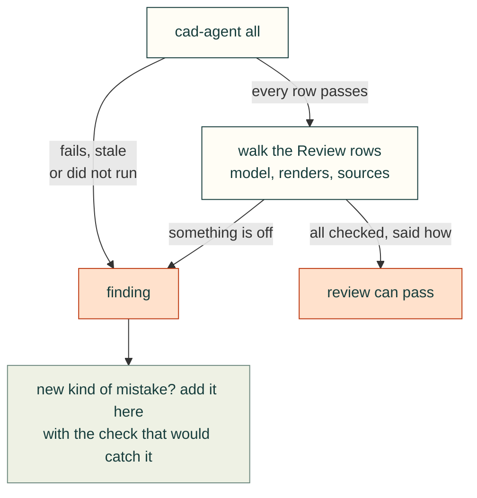
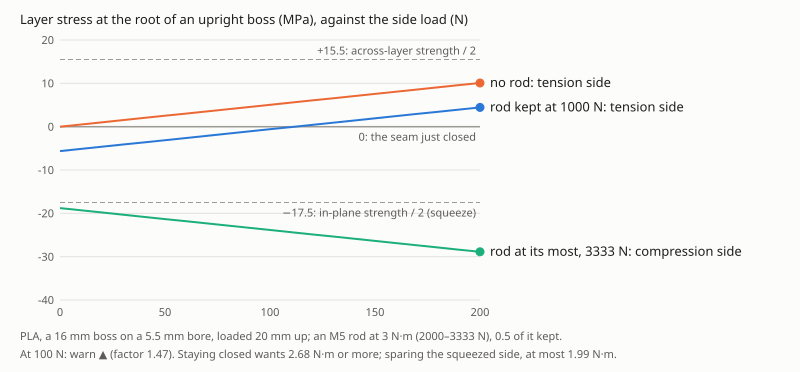

# Common issues in CAD design reviews

These mistakes recur in printed parts and assemblies. The list comes from real projects, and each entry links the
lesson that recorded it. Every review walks this list, whoever wrote the design and however small the change:

1. Run `cad-agent all`. Every row in the report must pass. A row that fails, is stale or did not run is a finding,
   never a footnote.
2. Then go through the **Review** rows below. No automatic check covers them yet, so look at the model, the renders and
   the sources yourself. Say in the review which ones you checked and how.

When a review finds a new kind of mistake, add it here, in the same PR or in an issue, with the check that would catch
it. Once a check exists, move the entry from "review" to the check.

## Geometry and modelling

| Issue | How it shows up | Caught by | Lesson |
|---|---|---|---|
| **A feature added after the holes refills them**: a rib, boss, skirt or gusset unioned after the screw holes, counterbores, countersinks or insert bores were cut | The part is a valid watertight solid and every fit, strength and slice check passes, but a screw head will not seat and an insert will not go in. Found on a printed lid: stiffening ribs ran into the four socket-head counterbores | `cad-agent holes` (the "Holes clear" rows, run by `all`): every cylindrical hole and countersink cone in each part's STEP is probed for material inside. Fix the build order so every hole is cut last, after all the added features. Known misses, so look at these in a section view: a hole capped at one end reads as blind, and a counterbore blocked right across with a hole cut through the block reads as a ledge (listed in the result) | [mechanical rules](../lessons/mechanical/design-rules.md) |
| A rib or boss ends on air: it was placed over a vent slot or an opening cut later | It looks attached in a render, but FEA puts the peak stress at the joint. A rib that is fully detached prints as a loose piece | FEA, plus a section view at each rib end. The "Printed parts" rows (one solid) catch a rib that is fully detached | [mechanical rules](../lessons/mechanical/design-rules.md) |
| Coplanar or flush unions | Faces that only touch leave seams: two solids, a non-manifold edge, or an open STL | The "Printed parts" rows (single solid, watertight). Overlap joined features by 1–2 mm | — |
| Parts collide, or a clearance was checked against a bounding box | It fits in the CAD assembly only because something was approximated or left out | Gates relation table; the project's clearance step. Investigate every hit; classify false positives explicitly | [verification](../lessons/review/verification-and-evidence.md) |
| Walls or ribs too thin to print or carry load | Weak parts; gaps in the slicer preview | The wall gate (`gates`); FEA for loaded parts | [simulation](../lessons/simulation/simulation-and-material.md) |
| Overhangs and unsupported bridges in the print orientation | Sagging or failed prints | `cadagent.geometry.downward_area` overhang screen; check in the slicer preview, and find each "long bridging" warning in the G-code: many are internal bridges over sparse infill | [mechanical rules](../lessons/mechanical/design-rules.md), [printing without supports](../lessons/mechanical/printing-without-supports.md) |
| Engraved or embossed text not fused before cutting | Floating islands; an open mesh | "Printed parts" rows (single solid, watertight) | [enclosure features](../lessons/mechanical/enclosure-features.md) |
| Slender columns or insert bosses not tied into a wall | They crack or wobble when the screw is driven | Review: every boss and column has a load path; FEA | [mechanical rules](../lessons/mechanical/design-rules.md) |
| One weak feature fixed, its siblings left as they were | The same failure on the other three corners | Review: survey all similar features when one is found | [mechanical rules](../lessons/mechanical/design-rules.md) |

*Why every hole is cut last: a rib unioned after the holes runs into the counterbore and the clearance hole, and `cad-agent holes` finds it inside both. An illustration of the counterbore plate in `tests/mechanical/test_holes.py`, in section; the volumes match the hole check's.*

## Bought parts, sources and assumptions

| Issue | How it shows up | Caught by | Lesson |
|---|---|---|---|
| **The wrong bought part**: a similar model, a guessed size, another revision | A printed lid 15 mm too short for the cooler that was actually fitted | Review: identify the exact part (vendor, part number, datasheet, photos) before sizing anything around it; record it | [simulation](../lessons/simulation/simulation-and-material.md) |
| A photo read in the wrong orientation, or a flow direction assumed | Features on the wrong side; a CFD with the fan blowing the wrong way | Review: record the user's observations (measurements, "the fan blows up") with the date, and check assumptions against them | [verify from source](../lessons/process/verify-from-source.md) |
| Connector windows sized from a bounding box or the board connector, not the mating plug | The cable's overmould does not fit | `cadagent.mechanical.connectors`: windows from the modelled mating plug, plus a sweep check | [mechanical rules](../lessons/mechanical/design-rules.md), [cables](../lessons/wiring/cables-connectors-and-routing.md) |
| A vendor model used as if it were measured data | Hidden errors in mounting holes or heights | Review: say which bodies are proxies | [verify from source](../lessons/process/verify-from-source.md) |
| Vendor files committed or redistributed | A licence problem; a leak that cannot be undone | Review the package and release include lists; fetch references with a script | [agent workflow](agent-workflow.md) |

*`cadagent.mechanical.connectors` sizes the window from the mated plug and sweeps the plug in along its mating axis. A window sized from the jack's bounding box is too short where the latch passes. An illustration of the RJ45 port in `tests/mechanical/test_connectors.py`, in section; the swept volumes match the connector check's.*

## Fasteners and assembly

| Issue | How it shows up | Caught by | Lesson |
|---|---|---|---|
| Screw length from the wrong datum, or too little thread engagement | Strips, or bottoms out | The fastener gate; compute the stack plus the engagement; print a coupon | [fasteners](../lessons/mechanical/fasteners-and-assembly-access.md) |
| No tool access at the step where a fastener goes in | It cannot be assembled in the documented order | The assembly-access gate; the assembly-step renders | [fasteners](../lessons/mechanical/fasteners-and-assembly-access.md) |
| Inserts, countersinks or D-holes sized without a test print | Loose inserts; bulkheads that turn | Coupons printed before the big parts (`fit_coupons` makes them for round holes) | [fasteners](../lessons/mechanical/fasteners-and-assembly-access.md) |
| Cable routes at an impossible bend radius | The plug fits, but its cable has no room to turn: it kinks at the boot, or presses on a wall, a shelf or the next plug | [`cable_bend`](toolkit.md#the-cable-behind-the-plug) in `cadagent.mechanical.connectors`, run by `check_ports()` for every mate with a `cable` (its diameter and the data sheet's minimum bend radius): the cable leaves the boot along the mating axis and turns at that radius each way across it; pass, warn or fail, with the clearance and the direction that works. It checks the first bend behind the plug; review the rest of the route | [cables](../lessons/wiring/cables-connectors-and-routing.md) |
| Tie anchors in a cable's path | A cable that cannot pass, or is pinched under an anchor | Review: put anchors beside the route, against a wall. Where one sits behind a plug, give it to `cable_bend` as an obstacle; review the rest of the route | [cables](../lessons/wiring/cables-connectors-and-routing.md) |

*`cable_bend` turns the cable behind the plug at its data sheet's minimum bend radius, each way across the mating axis, and finds the way it fits. An illustration of the RJ45 port in `tests/mechanical/test_connectors.py` with a Cat6 patch cord (Belden's data sheet: 6.1 mm across, 25 mm minimum bend radius) and the shelf the enclosure stands on, in section; the clearances are the check's.*

## Printed load-bearing parts

These are usually found only after printing. Each has a check in `cadagent.mechanical.printed_joints` or
`cadagent.manufacturing.fit_coupons` ([printed joints](printed-joints.md)): pass, warn or fail with its margin.

| Issue | How it shows up | Caught by | Lesson |
|---|---|---|---|
| A pin bears on a bare printed eye, too near its end, or with the eye printed on its side | The hole wears or creeps oval and the joint goes slack; the end tears out or splits along a layer through the hole | `pin_eye`: bearing, shear-out and net tension resolved on the layers, the failure mode from e/D and w/D (bearing first from 3 and 6 in PLA, 4.5 and 9 in ABS), the pin's tilt from the build direction, a pin turning in plastic; with and without a metal bushing | [mechanical rules](../lessons/mechanical/design-rules.md) |
| A boss or rib built upright and loaded from the side | It snaps off at its root along a layer line, often after many load cycles | `root_peel`: the root's bending stress across the layers, and the preload a through-bolt (threaded rod and nuts) must keep to hold the seam closed without crushing the boss | [mechanical rules](../lessons/mechanical/design-rules.md) |
| A screw in a vibrating printed joint, held by friction, a spring washer or threadlocker | It backs out; threadlocker stress-cracks the plastic round it | `thread_locking`: transverse slip against friction on the kept preload (Junker), the locking element against the thread it is in, preload held by plastic | [fasteners](../lessons/mechanical/fasteners-and-assembly-access.md) |
| Pin, bushing, bearing and insert holes drawn at nominal size | The pin will not go in or the bearing falls out, found on the finished part | `fit_coupons`: a coupon per fit, holes swept round nominal + allowance + the process profile's undersize, and a measurement sheet; the hole that fits sets the part's size | [fasteners](../lessons/mechanical/fasteners-and-assembly-access.md) |

*`root_peel` on a worked example: the tension side's layer stress without a rod and with a rod's kept preload, and
the compression side at the rod's most preload, against the side load.*

## Evidence, simulation and release

| Issue | How it shows up | Caught by | Lesson |
|---|---|---|---|
| Stale evidence: reports, renders or results from before the last change | A pass for geometry that no longer exists | Hash-bound results (slice report, hole check, gates, CI parameter check); rerun `cad-agent all` after every geometry change | [verification](../lessons/review/verification-and-evidence.md) |
| Exports that change bytes on every rebuild | The slice report, hole check or fit review goes stale with no geometry change; noisy diffs | Reproducible 3MF writer; `cadagent.geometry.export_step` for part and assembly STEP (fixed header date or `SOURCE_DATE_EPOCH`, product named after the file, no uuids); review zips and report pages dated by `SOURCE_DATE_EPOCH` or the last commit ([reproducible outputs](toolkit.md#reproducible-outputs)); check `git diff` after a rebuild with no change | [verification](../lessons/review/verification-and-evidence.md) |
| A simulation trusted before it converged, balanced and was calibrated | Confident but wrong temperatures or stresses | The project's simulation checks: steady, energy balance, calibrated, and inputs that match the design (fan axis and position) | [simulation](../lessons/simulation/simulation-and-material.md) |
| Material savings judged on CAD volume | The slicer disagrees by tens of percent | `cad-agent slice` | [simulation](../lessons/simulation/simulation-and-material.md) |
| A render or report published without being looked at | Wrong colours, clipped views, a stale picture | Review: open every image before it is shown | [verification](../lessons/review/verification-and-evidence.md) |
| Claims stronger than the evidence | "No re-breathing", "fits", "strong enough" from a model only | Review: every claim names its evidence and its limits; nothing physical is claimed without a print | [verification](../lessons/review/verification-and-evidence.md) |
