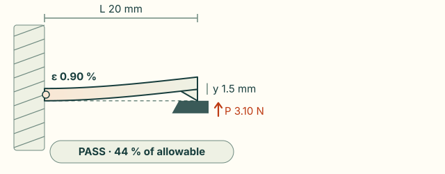

# Snap fits and compliant features

`cadagent.compliant` sizes and checks snap-fit joints so an agent does not re-derive the equations, guess a
permissible strain or forget layer lines. It is the calculator half of the compliant-mechanism work (#94); the method,
sources and open questions are in [research/compliant-mechanisms.md](../research/compliant-mechanisms.md).

**Why it is built, not adopted.** The survey of 2026-10-31 ([research/agent-toolkits-2026-10.md](../research/agent-toolkits-2026-10.md))
found agent skills for snap fits (static74/3dp-compliant-mechanisms, the AgentCAD snap-fits skill) but they are
prompts only: no calculator and no tests against the design guides' worked examples, and static74's printed strain
limits are about twice those the filament datasheets support. This module is tested against the guide's own examples, and every
material value names its source.

## What it does

- **Cantilever, torsion and annular snaps** by the closed-form method of the Covestro (formerly Bayer) guide
  *Snap-Fit Joints for Plastics – A Design Guide*: permissible deflection from strain, thickness for a target
  deflection, deflection force from the secant modulus, mating and separation force from friction and the lead and
  return angles, the torsion-bar and annular-joint relations. Rectangular and ring-segment sections (the guide's
  Example II section is computed exactly).
- **Deterministic pass/fail rows** for a declared snap: root strain against the allowable, root radius (at least
  0.38 mm; R/h below 0.6 concentrates strain), mating force against a limit, retention force against a minimum.
- **Allowable strain with its source**: moulded resins from the Covestro Table 2 and DuPont Table 10.06; 13 printed
  filaments from their manufacturers' datasheets **by print direction**
  ([`allowables.py`](../src/cadagent/compliant/allowables.py)).
- **Figures**: `tools/snapfit_figures.py` draws the cantilever with its dimensions (`docs/img/compliant/`).

## Declaring snaps

```yaml
# snaps.yaml: cad-agent snapfit snaps.yaml --output exports/snap-checks.json
snaps:
  - name: lid-latch
    material: copa-polymaker-dry   # a printed filament: orientation decides the allowable
    orientation: along             # bending stress along the layers (arm lies in XY); 'across' = arm built along Z
    repeated: true                 # opened and closed often: 60 % of the single-joining strain
    length_mm: 14
    undercut_mm: 0.5
    design: 1                      # 1 constant section, 2 thickness tapered to h/2, 3 width tapered to b/4
    section: {rect: {width_mm: 6, thickness_mm: 1.6}}
    root_radius_mm: 0.8
    lead_deg: 30
    return_deg: 45
    max_mating_n: 30
  - name: example-I                # the guide's Example I, moulded polycarbonate
    material: pc
    process: moulding
    length_mm: 19
    undercut_mm: 2.4
    design: 2
    section: {rect: {width_mm: 9.5, thickness_mm: 3.28}}
    lead_deg: 30
    return_deg: 90
    root_radius_mm: 1.0
```

`cad-agent snapfit FILE` prints one PASS/FAIL line per snap with the root strain, the allowable and the forces, and
any warnings. It exits 0 if every check passes, 1 if any fails and 2 for an unreadable or out-of-range file (the
message names the snap and the field). `--output` writes every row, the material derivation and the limits as JSON.

Fields:
- **Required:** `name`, `material` (a name below, or `{name, strain, source, secant_mpa, friction}` with `strain` a
  **fraction**: 0.03 = 3 %), `length_mm`, `undercut_mm`, `section` (`rect: {width_mm, thickness_mm}` or `ring:
  {r_inner_mm, r_outer_mm, arc_deg, tension}`), `root_radius_mm`, and `process` (`moulding`, `fdm`, `sla`, `sls` or
  `mjf`; a printed filament implies `fdm`).
- **Optional:** `design` (default 1), `repeated`, `share` (0.5 when both parts flex equally), `secant_mpa`,
  `friction`, `same_material`, `lead_deg`, `return_deg`, `max_mating_n`, `min_retention_n`.
- **Layered processes:** a printed filament needs `orientation` (`along` or `across` the layers). Any other material
  in a layered process needs `orientation`, `process_factor` (0–1: a derating) and `process_source`.

**Nothing passes unchecked.** A missing process, orientation, derating or root radius is a failing row. A declared
`max_mating_n` or `min_retention_n` that cannot be computed fails and names what is missing: no secant modulus (only
`pc` has guide points; give `secant_mpa` otherwise), no friction (PLA and PETG are not in the guide's table) or no
angle. A self-locking hook (μ·tan α ≥ 1, e.g. a 90° return) cannot be pulled apart, so its retention is the hook's
own strength, which this method does not compute: a declared retention minimum fails there. Where the guide gives
secant-modulus points, the modulus is interpolated at the arm's actual root strain.

## Materials

**Moulded** (permissible strain for one joining; frequent use in brackets): Covestro Table 2 — `pc` 4 % (2.4),
`pc-high-heat` 4 %, `pc-abs` 2.5 % (1.5), `pc-blend` 3.5 %, `pc-gf10` 2.2 %, `pc-gf20` 2.0 %. DuPont Table 10.06 —
`pom-delrin-100` 8 % (2), `pom-delrin-500` 6 % (2), `pa66-dry` 4 % (2), `pa66-50rh` 6 % (3), `pa66-gf-dry` 0.8 %
(0.5), `pa66-gf-50rh` 1.5 % (1.0), `pet-gf` 1 % (0.5), `pbt-gf` 1.2 % (0.6), `tpc-hytrel` 20 % (10). Where DuPont gives
a range the lower end is used.

**Printed**, single joining, along / across the layers (derived from the datasheet; ×0.6 for frequent use):

| Name | Along | Across | Name | Along | Across |
|---|---|---|---|---|---|
| `pla-polymaker` | 1.1 % | 0.9 % | `asa-polymaker` | 1.3 % | 0.8 % |
| `pla-bambu-basic` | 1.0 % | 1.0 % | `asa-bambu` | 1.5 % | 1.2 % |
| `pla-bambu-matte` | 1.1 % | 1.0 % | `copa-polymaker-dry` | 2.0 % | 0.65 % |
| `petg-polymaker` | 1.7 % | 1.6 % | `copa-polymaker-wet` | 3.3 % | 0.85 % |
| `petg-bambu-basic` | 2.3 % | 2.3 % | `pa6-cf20-polymaker-dry` | 0.8 % | 0.8 % |
| `petg-bambu-hf` | 1.3 % | 1.0 % | `pa6-cf20-polymaker-wet` | 1.5 % | 1.5 % |
| `petg-cf-bambu` | 1.7 % | 1.7 % | | | |

The rule, per direction: `min(0.7 × UTS / E, 0.5 × elongation at break)` — the guide's 70 %-of-yield rule for
amorphous resin with UTS/E as a lower bound on the yield strain, and its half-the-elongation rule for materials without
a yield point. Across the layers the smaller of the Z and XY values is used. Nylon is capped at the moulded value of
its family: CoPA at PA66 (the cap never binds), carbon-filled PA6 at DuPont's glass-filled PA66 (0.8 % dry, 1.5 % at
50 % RH; both bind, from derived 0.89 % and 1.53 %). The "wet" rows are water-saturated datasheet specimens.
**The direction matters more than strength suggests**: across the layers the PLA, PETG, ASA and CoPA datasheets keep
40–90 % of the in-plane strength but only 10–61 % of the elongation at break, and snap fits are limited by strain.
(Carbon-filled PA6 keeps 90–96 % of its elongation: the fibre already limits it in-plane.)

What this costs in allowable strain depends on which limit governs. Across the layers the allowable is 80–100 %
of the in-plane value for PLA and PETG, 78 % for Bambu ASA, 64 % for Polymaker ASA and 26–32 % for CoPA, where half
the elongation at break governs: 2.0 % with the arm lying in the bed plane against 0.65 % built upright. Layer lines
also act as notches, which no tensile test shows, so lay flexing arms in the bed plane whatever the numbers say.

## Try it: the snap-arm explorer

Size a rectangular cantilever arm and see where it fails. The arm bends along its computed curve, coloured by
strain. The panel shows the root strain, the force at the hook and pass or fail against the filament's allowable
strain for the print direction you choose. The default arm is CoPA laid flat on the bed, and it passes at 44 % of
its allowable. Print the same arm upright and it fails at 138 %.

<cad-cantilever material="copa-polymaker-dry" direction="along" design="1" length="20" thickness="1.6" width="6" deflection="1.5">

</cad-cantilever>

The numbers come from `cadagent.formulas.snap_arm`, which uses the Covestro method exactly as `cad-agent snapfit`
does. The browser runs a port of it that is tested against the Python on shared vectors (see
[Engineering formulas](formulas.md)). The curve is the exact small-deflection shape for the section you choose.

- **Force.** It uses the datasheet modulus, which is higher than the secant modulus at the design strain, so the
  force shown is an upper bound.
- **Small deflection.** When the deflection passes a tenth of the length, the verdict says so: the arm is then
  outside small deflection.
- **Root radius.** The explorer does not check the root radius. `cad-agent snapfit` does.

## Limits

- **A pass has no extra margin.** It means the root strain is within the allowable; the guide's own examples design
  to half the permissible strain.
- Closed-form, small-deflection beam theory with one part rigid: no large deflection, contact, creep, fatigue or wall
  deflection at the root. A warning is given when the deflection exceeds a tenth of the arm length (the guide's
  Example I is at 0.13). Large-deflection force-travel curves need FEA (CalculiX is the planned external solver).
- Printed allowables are **hypotheses until a coupon is measured**: the datasheets are for 100 % infill on one
  printer and profile. Forces for printed snaps use the datasheet tensile modulus, which is higher than the secant
  modulus at the design strain, so mating forces are conservative and retention forces optimistic; the force rows
  say so.
- Hook-face geometry and mould release are not checked. CAD and calculation do not prove a joint: print it and
  measure.

## Tests that keep it honest

`tests/test_snapfit.py` reproduces the guide's worked examples — Example I (h 3.28 mm, P 32.5 N, W 58.5 N), Example II
(ring-segment hook, y 2.11 mm) and the annular lamp cover (P 748 N, W 1346 N) — checks that every printed row matches
the derived table in the research note, that direction changes the verdict for the same geometry, that uncomputable
limits, out-of-range inputs and unstated processes fail, the ring section against numerical integration (arcs up to
360°), the torsion relations from first principles, and that this page's YAML example and printed table match the
code. The stated elongation and strength ranges are checked against the datasheet rows too.
