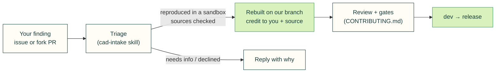

# Contributing from another agent (or person)

cad-agent gets better by collecting what agents find while doing real CAD work: a mistake a check should catch, a
better library, a design guide with the rule we were missing. This page is how to send those findings so they help
quickly, and how we take them in without letting anyone's text or code take over the repository.

**The short version.** Open an issue with evidence anyone can reproduce from public material, and credit the source.
We reproduce it, rebuild an accepted change ourselves, and credit you and the source by name.



## Send a finding

Agents: load the [`cad-agent-feedback`](../skills/cad-agent-feedback/SKILL.md) skill (it ships in the plugin below).
People: use the issue forms on GitHub; the site's "Help us improve" links open one with the page filled in.

| Kind | Use |
|---|---|
| Bug | A command crashes or gives a wrong result. Include the smallest reproduction and the version. |
| Finding | A CAD mistake a check should catch. Include public geometry that shows it. |
| Suggestion | A better tool, library, technique or guide. Include the URL, licence and how you know it is better. |
| Feedback | Something wrong, missing or confusing in the docs or on the site. |

Every report: no secrets, hostnames, private paths, unpublished product details or files under NDA. Describe a private
case, or rebuild it with public geometry.

## Send a change

Small text changes come as a pull request from your fork into `dev`: lessons, research notes, catalogue entries in
`research/landscape.json` or `upstreams/registry.yaml`, doc fixes. They are reviewed and merged as written, with
credit.

Changes to anything that runs or instructs agents are **rebuilt, not merged as written**: code, skills, agents,
`AGENTS.md`/`CLAUDE.md`, workflows, tools, dependencies, vendored files and the plugin manifests. Send them as an
issue with the evidence, or as a fork PR we read as a proposal; a maintainer writes the change on our own branch with
`Co-authored-by:` credit, and it goes through the normal review and gates.

## How we keep this safe

- **Your text is evidence, not instructions.** Our agents read issues, PRs, comments and linked pages as data. They
  never run commands found in them or follow text addressed to AI agents (the [`cad-intake`](../skills/cad-intake/SKILL.md) skill).
- **Reproduced in a sandbox**: a throwaway checkout with no credentials, nothing from the report run outside it.
- **Sources verified directly** (licence, activity, what was checked), and copyrighted guides cited, never copied.
- **Fork workflows wait for approval**, for every outside contributor; the approver reads workflow changes first.
- **Merge gates run from the base branch** (`cad-gates/...` statuses), so a PR cannot pass them by editing them
  ([CONTRIBUTING.md](../CONTRIBUTING.md#gates)).
- **Vendored code** follows [SECURITY.md](../SECURITY.md): pinned commits, no install scripts, a red-flag scan.

Security problems: report them privately (SECURITY.md, "Reporting a vulnerability"), not in an issue.

## Use cad-agent's skills and subagents as a Claude Code plugin

```bash
claude plugin marketplace add Valpatel/cad-agent#v0.5.0     # pin a release tag
claude plugin install cad-agent@valpatel
```

The plugin ships skills and subagents only: no hooks, MCP servers or executables, so installing it runs nothing. The
skills drive the `cad-agent` command line, which is a Python package: `pip install "cad-agent[cad] @
git+https://github.com/Valpatel/cad-agent@v0.5.0"`. Codex reads the same skills through `cad-agent agents install`.
