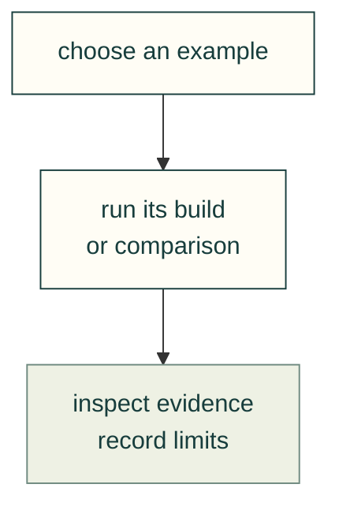

# Worked examples

These are runnable examples and test inputs. Their computed results do not establish physical performance.

| Example | Purpose |
|---|---|
| [numbered-coupons](numbered-coupons/README.md) | Uniquely stamped physical fit coupons, immutable source/artifact identity and a strict native project plate; no printer operation |
| [starter-box](starter-box/README.md) | The checkout and wheel starter copied by `cad-agent init` |
| [explore-two-wheel](explore-two-wheel/README.md) | Compare design alternatives with the existing evaluator |

[Guides](../README.md) · [Project format](../toolkit.md) · [Exploration](../explore.md)
