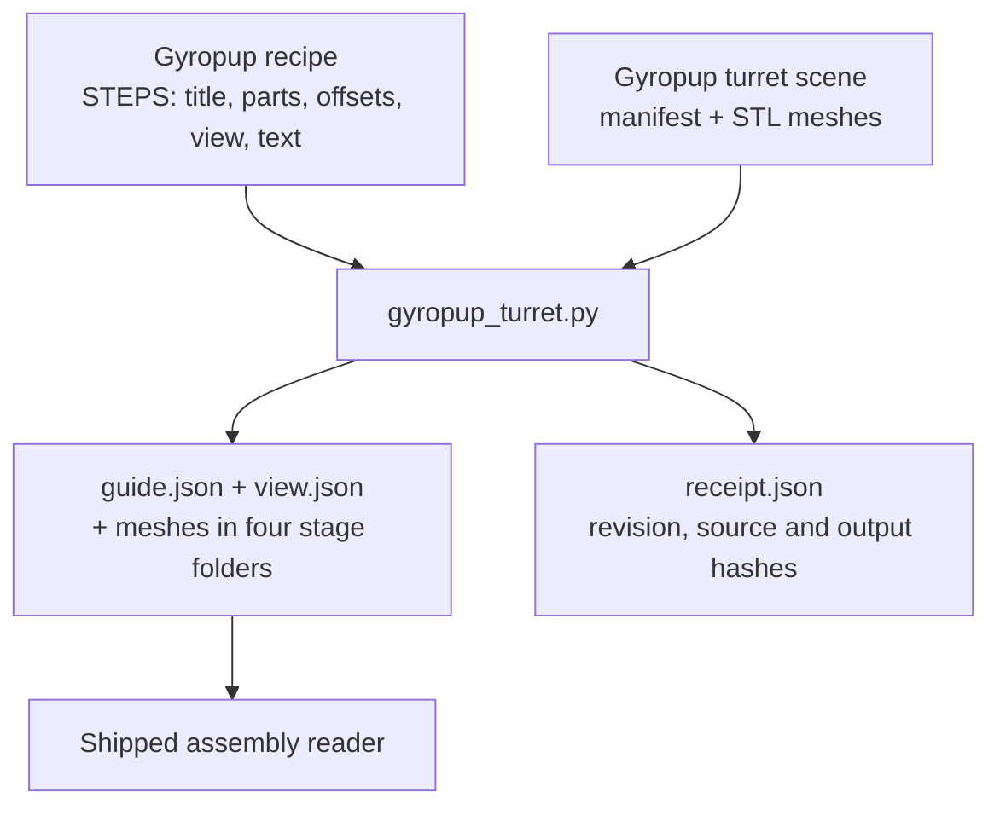

# Featured build guide: Gyropup's turret

The toolkit's build-guide demo steps through a real assembly: the turret of Gyropup, a work-in-progress wheel-legged
robot, in the order its own repository writes down for building it. [Open the guide](../../../software/cadagent/webkit/assembly/examples/gyropup-turret/README.md)
in the shipped assembly reader. Twelve steps, from the pan base to the cartridge's thumbscrew; each step's new parts
are highlighted and drawn back along the way they go in, the parts already fitted are ghosted, and the text is
Gyropup's own instruction for that step.



| File | Purpose |
| --- | --- |
| [gyropup_turret.py](gyropup_turret.py) | Converter from a clean Gyropup checkout's committed recipe and scene to the reader's guide, with a receipt and `--check`. |

**Limits.** This is an example sequence, not a verified build procedure. A CAD step order and its insertion offsets
do not prove that the parts can physically be assembled in that order, that they fit, or that a tool can reach each
fastener. The text is Gyropup's, verbatim; codes such as "D42" are Gyropup's design-decision numbers. Gyropup is a
work-in-progress prototype.

## What the converter reads and does

It reads three things from the checkout's committed `HEAD` (with `git show`, so uncommitted edits cannot leak in) and
writes nothing there:

- `hardware/cad/turret/turret_assembly.py`: only its literal `STEPS` list, parsed with `ast.literal_eval`. The file
  is never imported or run. Gyropup's `docs/turret/turret-assembly.md` and its step pictures come from the same list.
- `hardware/exports/sim/turret_box/manifest.json`: the turret's browser scene, the one gyropup.com's turret page shows.
- that scene's STL meshes. The bought parts in it (servos, bearings, motors, boards) are Gyropup's own envelope
  meshes, not vendor CAD; no vendor source CAD is read or shipped.

Each mesh keeps its triangles and normals. It is only translated out of its moving group's frame (base, pan, tilt,
and the dial, flywheels and flap nested in the tilt) into the turret's neutral pose: zero pan and tilt, with the
mounting face at z = 0. Seven scene parts that no authored step adds (the bumper ring, which is for the robot, the
board-bay lid, the hopper's fill flap, the DT12 plug and three insert or set-screw groups named only in the text) are
left out and listed in the receipt. The meshes are split into four folders by stage (base, turntable, tilt,
cartridge) only so no folder holds more than 20 files; the order is the recipe's.

The reader shows the guide's `source.qualification` under its version line, so the statement of what the guide is
travels with the data.

## Regenerate

From the repository root, with a clean Gyropup checkout (read only):

```bash
python docs/examples/build-guide/gyropup_turret.py --gyropup ../gyropup
python docs/examples/build-guide/gyropup_turret.py --check                      # committed bytes match their receipt
python docs/examples/build-guide/gyropup_turret.py --check --gyropup ../gyropup  # and a fresh conversion, byte for byte
node tools/site/figures/toolkit-examples.mjs --executable /path/to/chromium      # then recapture the card preview
```

It needs only Python's standard library and `git`. Tests: [test_gyropup_turret_guide.py](../../../tests/webkit/assembly/test_gyropup_turret_guide.py)
(receipt, cross-group geometry, the converter on a synthetic checkout) and
[example-browser.mjs](../../../tests/webkit/assembly/example-browser.mjs) (the guide in the shipped reader, phone
layout and controls, each check shown failing on a planted fault).

The synthetic rail bench that the demo used to show stays as the reader's test fixture in
[tests/fixtures/assembly-plan](../../../tests/fixtures/assembly-plan/README.md).

[Worked examples](../README.md) · [Assembly guide format](../../practice/assembly-guide.md)
