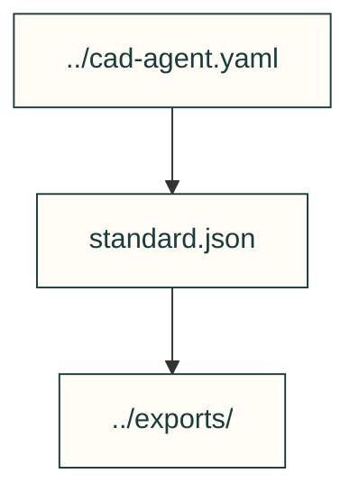

# Exploration candidates

Hand-authored parameter and part-slot variations consumed by the parent example.

| File or folder | Purpose |
|---|---|
| [standard.json](standard.json) | Base candidate and shared parameters. |
| [light.json](light.json) | Smaller wheel, actuator and battery variant. |
| [strong.json](strong.json) | Higher output and compute variant. |
| [long-range.json](long-range.json) | Larger pack and camera variant. |

[Parent map](../README.md)
