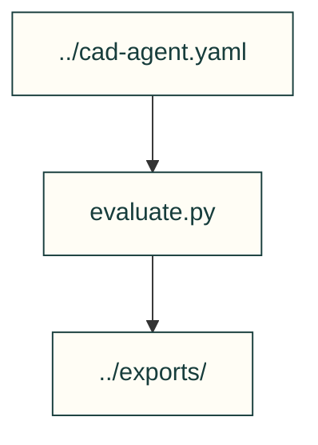

# Example evaluator

Textbook estimates belonging to this example, not generic toolkit physics.

| File or folder | Purpose |
|---|---|
| [evaluate.py](evaluate.py) | Evaluate candidate geometry, power and cost assumptions. |

[Parent map](../README.md)
