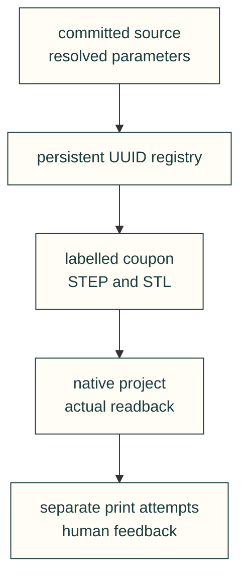

# Numbered fit-coupon plate

A small physical identity/export fixture for the manufacturing experiment loop: each coupon has its own engraved
short ID, resolving to a full UUID and exact committed source, fit sweep, label dimensions, settings and artifact
hashes. The holes reuse the existing [fit-coupon producer](../../../software/cadagent/manufacturing/fit_coupons.py).
This is the first fixture, not a printable latch library or physical qualification.



From a clean committed checkout with the CAD extra, supply an actual native Bambu project-settings JSON and a
persistent registry that you will commit with the resulting evidence:

```bash
python docs/examples/numbered-coupons/build.py \
  --settings native-project-settings.json \
  --registry docs/experiments/pin-fit-records \
  --out exports/numbered-pin-fit-01 --count 2
```

The script never starts Bambu Studio, slices or contacts a printer. It refuses an existing output destination.
The settings must contain real printer/process/filament identities and printable area; a test fixture or a
stored preset is not proof of current printer configuration. The initial design assumes a 0.4 mm nozzle and PLA;
brand, sufficient material and current readiness remain unknown until checked separately.

<details>
<summary>Look up a stamp and record feedback</summary>

Each allocated UUID is a **physical copy**, including repeated equal geometry. The ten-character stamp is
collision-checked against the entire declared persistent registry, not only this plate. Keep that registry and
commit it: losing it loses the human-readable stamp resolver. The registry rejects duplicate/changed identities,
changed artifact bytes and overwriting a prior record. A deliberate reprint needs a fresh UUID and stamp.

The immutable identity names the **earlier source commit actually used to generate CAD**, plus declared input
hashes. Push that source revision before making a physical specimen, so its immutable `model_url` is reachable.
Commit the generated records afterward; they do not pretend to know their own future commit. The declared closure
is explicit, not an automatic dependency discovery proof. The fixed seven-segment hex stamp (styled B/D appear as b/d) uses the existing line/engraving primitive with the profile's cited 1 mm stroke at 0.5 mm depth. Its CAD and SVG share the same segment plan. The stamp sits on an attached tab beyond the original
hole/fit envelope. Native readback binds object IDs, one placement per specimen, actual mesh geometry and
embedded settings to that identity. Own XML readback does not establish Bambu GUI acceptance.

Look up a stamp through the same persistent registry (case-insensitive):

```python
from cadagent.manufacturing.experiments import lookup
record = lookup("docs/experiments/pin-fit-records", "YOUR_STAMP")
print(record["identity"]["uuid"], record["identity"]["source"])
```

`batch.json` and the registry's write-once plate record map placements to UUIDs. `fit-measurements.csv` has each
UUID/stamp next to the existing hole measurements. `experiments.append_observation` appends an observer and date
with an attempt or human-feedback payload, referencing the unchanged identity/artifact digest. Record actual job
identity, function, fit, durability/cycles and notes when known; do not invent passing or printed results. An
unknown submission outcome stays unresolved and must not trigger an automatic duplicate print under the same IDs.

</details>

Before a real job, independently open/save/reopen the project in Bambu Studio and verify profiles and placements;
then check fresh device/material/bed/camera evidence and obtain the required submission authority. Physical label
legibility, fit and durability require the actual print and human measurements. Future cantilever/latch specimens
will reuse the same identity contract and the [existing snap-fit checks](../../mechanical/compliant.md), without
claiming this hole fixture covers their mechanical acceptance.

[Examples](../README.md) · [Manufacturing API](../../../software/cadagent/manufacturing/README.md)
