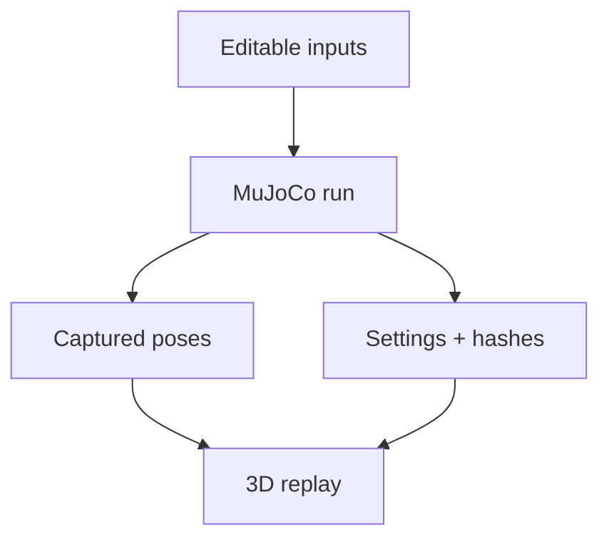

# Recorded robot simulation

An original two-link arm runs in MuJoCo, then its captured poses replay in an inspectable 3D viewer. Change the
illustrative masses, dimensions, damping and controller settings in [config.json](config.json), regenerate, and compare.
The recording is solver output; the browser does not recompute dynamics.



| File | Purpose |
| --- | --- |
| [config.json](config.json) | SI geometry, illustrative masses, joint limits and sinusoidal PD control settings. |
| [produce.py](produce.py) | Original model producer, actual solver sampling, bounded inputs and output verification. |
| [capture.mjs](capture.mjs) | Real browser thumbnail and source-bound capture receipt; uses the existing Playwright context. |

Install the existing robot extra (`python -m pip install -e '.[robot]'`). The committed receipt uses MuJoCo 3.3.7;
install that version to reproduce its bytes. From the repository root:

```bash
python docs/examples/robot-replay/produce.py
python docs/examples/robot-replay/produce.py --check
```

To refresh the owned thumbnail after reviewing the viewer, install `tools/site`'s locked development dependencies
and the existing Pillow extra, then run `node docs/examples/robot-replay/capture.mjs`. The capture uses Chromium,
the dark theme and recorded time 3.2 s; its receipt records source hashes and browser version.

The [owned recording](../../../software/cadagent/webkit/simulation/examples/two-link-arm/README.md) includes the generated
MJCF, frame data and receipt. Serve `software/cadagent/webkit` over HTTP and open `simulation/viewer.html`, or copy the full
toolkit with `cad-agent webkit kit` and serve that folder. Browser playback needs neither Python nor MuJoCo.

<details>
<summary>Sampling, controls and model limits</summary>

Each solver step computes a bounded joint torque `clip(kp × (target − qpos) − kd × qvel)`. Targets are editable
sinusoids. `mj_step` advances dynamics; `mj_forward` refreshes derived body transforms at the integrated state.
At each whole sampling stride, `data.xpos` and `data.xquat` supply world body poses. MuJoCo's wxyz quaternions are
reordered to xyzw; metres and the right-handed Z-up frame remain unchanged. The viewer rotates a single root into
the shared stage's Y-up world, with no unit scaling.

Rigid links use uniform-box inertias and ideal joints. Decorative geometry adds no payload inertia. Inputs are
illustrative estimates, not measured equipment parameters. There is no motor electrical/thermal model, backlash,
flexibility or collision-avoidance controller. The finite recording does not establish physical fit, strength or
safe operation. Interpolated browser poses do not re-enforce constraints between samples.

The receipt binds producer, configuration, generated model and frame bytes. It records engine version, effective
settings, applied torque and solver warnings. Hash agreement proves identity, not model validity; changing an
input requires regenerating both recording and receipt. A different engine version may change the result.

</details>

Official references: [mj_step](https://mujoco.readthedocs.io/en/3.3.7/APIreference/APIfunctions.html#mj-step),
[mj_forward](https://mujoco.readthedocs.io/en/3.3.7/APIreference/APIfunctions.html#mj-forward),
[mjData transforms](https://mujoco.readthedocs.io/en/3.3.7/APIreference/APItypes.html#mjdata), and
[body inertia](https://mujoco.readthedocs.io/en/3.3.7/XMLreference.html#body-inertial).

[Worked examples](../README.md)
